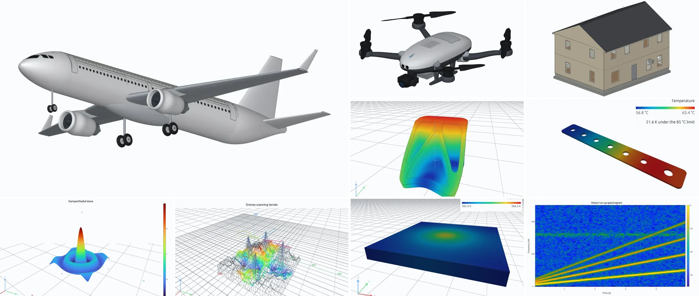
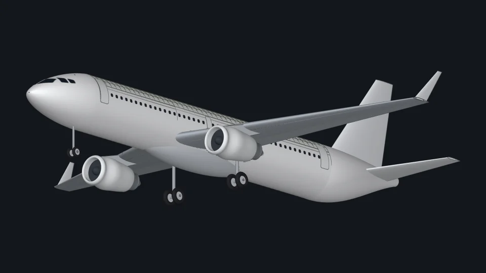
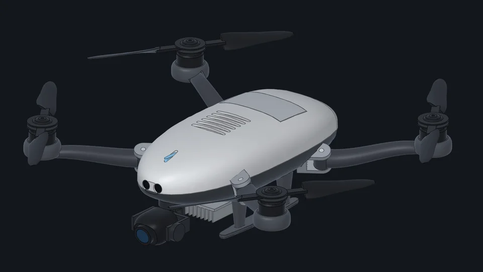
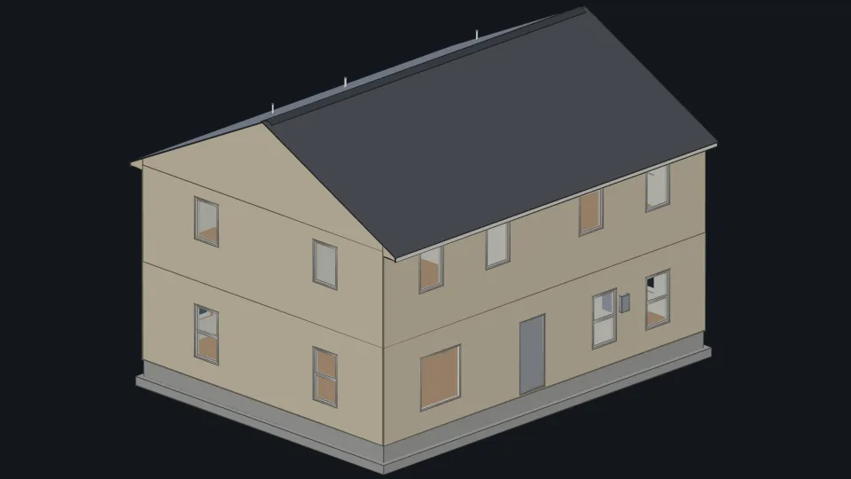
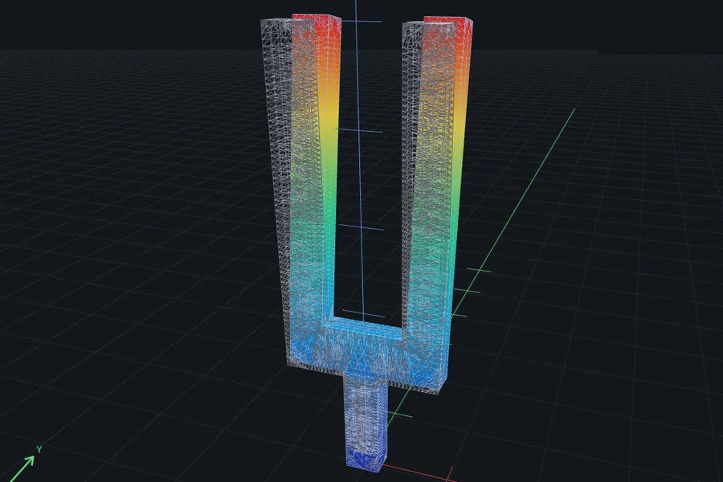
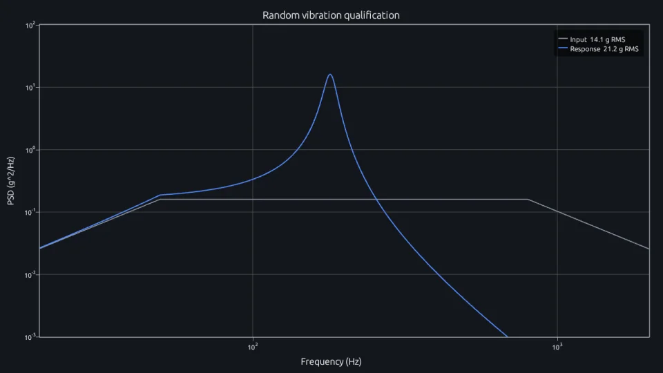
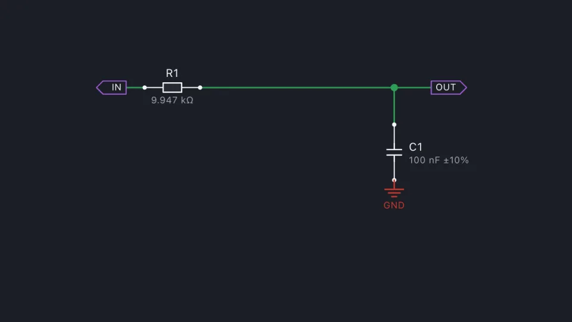

<picture>
  <source media="(prefers-color-scheme: dark)" srcset=".github/readme/examples-dark.webp">
  
</picture>

# RunMat examples

Complete engineering projects that open and run in [RunMat](https://runmat.com): scripts in the
MATLAB language, FEA studies, and MCAD/ECAD designs. Each folder is a self-contained project with
its source, its data and geometry files, and the finished run, so it opens with its results
already drawn.

**[Open RunMat in your browser](https://runmat.com/sandbox)** · **[Download RunMat](https://runmat.com/download)** · **[Documentation](https://runmat.com/docs)**

## Open an example

- **In the browser:** every example's README has an **Open in RunMat** link that opens it in the
  RunMat sandbox. Nothing to install.
- **On your computer:** clone this repository, open any example folder in
  [RunMat Desktop](https://runmat.com/download), and press Run. Every folder has a `runmat.toml`,
  so RunMat opens it as a project with its entry file ready.

## Featured

| | | |
| --- | --- | --- |
|  |  |  |
| **[A narrow-body airliner, inside and out](aerospace/airliner)** Parts and assemblies, with its cabin, flight deck and cargo holds. | **[A foldable camera drone](aerospace/camera-drone)** Shell, folding arms, gimbal and circuit boards, with circuit, thermal and modal studies. | **[A two-story house, foundation to roof](construction/house)** Framing, envelope layers, and the electrical, plumbing and HVAC routed through the framing. |
|  |  |  |
| **[Tuning fork modes](fea/tuning-fork-modal)** A modal FEA study: natural frequencies and mode shapes from a STEP file. | **[Random vibration of one mode](aerospace/random-vibration)** A qualification spectrum through a 180 Hz mode, checked against Miles' equation. | **[An RC filter sized by a function](electronics-semiconductors/rc-filter)** A circuit whose resistor comes from its corner frequency, with an AC simulation. |

## What is RunMat?

RunMat runs code written in the MATLAB language, solves FEA studies (structural, thermal, fluid,
electromagnetic and acoustic), and models parts, assemblies and circuit boards, in one app on
your desktop or in your browser. Learn more at [runmat.com](https://runmat.com), or see what it
does for [simulation](https://runmat.com/simulation), [CAD](https://runmat.com/cad) and
[PCB design](https://runmat.com/pcb-design).

## All examples

<!-- catalog:start (generated by scripts/build-readme.mjs; do not edit by hand) -->

213 examples: 166 scripts, 42 FEA studies and 5 design projects.

### [FEA studies](https://runmat.com/simulation)

**[Structural](https://runmat.com/simulation/structural)**

- [Bracket random vibration](fea/bracket-random-vibration): A random vibration FEA study of a steel bracket under a 14.2 g RMS base PSD.
- [Bracket shock response](fea/bracket-shock-spectrum): A response spectrum FEA study of a steel bracket under a 1000 g shock spectrum.
- [Cantilever beam frequency response](fea/cantilever-harmonic): A harmonic FEA study of a steel cantilever beam driven from 20 to 200 Hz.
- [Cantilever beam impact](fea/cantilever-impact): A transient FEA study of a steel cantilever beam struck by a 1 kN pulse.
- [Cantilever beam plastic bending](fea/cantilever-plastic): A nonlinear FEA study of a steel cantilever beam loaded past first yield.
- [Column buckling](fea/column-buckling): A buckling FEA study of a steel column under a 250 kN axial load.
- [Tuning fork modes](fea/tuning-fork-modal): An FEA study of a steel tuning fork's natural modes.
- [Wall-hook bracket load sweep](fea/bracket-hook-sweep): A static FEA study of an S355 steel wall-hook bracket under a 2 kN hanging load, checked against a 0.1 mm hook deflection limit and swept from 1 to 4 kN.
- [Wall-hook bracket under load](fea/bracket-hook-load): A static FEA study of a steel wall-hook bracket carrying a 2 kN hanging load.

**[Thermal](https://runmat.com/simulation/thermal)**

- [Battery module cells on a cold plate](fea/battery-module-cells): A steady thermal FEA study of eight prismatic cells in one battery module, 20 W per cell, cooled from below.
- [Fin array cell with periodic sides](fea/fin-array-cell): A steady thermal FEA study of one cell of a straight-fin heat sink, with periodic side faces.
- [Heat spreader on a cooled block](fea/tim-stack): A steady thermal FEA study of a copper spreader on an aluminum block, with a contact conductance at the joint.
- [Heat spreader warm-up](fea/heat-spreader-warm-up): A transient thermal FEA study of an aluminum heat spreader warming up after a 20 W component switches on.
- [Heater rod with fixed end temperatures](fea/heated-rod-fixed-ends): A steady thermal FEA study of a stainless heater rod with uniform heat generation and both ends held at 20 C.
- [Pin fin convection](fea/pin-fin-convection): A steady thermal FEA study of an aluminum pin fin with its base at 80 C, cooled by air.
- [Spacecraft radiator panel](fea/radiator-panel): A steady thermal FEA study of a spacecraft radiator panel rejecting 40 W to deep space by radiation.

**[Thermomechanical](https://runmat.com/simulation/thermomechanical)**

- [Brake disc temperature and thermal stress](fea/brake-disc): Temperature and thermal stress of a ventilated grey-iron front brake disc holding a car at 50 km/h down an 8 % grade.
- [Heated bar natural frequencies](fea/heated-bar-modes): A thermal-stress FEA study of the natural frequencies of a steel bar clamped at both ends and heated 200 K.
- [Heated panel frequency response](fea/heated-panel-harmonic): A thermal-stress FEA study of a clamped titanium heat-shield panel heated 150 K and driven by exhaust noise.
- [Rail thermal buckling](fea/rail-thermal-buckling): A thermal buckling FEA study of a steel rail fixed at both ends and warmed 10 K.
- [Restrained bar heated past yield](fea/clamped-bar-yield): A nonlinear thermal-stress FEA study of a steel bar restrained at both ends and heated 150 K past first yield.

**[Conjugate heat transfer](https://runmat.com/simulation/conjugate-heat-transfer)**

- [Battery module on its liquid cold plate](fea/battery-cold-plate): Conjugate heat transfer through battery module M01, its gap filler, an aluminum cold plate and the laminar coolant in its serpentine, against a 45 C cell limit.
- [Chip cold plate power step](fea/chip-cold-plate-power-step): A transient conjugate heat transfer FEA study of a water-cooled aluminum block after a 50 W power step.
- [Heated tube Nusselt number](fea/heated-tube-nusselt): A steady conjugate heat transfer FEA study of laminar water in a uniformly heated copper tube.
- [Insulated oil line heat loss](fea/insulated-oil-line): A steady conjugate heat transfer FEA study of hot oil in a lagged steel pipe losing heat to still air.

**[Fluid flow](https://runmat.com/simulation/fluid-flow)**

- [Hydraulic line pressure drop](fea/hydraulic-line-poiseuille): A steady laminar flow FEA study of hydraulic oil in a 10 mm line at 1 L/min.
- [Hydraulic manifold pressure drop](fea/hydraulic-manifold): Laminar oil flow through a cross-drilled aluminum manifold at 20 L/min, checked against a 1 bar loss budget from P to A.
- [Pipe flow start-up](fea/pipe-start-up): A transient flow FEA study of oil in a 10 mm line starting from rest under a step pressure.
- [Pipe wall shear stress](fea/pipe-wall-shear): A steady flow FEA study of the wall shear stress in a 10 mm hydraulic line.
- [Slurry line pressure drop](fea/slurry-line-power-law): A steady flow FEA study of a shear-thinning power-law slurry in a 25 mm pipe.

**[Fluid-structure](https://runmat.com/simulation/fluid-structure)**

- [Paddle flow switch deflection](fea/paddle-flow-switch): Steady oil flow at 1 m/s bends the spring-steel paddle of a flow switch in a 2-inch tee; fluid and paddle are solved together against a 1 mm trip travel.
- [Pulse in a compliant tube](fea/compliant-tube-pulse): A transient fluid-structure FEA study of a pressure pulse traveling along a silicone tube full of water.

**[Electromagnetic](https://runmat.com/simulation/electromagnetic)**

- [Coaxial bushing electric field](fea/coaxial-bushing): An electrostatic FEA study of the field in the cast-epoxy insulation of a 36 kV coaxial bushing.
- [Hall current sensor core flux at 500 A](fea/hall-current-sensor): Magnetic flux in the gapped ferrite C-core of an open-loop Hall current sensor at 500 A, against the ferrite's saturation.

**[Electrothermal](https://runmat.com/simulation/electrothermal)**

- [AC resistance of a round conductor](fea/round-conductor-ac): A harmonic electromagnetic FEA study of skin effect in a 20 mm copper conductor at 50 Hz and 1 kHz.
- [Busbar fault pulse](fea/busbar-fault-pulse): A transient Joule heating FEA study of a copper busbar strip through a 25 kA, 0.5 s fault.
- [Busbar resistance with a bolt hole](fea/busbar-resistance): A DC current-flow FEA study of a copper busbar strip with one bolt hole at 100 A.
- [EV busbar temperature at 400 A](fea/six-bolt-busbar): Current flow and temperature in a six-bolt copper module busbar at 400 A in still air, against an 85 C limit.
- [Fuse element overload](fea/fuse-link-overload): A Joule heating FEA study of a copper fuse element at a 120 A overload, with resistivity rising with temperature.

**[Acoustics](https://runmat.com/simulation/acoustics)**

- [Exhaust muffler transmission loss](fea/exhaust-muffler): Transmission loss of a two-chamber exhaust muffler from 50 Hz to 2 kHz, against at least 15 dB in the 500 Hz band.
- [Listening room modes](fea/listening-room-modes): An acoustic modal FEA study of a rigid-walled 5 x 4 x 2.8 m listening room.
- [Sound pulse in a duct](fea/duct-pulse): A transient acoustic FEA study of a pressure pulse traveling down a 1 m air duct.

### [Aerospace](https://runmat.com/industries/aerospace)

- [A foldable camera drone, shell to boards to studies](aerospace/camera-drone) (design project): A foldable photography drone: lofted two-part shell, folding arms, a 3-axis gimbal, a flight controller and a 4-in-1 ESC, with circuit, thermal and modal studies.
- [A narrow-body airliner, inside and out](aerospace/airliner) (design project): A twin-engine airliner modeled as parts and assemblies, with its cabin, flight deck and cargo holds.
- [Avionics temperature through a flight](aerospace/avionics-thermal): A two-mass thermal model of a board and its case, with ode45.
- [Flight-test spectrogram](aerospace/flight-test-spectrogram): An accelerometer through taxi, takeoff, climb and cruise, as a spectrogram.
- [Flight-test vibration against its limit](aerospace/flight-test-psd): Welch spectra of three test points against the GEVS limit.
- [Impact footprint](aerospace/impact-footprint): 4,000 dispersed trajectories and their 3-sigma ellipse.
- [Pitch from IMU data](aerospace/flight-attitude): A Kalman filter on a drifting gyro and a noisy accelerometer.
- [Random vibration of one mode](aerospace/random-vibration): Miles' equation against the integrated response at 180 Hz.
- [Shock response spectrum](aerospace/shock-response-spectrum): A pyroshock-like transient through 60 Q = 10 oscillators.

### [Automotive and transportation](https://runmat.com/industries/automotive-transportation)

- [Battery module temperatures](automotive-transportation/module): A 12-cell module on its cold plate, colored by cell temperature after three US06 cycles.
- [Bracket modes against engine orders](automotive-transportation/bracket-orders): Where the second and fourth orders cross a bracket's modes.
- [Cell model from a pulse test](automotive-transportation/cell-model): A one-RC equivalent circuit fitted to a 50 A pulse.
- [EV energy on the EPA urban cycle](automotive-transportation/drive-cycle): Battery power, Wh/km and range from the EPA's own trace.
- [Module temperatures on US06](automotive-transportation/module-temperature): Twelve cells on a cold plate through three aggressive cycles.
- [Order tracking on a run-up](automotive-transportation/order-tracking): A 4-cylinder's orders, resampled to shaft angle.
- [Quarter-car ride](automotive-transportation/quarter-car): Body acceleration against damping on an ISO 8608 class C road.

### [Construction](https://runmat.com/cad)

- [A two-story house, foundation to roof, with its MEP](construction/house) (design project): A 2,400 sq ft wood-framed stucco house: footings, framing, shear walls, envelope layers, interior, and the electrical, plumbing and HVAC routed through the framing.

### [Defense](https://runmat.com/industries/defense)

- [CFAR detection](defense/cfar-detection): Cell-averaging CFAR at a false-alarm rate of 1e-5.
- [Detection range](defense/detection-range): The radar range equation from 0.001 to 10 m² of RCS.
- [Multi-drone SLAM](defense/multi-drone-slam): Four drones map unknown terrain with LIDAR and correct their drift.
- [Phased-array beam pattern](defense/array-beam-pattern): 16 elements steered to 20 degrees, with and without a taper.
- [Pulse compression](defense/pulse-compression): A 5 MHz chirp separates two targets 120 m apart.
- [Range-Doppler map](defense/range-doppler): 64 pulses resolve three targets in range and closing speed.
- [Tracking a turning target](defense/track-filter): An extended Kalman filter on radar range and bearing.

### [Electronics and semiconductors](https://runmat.com/industries/electronics-semiconductors)

- [ADC characterization](electronics-semiconductors/adc-enob): SINAD, ENOB and SFDR of a 12-bit converter from one FFT.
- [An RC filter sized by a MATLAB function](electronics-semiconductors/rc-filter) (design project): A first-order RC low-pass filter whose resistor is computed from its corner frequency by a MATLAB function.
- [Cpk by test station](electronics-semiconductors/station-cpk): One 3.3 V test across six stations; one station reads high.
- [Heat sink sized by hand](electronics-semiconductors/heatsink-hand): Fin efficiency, thermal resistance and temperature rise of a finned heat sink at 10 W.
- [Junction temperature](electronics-semiconductors/junction-temperature): A power device's thermal resistance chain against its limit.
- [Voids in a CT scan](electronics-semiconductors/ct-void): 96 slices of a potted module searched for low-density voxels.
- [Wafer bow from film stress](electronics-semiconductors/wafer-bow): Stoney's equation for a stressed film on a 300 mm wafer.
- [Wafer map yield](electronics-semiconductors/wafer-map): Die yield across a 300 mm wafer, center against edge.

### [Energy](https://runmat.com/industries/energy)

- [Heat exchanger sizing](energy/heat-exchanger): Effectiveness-NTU for a counterflow exchanger.
- [Hosting capacity](energy/hosting-capacity): How much solar a bus takes before its voltage passes the limit.
- [Load-duration curve](energy/load-duration): A year of hourly load, its peak and its load factor.
- [Newton-Raphson power flow](energy/power-flow): The IEEE 14-bus case, checked against its published solution.
- [Tower against 1P and 3P](energy/tower-campbell): The NREL 5-MW tower's first mode against rotor excitation.
- [Wind energy yield](energy/wind-energy): A Weibull fit to a year of wind and a 5 MW turbine's output.
- [Wind turbine tower mode](energy/turbine): A reference wind turbine drawn to scale, colored by its tower's first fore-aft mode.

### [Industrial machinery](https://runmat.com/industries/industrial-machinery)

- [A disc cam shaped by its motion law](industrial-machinery/disc-cam) (design project): A disc cam whose base circle and profile come from MATLAB functions for its cycloidal motion law.
- [Bearing fault in an envelope spectrum](industrial-machinery/bearing-envelope): An outer-race defect on a 6205 bearing, found at its defect frequency.
- [Broken rotor bar](industrial-machinery/motor-current): Slip sidebands in an induction motor's stator current.
- [Milling stability lobes](industrial-machinery/stability-lobes): Chatter-free depth of cut against spindle speed.
- [Rotor bending mode](industrial-machinery/rotor): A stepped shaft on two bearings, colored by its first bending mode.
- [Servo axis tuning](industrial-machinery/servo-axis): A cascaded position loop's response to a 10 mm step.
- [Shaft critical speed](industrial-machinery/critical-speed): Dunkerley, a beam model and Rayleigh for a stepped shaft with two discs.
- [X-bar control chart](industrial-machinery/xbar-chart): A bore diameter drifting out of control.

### [Life sciences](https://runmat.com/industries/life-sciences)

- [Dose-response fit](life-sciences/dose-response): A four-parameter Hill fit to a triplicate assay.
- [Dosing to steady state](life-sciences/pk-dosing): A one-compartment oral model, 500 mg every 12 hours.
- [EEG alpha power](life-sciences/eeg-alpha): The 10 Hz rhythm with eyes open and closed.
- [Flux balance and knockouts](life-sciences/fba-knockout): Which reactions a cell can lose and still grow.
- [Heart-rate variability from an ECG](life-sciences/hrv-ecg): R peaks, beat-to-beat intervals, SDNN and RMSSD.
- [Metabolic phase plane](life-sciences/phase-plane): Best growth rate over glucose and oxygen uptake limits, one linear program per point.
- [Wearable skin temperature](life-sciences/wearable-temperature): A device on the wrist against the 43 C skin-contact limit.

### [Quantitative finance](https://runmat.com/industries/quant)

- [Asian option with a control variate](quant/asian-control-variate): The geometric average cuts the error for the same paths.
- [European call by Monte Carlo](quant/european-call): Four million paths against the Black-Scholes price.
- [Heston volatility surface](quant/heston-surface): Heston Monte Carlo prices inverted to an implied volatility surface.
- [Implied volatility smile](quant/vol-smile): Volatilities from rounded quotes, with a fitted smile.
- [Nelson-Siegel yield curve](quant/yield-curve): Level, slope and curvature fitted to ten par yields.
- [Responses to a policy-rate shock](quant/policy-shock): A VAR in inflation, output and the policy rate.
- [Value at risk and expected shortfall](quant/portfolio-var): 500,000 correlated scenarios against the normal closed forms.
- [Yield curves through a cycle](quant/yield-curves): Ten years of month-end yield curves through hikes, inversion and cuts.

### [Plotting](https://runmat.com/math/plotting)

- [3-D contours](plotting/contour3): Contour lines drawn at their own heights.
- [3-D line](plotting/plot3): A helical sensor trajectory.
- [3-D polygons](plotting/fill3): Filled polygons placed in space.
- [3-D scatter](plotting/scatter3): Two thousand points colored by height.
- [Box plot](plotting/boxplot): Spread and outliers of four production batches.
- [Contour lines](plotting/contour): Level sets of a thermal field.
- [Damped radial wave](plotting/damped-radial-wave): A damped radial wave from surf, drawn by RunMat.
- [Empirical CDF](plotting/cdfplot): Bearing lifetimes from two suppliers.
- [Error bars](plotting/errorbar): Measured strength with asymmetric error bars.
- [Filled contours](plotting/contourf): An interference pattern in filled bands.
- [Four-panel figure](plotting/subplot-summary): A test run summarized with subplot and sgtitle.
- [Grayscale image](plotting/imshow): A field scaled to its own range with imshow(X, []).
- [Grouped bar chart](plotting/bar): Quarterly revenue for three regions, side by side.
- [Heatmap](plotting/heatmap): Test scores by component and condition, with each value in its cell.
- [Indexed image](plotting/image): A matrix of colormap indices shown with image.
- [Line plot](plotting/plot): A damped oscillation and its envelope with plot and hold on.
- [Live-updating line](plotting/animated-line): Points added to a line as they are computed.
- [Log x-axis](plotting/semilogx): A low-pass filter's frequency response.
- [Log y-axis](plotting/semilogy): Two exponential decays on a log scale.
- [Log-log plot](plotting/loglog): A power law and its reference line.
- [Mesh](plotting/mesh): A saddle surface drawn as a wireframe.
- [Mesh with contours](plotting/meshc): A wireframe with its contour map below it.
- [Overlaid histograms](plotting/histogram): Two distributions with shared bin edges.
- [Patch](plotting/patch): A pyramid from a face and vertex list.
- [Pie chart](plotting/pie): Budget shares with one slice pulled out.
- [Polar plot](plotting/polarplot): Two radiation patterns on polar axes.
- [Quantile-quantile plot](plotting/qqplot): Fit residuals against a normal distribution.
- [Reference lines](plotting/reference-lines): Mark a time and a limit with xline and yline.
- [Scaled image](plotting/imagesc): A scalar field shown with its colorbar.
- [Scatter plot](plotting/scatter): Two calibration runs against the ideal line.
- [Stacked area](plotting/area): Energy generation by source, stacked by year.
- [Stairstep plot](plotting/stairs): A sampled step response held between samples.
- [Stem plot](plotting/stem): Discrete samples of a decaying sinusoid.
- [Surface](plotting/surf): A damped radial wave with interpolated shading.
- [Surface beside its contours](plotting/surface-and-contours): One field drawn two ways in one figure.
- [Surface with contours](plotting/surfc): A surface with its contour map below it.
- [Vector field](plotting/quiver): Gradient arrows over a filled-contour potential.

### [Signal processing](https://runmat.com/math/signal-processing)

- [16-QAM with noise](signal-processing/qam16-constellation): Map symbols to a constellation, add noise and plot it.
- [Motor run-up spectrogram](signal-processing/run-up-spectrogram): A motor run-up, computed and drawn by RunMat.
- [Recover an AM envelope](signal-processing/am-envelope): Band-pass a carrier, then read its envelope and frequency.
- [Remove a tone from a noisy signal](signal-processing/remove-tone): Low-pass it, then compare filter with filtfilt.
- [Spectrogram of a sweep](signal-processing/spectrogram-check): A rising tone and a steady one, seen over time.
- [Spectrum of a recorded CSV](signal-processing/csv-signal-fft): Fix gaps, resample to a uniform grid, then read the spectrum.
- [Welch against a single FFT](signal-processing/welch-psd): See what averaging does to the noise floor.

### [Statistics and probability](https://runmat.com/math/statistics)

- [Bootstrap a median](statistics/bootstrap-median): Two thousand resamples of a skewed sample and a percentile interval.
- [Compare three suppliers](statistics/three-batches-anova): One-way ANOVA across three groups, with the F test and group means.
- [Do two batches differ?](statistics/two-batches): Box plots, a Welch t-test and the interval on the difference.
- [Estimate pi](statistics/estimate-pi): The smallest Monte Carlo study, with its error at every sample size.
- [Fit a distribution](statistics/fit-distribution): A normal fit over the histogram, a QQ plot and a KS test.
- [Monte Carlo stack-up](statistics/monte-carlo): A million-draw tolerance stack-up, drawn by RunMat.
- [Monte Carlo tolerance stack-up](statistics/tolerance-stack-up): A shaft in a bore: interference probability, its standard error and when to stop.
- [Principal components](statistics/principal-components): Which directions carry the variance in four correlated sensors.
- [Regression with diagnostics](statistics/regression-diagnostics): A fitted line, a prediction interval and the residuals that judge it.
- [Smooth a histogram](statistics/kernel-density): A kernel density estimate that finds the peaks a histogram blurs.

### [Curve fitting](https://runmat.com/math/curve-fitting)

- [Calibration with a prediction band](curve-fitting/prediction-band): A straight-line fit and where the next reading will fall.
- [Choose a polynomial degree](curve-fitting/choose-degree): Degrees 1 to 6 by R-squared, then both fits past the data.
- [Fit a peak](curve-fitting/gaussian-peak): Center, width and height of a peak on a sloping background.
- [Fit an exponential decay](curve-fitting/exponential-decay): Amplitude, rate and offset with bounds and 95% intervals.
- [Linear, spline or pchip?](curve-fitting/interp-methods): Three interpolants across a step, and where spline overshoots.
- [Refine a lookup table](curve-fitting/lookup-table): A coarse efficiency map filled in with a 2-D spline.
- [Two fits, one dataset](curve-fitting/two-fits): Twenty-five noisy samples fitted two ways, drawn by RunMat.

### [Data and tables](https://runmat.com/math/data-tables)

- [Clean a sensor trace](data-tables/clean-sensor-trace): Fill dropouts and replace spikes, then compare before and after.
- [Force by fixture and hour](data-tables/force-by-hour): A rig's load log pivoted by fixture and hour, drawn by RunMat with each cell's mean.
- [Messy CSV to a clean table](data-tables/messy-csv): Preamble lines, a units row, N/A and two date formats, read right.
- [Parse a text log](data-tables/text-log): Pull levels and loads out of log lines, then count by level.
- [Pivot two keys](data-tables/pivot-heatmap): Fixture by hour as a grid of means, drawn as a heatmap.
- [Summary by group](data-tables/group-summary): Mean and spread of force per fixture with groupsummary.
- [Timestamps and a rolling mean](data-tables/rolling-mean): Two weeks of hourly readings in a timetable, on a time axis.

### [Differential equations](https://runmat.com/math/differential-equations)

- [A stiff problem](differential-equations/van-der-pol-stiff): Step sizes of ode45 and ode15s on Van der Pol.
- [Area under a curve](differential-equations/trapz-vs-integral): integral against trapz on the same function.
- [Damped oscillator](differential-equations/damped-oscillator): ode45 against the closed-form solution.
- [Lorenz attractor](differential-equations/lorenz-attractor): The Lorenz system, drawn live and solved with ode45 by RunMat.
- [Predator and prey](differential-equations/predator-prey): Lotka-Volterra time history and its closed orbit.
- [Projectile with drag](differential-equations/projectile-drag): Range from interpolating the ground crossing.
- [SIR epidemic](differential-equations/sir-epidemic): Susceptible, infected and recovered over 160 days.

### [Linear algebra](https://runmat.com/math/linear-algebra)

- [Correlated samples](linear-algebra/cholesky-samples): Random vectors from a covariance matrix with chol.
- [Eigenvalues of a sparse operator](linear-algebra/sparse-eigs): The smallest modes of a 1-D Laplacian with eigs.
- [Least squares three ways](linear-algebra/least-squares): Normal equations, QR and pinv on one fit.
- [Low-rank approximation](linear-algebra/low-rank-svd): Keep five singular values of a noisy matrix.
- [Plate vibration mode](linear-algebra/plate-mode): A vibration mode of a rectangular plate, from eigs on its sparse Laplacian, drawn by RunMat.
- [Solve a system you can check](linear-algebra/trust-a-solve): inv(A)*b against A\b on a Vandermonde matrix.
- [Vibration modes](linear-algebra/spring-mass-modes): Natural frequencies of a spring-mass chain from eig.

### [Optimization](https://runmat.com/math/optimization)

- [Least metal for a one-liter can](optimization/cheapest-can): fminbnd finds a radius of 5.42 cm, where the height equals the diameter.
- [Lightest cantilever section](optimization/lightest-beam): fmincon finds 35 by 140 mm, held by the deflection and depth limits.
- [Local and global minima](optimization/local-minima): Of 81 starts on peaks, 19 reach the global minimum, 21 a local one and 41 drift away.
- [Pipe friction from Colebrook](optimization/colebrook-friction): One fzero call per point gives the friction factor across Reynolds number and roughness.
- [Production plan](optimization/production-plan): A weekly production plan as a linear program, solved with linprog and drawn by RunMat.
- [Shadow prices](optimization/shadow-prices): An hour on machine 2 is worth 1.50 and on machine 3 1.00; machine 1 has 2 idle hours.
- [Three solvers on Rosenbrock](optimization/rosenbrock-solvers): From (-1.2, 1): fminsearch takes 159 evaluations, fminunc 156, and 53 with a gradient.
- [Two equations, two unknowns](optimization/two-equations): fsolve finds a different intersection from each of two starting points.
- [Whole units only](optimization/integer-program): The best integer point, (4, 0), is worth 20; the relaxation's corner, (3, 1.5), is worth 21.
- [Why the solver stopped](optimization/stopping-tests): Past a tolerance of 1e-6 the error stays near 1e-5, the limit of finite-difference gradients.

### [Control systems](https://runmat.com/math/control-systems)

- [Add integral action](control-systems/pi-controller): A PI controller removes the 29% steady-state error left by proportional control.
- [Check a gain margin by hand](control-systems/margins-three-ways): margin, the Routh array and rlocus all give a gain margin of 3.
- [Damping ratio and overshoot](control-systems/damping-overshoot): Pole locations and step responses for damping ratios of 0.2, 0.5 and 0.8.
- [Discretize with c2d](control-systems/sample-controller): Sampling at 0.5 s with a zero-order hold raises the overshoot from 25% to 40%.
- [Low-pass Bode plot](control-systems/low-pass-bode): A second-order low-pass filter with a natural frequency of 10 rad/s and damping ratio 0.707, drawn by RunMat.
- [LQR for an inverted pendulum](control-systems/pendulum-lqr): State feedback from lqr, simulated with ode45 from a 0.2 rad tilt.
- [Proportional gain and overshoot](control-systems/gain-sweep): Step responses for K = 0.5, 1 and 2, with rise time and overshoot from stepinfo.
- [Ramp tracking error](control-systems/ramp-tracking): A type-1 loop follows a ramp with a constant lag of 1/Kv = 0.5.
- [Resonance on a Bode plot](control-systems/bode-resonance): A mass-spring-damper with damping ratio 0.1 peaks 14 dB above its static gain.
- [Stability from a Nyquist plot](control-systems/nyquist-stability): At K = 4 the curve encircles -1 and the closed loop has two unstable poles.

### [Computational finance](https://runmat.com/math/finance)

- [Black-Scholes and Monte Carlo](finance/bs-vs-monte-carlo): A European call by simulation, inside its standard error of blsprice.
- [Call price surface](finance/call-price-surface): A Black-Scholes call price across spot and time to expiry, drawn by RunMat from one blsprice call on a grid.
- [Delta and gamma](finance/greeks): The option Greeks from the formulas, checked against blsprice.
- [Drawdown and Sharpe ratio](finance/drawdown-and-volatility): Maximum drawdown, rolling volatility and Sharpe ratio of a price series.
- [Efficient frontier](finance/efficient-frontier): The minimum-variance frontier for four assets from their covariance.
- [Implied volatility smile](finance/volatility-smile): Volatility recovered from prices across 13 strikes with blsimpv.
- [Value at risk](finance/value-at-risk): 99% VaR and expected shortfall for three correlated assets.

<!-- catalog:end -->

## Contributing

[CONTRIBUTING.md](CONTRIBUTING.md) describes the layout of an example and how to add one.
