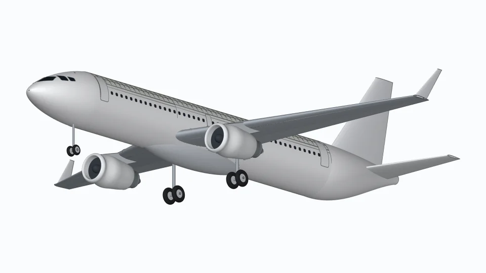

# Narrow-body airliner CAD model: fuselage structure, cabin, avionics boards and FEA checks

[](https://runmat.com/sandbox?example=aerospace-airliner)

A generic 38 m twin-engine narrow-body airliner built from `.part` and `.assembly` files: the outer
structure, the cabin, the flight deck and the cargo holds, about 3,200 part occurrences in all. A
skeleton part holds the main sizes, two circuit boards sit inside, four FEA studies check the
structure and a board's temperature, and four drawings document it. The main gear strut solves at
325.5 MPa peak von Mises in a 3.05 m/s landing, against a 1,586 MPa yield.

<picture>
  <source media="(prefers-color-scheme: dark)" srcset=".artifacts/thumbnail.webp">
  
</picture>

## The problem

An airliner model is large, repetitive and mostly symmetric. Frames repeat at a fixed pitch, seat
rows at theirs, and nearly every wing and tail piece has a left and a right hand. The model has to
stay editable when a main size changes, and it has to carry enough detail to cut sections through
the cabin and to feed structural and thermal studies.

The main sizes, in millimeters, with x aft from the nose tip, y to starboard and z up:

- Length 38.0 m, span 34.8 m over the winglets, height 12.3 m.
- Fuselage radius 1,980, in three 8,000 barrel sections behind a 5,200 nose and ahead of an 8,800
  tail cone. Frames at a 500 pitch, 24 stringers and 8 skin panels round each barrel.
- Wing: 34,000 span, 6,400 root chord, 1,550 tip chord, 27° leading-edge sweep, 5.5° dihedral, ribs
  at a 650 pitch. The box runs between spars at 15 % and 65 % chord.
- Cabin: 3 business rows at a 940 pitch, then 22 economy rows (3+3) at a 790 pitch, split by the
  overwing exits.

## How the example works

1. **A skeleton sets the sizes.** `airliner_skeleton.part` holds span, chords, fuselage radius,
   frame pitch and rib pitch as inputs, and publishes one frame per major assembly. The top
   assembly places each assembly on its frame.

2. **Assemblies name each other.** A file imports each design it places from that design's
   file, and an `instance` line places it:

   ```
   import { seat_frame } from "../cabin/seat_frame.part"

   instance seat_frame_captain : seat_frame
   ```

   Every folder imports the flush rivet from `+hardware/rivet.part`.

3. **Patterns for repeated parts.** Frames, stringers, skin panels, windows, bins, rivet rows and
   seat rows are patterns. The Outline shows each as one row (`rivet × 23`) until you expand it:

   ```
   pattern business_starboard_frames = grid(seeds = [business_starboard_frame], first = [1, 0, 0], first_spacing = input.business_pitch, first_count = 3, second = [0, 1, 0], second_spacing = 560 mm, second_count = 2)
   ```

4. **One file per handed part.** A part with a left and a right hand is built to starboard with a
   `side` input of 1. With `side = -1` it builds the port hand, and a `mirror` about y = 0 places
   it. `empennage.assembly` holds `stabilizer_starboard` and a mirror `stabilizer_port`:

   ```
   mirror stabilizer_port = {
       seeds = [stabilizer_starboard],
       plane = { plane = explicit, point = [0 mm, 0 mm, 0 mm], normal = [0, 1, 0] },
   ```

5. **Boards in the cockpit and cabin.** The display unit controller (120 × 100 mm, four layers)
   runs from the 28 V bus and drives six strings of eleven backlight LEDs at 60 mA. The reading-light
   driver (60 × 30 mm, two layers) drives a seat row's three lights in series at 333 mA. Both pass
   ERC and DRC with every net routed, and each component's `power` forms the board's power map.

6. **Studies on exported geometry.** Each `.fea` file reads a STEP file exported from a study
   assembly beside it, with its loads, their sources and a hand check in its header.
   `main_gear_landing.fea` holds the trunnion end and loads the axle with 397 kN up and 99 kN aft:

   ```
   output peak_stress = max(analysis.static.field.element.von_mises_stress, over = geometry.strut.region.body)
   ```

## Results

| Study | Load | Hand check | Result |
| --- | --- | --- | --- |
| `main_gear_landing.fea` | 3.05 m/s limit sink rate with spin-up drag | 330 MPa, 29 mm at the axle | Solved: 325.5 MPa peak von Mises, 27.6 mm peak displacement, against 1,586 MPa yield |
| `du_thermal.fea` | 2.65 W from the display board's power map | about 48 °C board peak | Solved: 56.4 °C on the board, 40.8 °C at the screen's face, 28.6 K below the parts' 85 °C rating |
| `window_cutout.fea` | 59.3 kPa (8.6 psi) cabin differential | 39.1 MPa hoop, about 100 MPa at the corners | Hand estimate; solve pending |
| `bulkhead_dome.fea` | 89.0 kPa ultimate, 1.5 × 59.3 kPa | 30.9 MPa membrane, about 50 MPa at the rim | Hand estimate; solve pending |

The gear strut is a 230 mm 300M steel cylinder with a 180 mm bore, and the solve agrees with the
cantilever hand check within 2 %. The thermal solve reads 8 K above its hand check, whose single
spreading path to the case's bosses is optimistic.

## What to try

1. Run Section view on the center plane (y = 0) to see the seat rows, galleys, holds and wing box.
   A section across the cabin at about x = 22 m shows a 3+3 economy row, the bins, the floor and a
   container in the aft hold.
2. Change `frame_pitch` or `rib_pitch` on the skeleton and on the assemblies to respace the frames
   or ribs.
3. Raise the pressure in `simulation/window_cutout.fea` to the safety valve's 62 kPa and run it.
   Thin-wall hoop stress p·r/t scales with pressure, so the hoop stress away from the window rises
   by 62 / 59.3, about 4.6 %.
4. Ask the Agent to add two economy rows and shorten the seat pitch to 760 mm.

## Files

- `airliner.assembly`: the top assembly, placing each major assembly on a skeleton frame.
- `airliner_skeleton.part`: the main sizes and the frames the assemblies attach to.
- `fuselage/`: the nose and cockpit panes, three barrel sections, tail cone, aft pressure bulkhead and wing-to-body fairing.
- `wing/`: both wings: slat, box skins, spars, ribs, flaps, aileron, winglet, rivet rows and the engine.
- `empennage/`: fin and rudder, stabilizers and elevators.
- `engine/`: the nacelle: cowl, fan, spinner, core nozzle, plug and pylon.
- `landing_gear/`: main and nose gear legs: strut, axle, hubs and tires.
- `cabin/`: floor, linings, ceiling, bins, seat rows, galleys, lavatories and doors.
- `cockpit/`: the flight deck, from floor and instrument panel to pilot seats.
- `cargo/`: forward and aft holds, containers, liners and doors, center wing box and main gear bays.
- `+hardware/`: the flush rivet.
- `electrical/display_unit/`: the display unit controller's schematic, four-layer board and lock file.
- `electrical/reading_light/`: the reading-light driver's schematic, two-layer board and lock file.
- `simulation/`: the four FEA studies, the study assemblies and parts, and the exported STEP files.
- `drawings/`: the gear strut, the window frame, the installed display unit and the general arrangement.
- `DESIGN-NOTES.md`: dimensions, board design, drawings and study results.
- `runmat.toml`: the project file.

## Related

- [Aerospace in RunMat](https://runmat.com/industries/aerospace)
- [RunMat MCAD](https://runmat.com/cad), the [build an assembly guide](https://runmat.com/docs/mcad/guides/build-an-assembly) and the [make a drawing guide](https://runmat.com/docs/mcad/guides/make-a-drawing)
- [Linear static guide](https://runmat.com/docs/simulation/guides/linear-static)
- [Foldable camera drone](../camera-drone) and [avionics temperature through a flight](../avionics-thermal)
- [Download RunMat](https://runmat.com/download)
