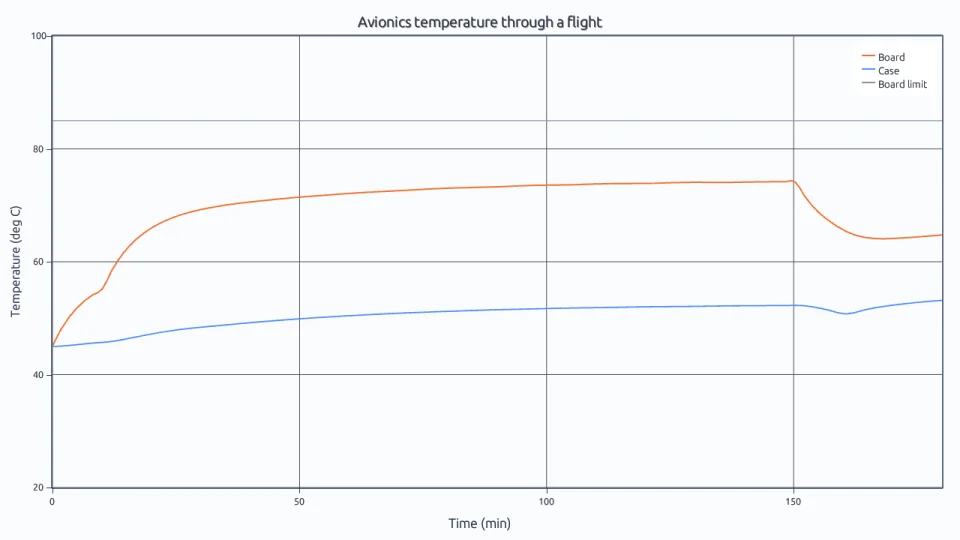

# Avionics board temperature through a flight: a two-mass thermal model with ode45

[](https://runmat.com/sandbox?example=aerospace-avionics-thermal)

This example integrates the temperatures of an avionics circuit board and its case through a
three-hour flight. The electrical load rises from 30 W to 55 W after takeoff, while the cooling air
gets colder and the convection to it weaker with altitude. The board peaks at 74.4 °C at 149
minutes, 10.6 °C below its 85 °C limit.

<picture>
  <source media="(prefers-color-scheme: dark)" srcset=".artifacts/thumbnail.webp">
  
</picture>

## The problem

An avionics unit has to keep its components below their rated temperature for the whole mission,
including the transients at takeoff and descent. A lumped two-node model captures the main
behavior: the board stores heat in its capacitance and passes it through a resistance to the case,
and the case stores heat and gives it to the surrounding air:

$$C_b \dot T_b = P(t) - \frac{T_b - T_c}{R}, \qquad
C_c \dot T_c = \frac{T_b - T_c}{R} - G(t)\,(T_c - T_a(t))$$

Here C_b = 900 J/K and C_c = 4000 J/K are the heat capacities, R = 0.4 K/W is the board-to-case
resistance, G is the case-to-air conductance and T_a the air temperature.

## How the example works

1. **Define the flight profile.** The load steps from 30 W to 55 W between 10 and 150 minutes. Over
   the first 30 minutes of the climb, the air cools from 45 °C to 25 °C and the conductance drops
   from 3.0 to 2.0 W/K. After 160 minutes both return to ground values:

   ```matlab
   P  = @(t) 30 + 25 * (t > 600 & t < 9000);
   G  = @(t) (3.0 - 1.0 * min(t / 1800, 1)) .* (t < 9600) + 3.0 * (t >= 9600);
   Ta = @(t) (45 - 20 * min(t / 1800, 1)) .* (t < 9600) + 45 * (t >= 9600);
   ```

2. **Write the two equations as one state function** with T = [board; case]:

   ```matlab
   f = @(t, T) [(P(t) - (T(1) - T(2)) / R) / Cb; ...
                ((T(1) - T(2)) / R - G(t) * (T(2) - Ta(t))) / Cc];
   ```

3. **Integrate over three hours** from 45 °C, with adaptive steps:
   `[t, T] = ode45(f, [0 3 * 3600], [45; 45]);`

4. **Find the peak and the margin** with `max`, and plot both temperatures against the 85 °C limit.

## Results

```
peak board temperature 74.4 C at 149 min
margin to the 85 C limit 10.6 C
```

The board climbs quickly after the load step, then settles toward its cruise equilibrium. In steady
cruise the case sits at T_a + P/G = 25 + 55/2 = 52.5 °C and the board at 52.5 + 55 × 0.4 =
74.5 °C, which the integrated peak of 74.4 °C approaches. When the load drops at 150 minutes the
board falls toward the case; when the unit lands back into 45 °C air, the case warms again.

## What to try

1. Raise the in-flight load to 65 W by changing `25` to `35` in `P`. The steady cruise board
   temperature becomes 25 + 65/2 + 65 × 0.4 = 83.5 °C, leaving 1.5 °C of margin.
2. Halve the board-to-case resistance with `R = 0.2`. The cruise board temperature falls by
   55 × 0.2 = 11 °C, to 63.5 °C.
3. Extend the cruise by moving `9000` and `9600` later, and watch how close the board gets to its
   steady value before the descent.

## Files

- `avionics-thermal.m`: the script: flight profile, two-mass model, ode45 integration and the plot.
- `runmat.toml`: the project file.

## Related

- [Aerospace engineering in RunMat](https://runmat.com/industries/aerospace)
- [Pitch from IMU data](../flight-attitude) and [random vibration of one mode](../random-vibration)
- Function reference: [`ode45`](https://runmat.com/docs/reference/builtins/ode45), [`max`](https://runmat.com/docs/reference/builtins/max), [`plot`](https://runmat.com/docs/reference/builtins/plot)
- [Download RunMat](https://runmat.com/download)
