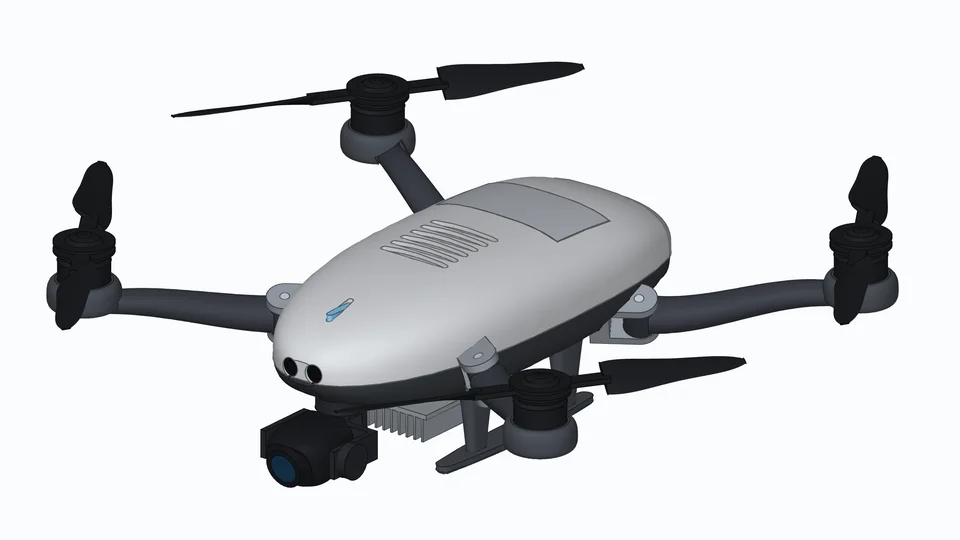

# Foldable camera drone design: CAD assembly, flight-controller and ESC boards, and FEA checks

[](https://runmat.com/sandbox?example=aerospace-camera-drone)

A foldable camera quadcopter designed in one project: a lofted two-part shell, four arms that fold
on hinge pins, motor pods with folding props, a 3-axis gimbal, landing skids and a flush rear
battery. The flight controller and the 4-in-1 ESC are schematics with routed boards and circuit
simulations, and the arm, the skids, the gimbal arm and the ESC have FEA studies. The flight
controller's 5 V buck settles at 4.982 V against a 4.85–5.15 V spec, and the landing skid carries
a 1 m/s touchdown at a peak of 23.9 MPa against its 55 MPa allowable.

<picture>
  <source media="(prefers-color-scheme: dark)" srcset=".artifacts/thumbnail.webp">
  
</picture>

## The problem

A camera drone couples mechanical, electrical and thermal requirements in a small closed shell:

- **Thrust.** The props must give a 2:1 thrust-to-weight ratio at full throttle, so the drone can
  climb, brake and hold station in gusts.
- **Arm stiffness.** The arm's first flap mode has to sit above 1.2 × the full-throttle blade-pass
  frequency, so the props don't drive the arm at resonance. The check in `arm_modal.fea` keeps a
  476 Hz target.
- **Landing.** Each skid carries a 1 m/s touchdown, 250 m/s² when stopped over 2 mm of compliance,
  with stress under 55 MPa: the conditioned strength of 30 % glass-filled nylon, about 110 MPa,
  over a factor of 2.
- **Electronics.** The 5 V rail must reach 5 V ± 3 % from the 6S battery without overshoot, the
  ESC's current-sense filter must pass the current loop's band and reject the 48 kHz switching
  ripple, and the ESC board must stay under 85 °C in 35 °C air.

[DESIGN-NOTES.md](DESIGN-NOTES.md) is a dated log of each decision: the requirement, the analysis,
the change and the margin it reached. Hand checks are labeled "hand estimate" and study results
"solved".

## How the example works

1. **The top assembly.** `drone.assembly` places the body, the four arm stations, the gimbal, the
   heatsink and the board stack. Its inputs set the fold and blade angles, and
   `drone_folded.assembly` sets them to stow the drone:

   ```
   input fold_front : angle = 0 deg
   input fold_rear : angle = 0 deg
   ```

   The `service` exploded view lifts the shell, slides the battery out and separates the board
   stack.

2. **Designs that name each other.** Files in one folder use each other directly. A file names a
   design in another folder with `from`, and a drawing view names its model the same way:

   ```
   use part arm from "../mechanical/arm" as arm
   ```

3. **Circuit simulations with specs.** Each simulation measures its result against a spec. The
   flight controller's `buck_startup` transient checks the 5 V rail:

   ```circuit
   measure v5 = { of = startup, average = "net.+5V", from = 1.4 ms, to = 1.6 ms, spec = { min = 4.85 V, max = 5.15 V } }
   ```

   The ESC's `current_sense` simulation checks the shunt filter's corner, and `gate_drive` checks
   the switch node's rise time and overshoot.

4. **FEA on exported geometry.** Each study reads a STEP file exported from a study assembly in
   `simulation/` and selects regions by name. `arm_modal.fea` fixes the arm at its pin bore and
   carries the motor pod as a lumped mass:

   ```
   analysis modes { structural modal { modes = 4 } retain basis }
   ```

5. **Drawings.** `drawings/` holds production drawings of the arm and the hinge mount and the
   drone's general arrangement. `arm.drawing` calls out the arm's [0/0/90/0]s carbon layup.

## Results

These results are recorded in DESIGN-NOTES.md:

| Check | Result | Requirement | Source |
| --- | --- | --- | --- |
| 5 V rail, `buck_startup` | 4.982 V, 9.2 mV ripple, 0.09 % overshoot | 4.85–5.15 V, ≤ 50 mV | solved |
| Buck inductor peak | 2.14 A | ≤ 3 A | solved |
| 5 V rail over 1 % resistors, 2,000 runs | mean 4.982 V, σ 19.4 mV, 100 % in band | 4.9–5.1 V | solved |
| ESC current-sense corner | 15.92 kHz | 14–18 kHz | solved |
| Landing skid, 3.5 mm rail | 23.9 MPa peak von Mises | 55 MPa | solved |
| Gimbal yaw arm, 3.5 mm drop | 76.3 MPa element peak | 184 MPa | solved |
| Arm first flap mode | 499 Hz | 476 Hz | hand estimate |
| ESC board, worst edge bridge | about 65 °C | 85 °C | hand estimate |

The arm and ESC thermal studies are set up in `simulation/` with their results pending, and the
notes say so for each one. The arm stiffness drove the change from a 0/90 laminate (E = 65 GPa,
first mode about 433 Hz) to the 0-dominated layup at 90 GPa. The ESC cooling drove the change from
polycarbonate bosses, a conduction path of about 258 K/W, to an aluminum belly heatsink with 14
fins in the props' downwash.

## What to try

1. Change the arm laminate's modulus and density in `simulation/arm_modal.fea`, run the study, and
   compare the first flap mode with the 476 Hz target.
2. Change phase A's current-sense filter capacitor (`CISA` in the `channel` sheet of
   `electrical/esc/esc.circuit`) from 10 nF to 22 nF. The corner is 1 / (2π · R · C), so 1 kΩ with
   22 nF gives 7.23 kHz, outside the 14–18 kHz spec. Re-run `current_sense` and read its measures.
3. Run Interference on `drone_folded.assembly` to check the stowed arms and blades.
4. Ask the Agent to explode the board stack and make an assembly drawing of it.

## Files

- `drone.assembly`: the top assembly, with fold and blade inputs and the `service` exploded view.
- `drone_folded.assembly`: the drone at its folded inputs.
- `mechanical/body/`: upper and lower shells, battery, light pipe, landing skids, antennas and vision sensors.
- `mechanical/arm/`: the arm, its hinge mount, and the assemblies that turn it about the hinge pin; `NOTES.md` has the arm's sizing.
- `mechanical/propulsion/`: motor pod, motor, prop hub and folding blade, placed by `motor_station.assembly`.
- `mechanical/gimbal/`: the 3-axis gimbal: three motors, yaw arm, yoke, camera head and lens.
- `mechanical/ground/`: the field launch stand, a welded aluminum tube frame.
- `mechanical/+hardware/`: the M3 screw, the hinge pin and the nylon spacer.
- `electrical/flight_controller/`: the flight controller's schematic, board, lock file and SPICE models.
- `electrical/esc/`: the ESC's schematic, board, lock file and SPICE models, with its heatsink and gap pad.
- `simulation/`: the FEA studies (arm modal and landing, landing skid, gimbal yaw arm, ESC thermal) and the study assemblies they export geometry from.
- `drawings/`: drawings of the arm, the hinge mount and the whole drone.
- `DESIGN-NOTES.md`: the dated log of requirements, analyses, changes and margins.
- `runmat.toml`: the project file.

## Related

- [Aerospace in RunMat](https://runmat.com/industries/aerospace)
- [RunMat MCAD](https://runmat.com/cad) and [RunMat ECAD](https://runmat.com/pcb-design)
- [Build an assembly](https://runmat.com/docs/mcad/guides/build-an-assembly), [run a circuit simulation](https://runmat.com/docs/ecad/guides/run-a-simulation) and the [modal analysis guide](https://runmat.com/docs/simulation/guides/modal-analysis)
- [Narrow-body airliner](../airliner) and [random vibration of one mode](../random-vibration)
- [Download RunMat](https://runmat.com/download)
