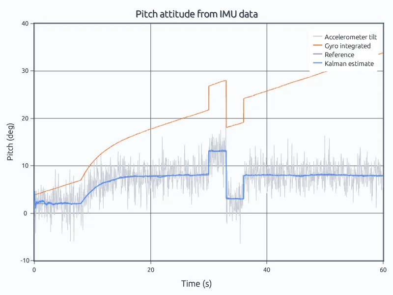

# Pitch attitude from IMU data with a two-state Kalman filter

[](https://runmat.com/sandbox?example=aerospace-flight-attitude)

This example estimates an aircraft's pitch angle from two imperfect sensors sampled at 100 Hz for
60 seconds: a rate gyro with a 0.4 deg/s bias and an accelerometer whose tilt reading has 2.5° of
noise. A Kalman filter with pitch and gyro bias as its states follows the reference pitch through a
climb and a pitch doublet. The run prints the RMS pitch error of the filter, of the gyro alone and
of the accelerometer alone.

<picture>
  <source media="(prefers-color-scheme: dark)" srcset=".artifacts/thumbnail.webp">
  
</picture>

## The problem

Flight-test and flight-control work needs attitude from an inertial measurement unit (IMU). Each
sensor fails in a different way. Integrating the gyro gives a smooth angle, but its bias integrates
into a drift that grows without limit: 0.4 deg/s becomes 24° after 60 seconds. The accelerometer
measures tilt against gravity with no drift, but its reading is noisy. A Kalman filter combines
them: the gyro predicts the next pitch, and the accelerometer corrects it, while the filter
estimates the gyro bias as a second state.

With state x = [θ; b] and gyro rate ω, the model is

$$x_{k+1} = \begin{bmatrix} 1 & -\Delta t \\ 0 & 1 \end{bmatrix} x_k + \begin{bmatrix} \Delta t \\ 0 \end{bmatrix} \omega_k, \qquad z_k = \begin{bmatrix} 1 & 0 \end{bmatrix} x_k + v_k$$

## How the example works

1. **Build the reference and the sensors.** The reference pitch climbs from 2° to 8° after
   8 seconds, with a ±5° doublet from 30 to 36 seconds:

   ```matlab
   gyro  = rate + 0.4 + 0.3 * randn(n, 1);   % deg/s, with a 0.4 deg/s bias
   accel = pitch + 2.5 * randn(n, 1);        % deg, tilt from the accelerometer
   ```

2. **Set up the filter.** Process noise `Q = diag([1e-4 1e-6])` lets pitch move and the bias wander
   slowly; measurement noise `R = 2.5^2` matches the accelerometer.

3. **Predict with the gyro, correct with the accelerometer** at every sample:

   ```matlab
   x = F * x + B * gyro(k);
   P = F * P * F' + Q;
   K = P * H' / (H * P * H' + R);
   x = x + K * (accel(k) - H * x);
   P = (eye(2) - K * H) * P;
   ```

4. **Compare the three estimates** against the reference with RMS error.

## Results

The plot shows the three estimates against the reference. The integrated gyro follows the shape of
every maneuver but drifts upward steadily and ends far above the reference. The accelerometer tilt
scatters by several degrees around it. The Kalman estimate stays on the reference through the climb
and the doublet with little of the accelerometer's scatter. The printed RMS errors rank the filter
well below either sensor alone.

## What to try

1. Raise the gyro bias from `0.4` to `1.0`. The bias alone adds 60° of drift to the integrated gyro
   by 60 seconds; check how quickly the filter's bias state settles to the new value.
2. Increase `R` to `10^2`. The filter trusts the accelerometer less: look at how smooth the
   estimate gets and how far it lags the doublet.
3. Change `rng(3)` to another seed to see how much the RMS errors move between noise draws.

## Files

- `flight-attitude.m`: the script: reference pitch, sensor models, Kalman filter and the plot.
- `runmat.toml`: the project file.

## Related

- [Aerospace engineering in RunMat](https://runmat.com/industries/aerospace)
- [Avionics temperature through a flight](../avionics-thermal) and [flight-test vibration against its limit](../flight-test-psd)
- [Target tracking with a Kalman filter](../../defense/track-filter)
- Function reference: [`randn`](https://runmat.com/docs/reference/builtins/randn), [`eye`](https://runmat.com/docs/reference/builtins/eye), [`plot`](https://runmat.com/docs/reference/builtins/plot)
- [Download RunMat](https://runmat.com/download)
