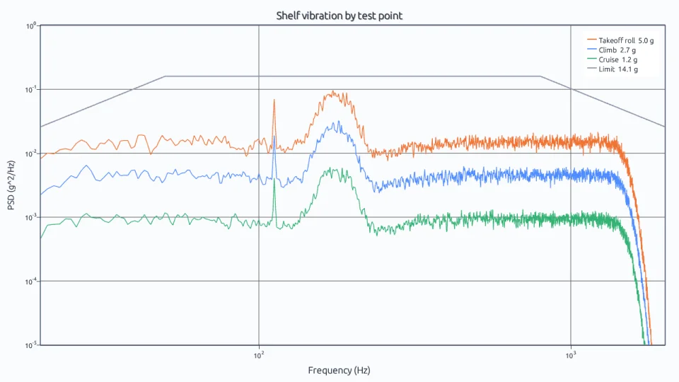

# Flight-test vibration PSD against the GEVS qualification limit

[](https://runmat.com/sandbox?example=aerospace-flight-test-psd)

This example turns 30-second accelerometer records from an equipment shelf into power spectral
densities and compares them with the GEVS component qualification limit (GSFC-STD-7000B, 14.1 g
RMS). The takeoff roll is the most severe test point at 5.0 g RMS, against 2.7 g in the climb and
1.2 g in cruise. Its closest approach to the limit is a 2.2 dB margin at 173 Hz, near the shelf's
resonance.

<picture>
  <source media="(prefers-color-scheme: dark)" srcset=".artifacts/thumbnail.webp">
  
</picture>

## The problem

Equipment is qualified on a shaker against a random vibration spectrum. A flight test then has to
show that the environment the equipment sees in service stays inside what it was qualified for.
Comparing overall g RMS is not enough: a narrow resonance can exceed the limit spectrum at one
frequency while the total level stays well below. The check compares the measured PSD with the limit
PSD frequency by frequency, as a margin in decibels:

$$\text{margin}(f) = 10 \log_{10} \frac{\text{PSD}_{\text{limit}}(f)}{\text{PSD}_{\text{measured}}(f)}$$

The GEVS limit rises at +6 dB/octave from 0.026 g²/Hz at 20 Hz to 0.16 g²/Hz at 50 Hz, stays flat
to 800 Hz and falls at -6 dB/octave to 0.026 g²/Hz at 2000 Hz.

## How the example works

1. **Synthesize the records.** Each test point is broadband noise sampled at 4096 Hz, shaped by a
   20–1500 Hz band and a 150–210 Hz shelf mode, plus a 112 Hz propeller blade-pass tone. The three
   points differ in level (1.0, 0.55, 0.25):

   ```matlab
   a = 5.6 * levels(k) * (filter(bh, ah, w) + 1.3 * filter(bs, as, w));
   ```

2. **Estimate each PSD** with Welch's method: 4096-point Hann segments with 50 % overlap, which gives
   1 Hz resolution:

   ```matlab
   [p, f] = pwelch(a, hann(4096), 2048, 4096, fs);
   ```

3. **Integrate for g RMS** over 20–2000 Hz: `grms(k) = sqrt(trapz(f(keep), p(keep)))`.

4. **Build the limit on the same frequencies** and take the smallest margin for the takeoff roll:
   `[margin, at] = min(10 * log10(lim ./ pk))`.

5. **Plot** all three spectra and the limit on log-log axes, with each point's g RMS in the legend.

## Results

```
takeoff roll 5.0 g RMS, climb 2.7, cruise 1.2
smallest margin to the limit: 2.2 dB at 173 Hz
```

Every test point is far below the 14.1 g RMS of the limit, yet the takeoff spectrum comes within
2.2 dB of the limit at 173 Hz. That frequency is the shelf mode, where the airframe input is
amplified. The margin is positive, so the shelf environment is covered by the qualification test.

## What to try

1. Set the takeoff level `levels(1)` to `2.0`. Acceleration scales with the level and PSD with its
   square, so the takeoff PSD rises by 6.0 dB and the margin at 173 Hz becomes -3.8 dB: the
   measurement now exceeds the limit there.
2. Narrow the shelf-mode band in the second `butter` call and look at how the peak sharpens.
3. Replace the synthetic records with your own accelerometer data in `a`, keeping `fs` at its true
   sample rate.

## Files

- `flight-test-psd.m`: the script: synthetic shelf records, Welch PSDs, g RMS, the GEVS limit and the margin.
- `runmat.toml`: the project file.

## Related

- [Aerospace engineering in RunMat](https://runmat.com/industries/aerospace)
- [Random vibration of one mode with Miles' equation](../random-vibration) and [the flight-test spectrogram](../flight-test-spectrogram)
- Function reference: [`pwelch`](https://runmat.com/docs/reference/builtins/pwelch), [`butter`](https://runmat.com/docs/reference/builtins/butter), [`trapz`](https://runmat.com/docs/reference/builtins/trapz), [`loglog`](https://runmat.com/docs/reference/builtins/loglog)
- [Download RunMat](https://runmat.com/download)
