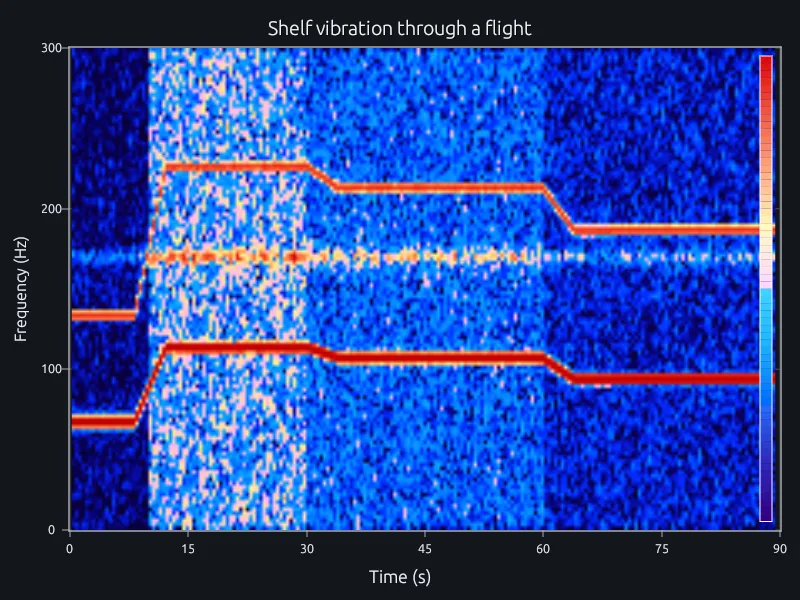

# Spectrogram of flight-test vibration: propeller tone and shelf mode

[](https://runmat.com/sandbox?example=aerospace-flight-test-spectrogram)

This example computes the spectrogram of an equipment-shelf accelerometer through a compressed
90-second flight-test card: taxi, takeoff roll, climb and cruise. The four-bladed propeller's
blade-pass tone moves with engine speed, from 66.7 Hz in taxi to 113.3 Hz on the takeoff roll and
93.3 Hz in cruise. The shelf's 170 Hz mode is excited by the broadband vibration and is strongest
during the takeoff roll.



## The problem

A single PSD averages a whole record, so it smears together tones whose frequency changes and
events that come and go. A spectrogram splits the record into short segments and computes a
spectrum for each, which shows how every component evolves in time. Flight-test engineers use it
to separate tones tied to engine or rotor speed, which move as the speed changes, from structural
modes, which stay at fixed frequencies and rise and fall with the excitation level.

A propeller with N blades turning at n rpm produces its blade-pass tone at

$$f_{BP} = \frac{N \, n}{60}$$

and harmonics at multiples of it.

## How the example works

1. **Lay out the flight card.** Propeller speed ramps from 1000 to 1700 rpm for the takeoff roll at
   10 seconds, eases to 1600 rpm in the climb from 30 seconds and to 1400 rpm in cruise from
   60 seconds. The broadband level steps with each phase.

2. **Generate the blade-pass tone and its second harmonic** by integrating the instantaneous
   frequency, so the phase stays continuous as the speed changes:

   ```matlab
   phase = 2*pi*cumsum(4 * rpm / 60) / fs;
   tone = 0.8 * sin(phase) + 0.3 * sin(2 * phase);
   ```

3. **Ring the shelf mode** by passing noise through a two-pole resonator at 170 Hz:

   ```matlab
   r = 0.99;  w0 = 2*pi*170/fs;
   ring = filter(1, [1 -2*r*cos(w0) r^2], randn(n, 1));
   ```

4. **Compute the spectrogram** with 256-sample Hann segments at 600 Hz, so each column covers
   0.43 s and each row 2.34 Hz, and plot power in dB:

   ```matlab
   [s, f, tt, ps] = spectrogram(x, hann(256), 0, 256, fs);
   imagesc([tt(1) tt(end)], [f(1) f(end)], power_db);
   ```

5. **Measure** the strongest tone in the 50–130 Hz band on the takeoff roll and in cruise, and the
   change in the shelf mode's band power between them.

## Results

The spectrogram shows the blade-pass tone and its second harmonic as two parallel lines that step
up at takeoff, ease down in the climb and again in cruise. The 170 Hz shelf mode is a horizontal
line at fixed frequency that is brightest during the takeoff roll, when the broadband level is
highest, and fades in cruise. The script prints the measured tone frequencies and how many dB lower
the shelf mode is in cruise than on the takeoff roll.

## What to try

1. Change the window to `hann(512)` with `nfft` 512. Each row narrows to 1.17 Hz and each column
   widens to 0.85 s; look at how the tone ramps blur in time.
2. Change the propeller to three blades by replacing `4` in `phase` with `3`. The takeoff tone
   moves to 3 × 1700 / 60 = 85 Hz.
3. Lower `r` to `0.95` to damp the shelf mode, and look at how its line widens and dims.

## Files

- `flight-test-spectrogram.m`: the script: flight card, propeller tone, shelf mode, spectrogram and measurements.
- `runmat.toml`: the project file.

## Related

- [Aerospace engineering in RunMat](https://runmat.com/industries/aerospace)
- [Flight-test vibration against its limit](../flight-test-psd) and [random vibration of one mode](../random-vibration)
- Function reference: [`spectrogram`](https://runmat.com/docs/reference/builtins/spectrogram), [`imagesc`](https://runmat.com/docs/reference/builtins/imagesc), [`filter`](https://runmat.com/docs/reference/builtins/filter), [`cumsum`](https://runmat.com/docs/reference/builtins/cumsum)
- [Download RunMat](https://runmat.com/download)
