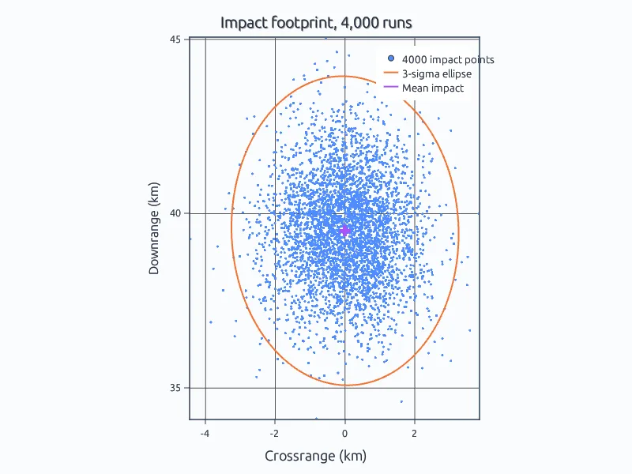

# Monte Carlo impact footprint of a ballistic payload with a 3-sigma ellipse

[](https://runmat.com/sandbox?example=aerospace-impact-footprint)

This example flies 4,000 trajectories of a 180 kg ballistic payload released at 25 km and 900 m/s,
each with dispersed mass, drag area, release speed and angle, air density and crosswind. All runs
advance together as arrays until each reaches the ground. The mean impact lands 39.5 km downrange,
and the 3-sigma ellipse around it has semi-axes of 4.44 km and 3.23 km.

<picture>
  <source media="(prefers-color-scheme: dark)" srcset=".artifacts/thumbnail.webp">
  
</picture>

## The problem

Range safety and recovery planning need the area where a falling body can land, not just its
nominal impact point. Each input to the trajectory is known only within a tolerance, and the
errors add up over a long flight. A Monte Carlo analysis samples every uncertain input, flies each
sample, and describes the scatter of impact points. The covariance of those points defines a
dispersion ellipse; its 3-sigma size is the usual basis for a hazard or recovery area.

The dispersions in this example, each a normal distribution:

| Input | Nominal | 1-sigma |
| --- | --- | --- |
| Mass | 180 kg | 2 % |
| Drag area C_d·A | 0.35 m² | 5 % |
| Air density scale | 1 | 4 % |
| Crosswind | 0 m/s | 8 m/s |
| Release speed | 900 m/s | 1 % |
| Flight-path angle | 20° | 0.3° |

## How the example works

1. **Sample the inputs** for all 4,000 runs at once:

   ```matlab
   m    = 180 * (1 + 0.02 * randn(N, 1));
   CdA  = 0.35 * (1 + 0.05 * randn(N, 1));
   wind = 8 * randn(N, 1);
   ```

2. **Fly every run together.** Each 0.1 s step applies gravity and drag relative to the moving air,
   with an exponential atmosphere (7200 m scale height). The `flying` mask freezes runs that have
   landed:

   ```matlab
   rho = 1.225 * rhoS .* exp(-h / 7200);
   k = 0.5 * rho .* CdA .* speed ./ m;
   vh = vh - flying .* (k .* uh + g) * dt;
   flying = flying & h > 0;
   ```

3. **Fit the ellipse.** The eigenvectors of the impact covariance give the ellipse's axes and the
   square roots of its eigenvalues give the 1-sigma lengths:

   ```matlab
   C = cov([xk(:) yk(:)]);
   [V, D] = eig(C);
   ell = (V * (3 * sqrt(D)) * [cos(th); sin(th)])' + mu;
   ```

4. **Plot** the impact points, the ellipse and the mean impact on equal axes.

## Results

```
mean impact 39.5 km downrange
3-sigma ellipse 4.44 km by 3.23 km
```

The two printed lengths are the ellipse's 3-sigma semi-axes. The long axis runs downrange, where
the release speed, angle and drag errors act; crosswind spreads the points across the range. A
3-sigma ellipse of a two-dimensional normal distribution contains about 98.9 % of the impacts.

## What to try

1. Set the crosswind dispersion to zero with `wind = 0 * randn(N, 1)` and look at how much of the
   crossrange spread it accounted for.
2. Tighten the drag-area tolerance from `0.05` to `0.02` and compare the downrange semi-axis.
3. Change the flight-path angle from `20` to `30` degrees and see where the mean impact moves.

## Files

- `impact-footprint.m`: the script: dispersed inputs, vectorized trajectories, covariance ellipse and the plot.
- `runmat.toml`: the project file.

## Related

- [Aerospace engineering in RunMat](https://runmat.com/industries/aerospace)
- [Pitch from IMU data](../flight-attitude) and [detection range of a radar](../../defense/detection-range)
- Function reference: [`randn`](https://runmat.com/docs/reference/builtins/randn), [`cov`](https://runmat.com/docs/reference/builtins/cov), [`eig`](https://runmat.com/docs/reference/builtins/eig), [`scatter`](https://runmat.com/docs/reference/builtins/scatter)
- [Download RunMat](https://runmat.com/download)
