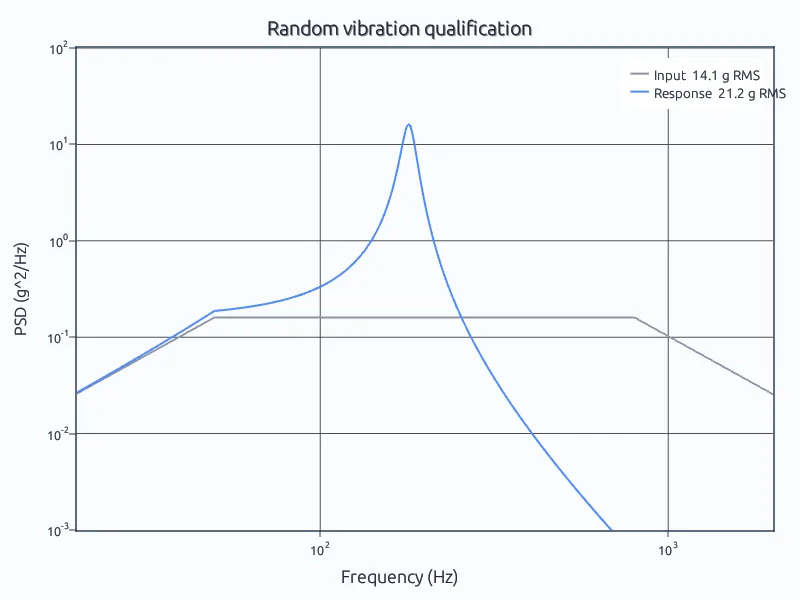

# Random vibration response of one mode with Miles' equation

[](https://runmat.com/sandbox?example=aerospace-random-vibration)

This example applies the GEVS component random vibration spectrum to a bracket's mounting face and
computes the response of the bracket's first mode, at 180 Hz with Q = 10. The 14.1 g RMS input
becomes a 21.2 g RMS response. Miles' equation predicts 21.3 g RMS, which puts the 3-sigma peak at
64 g.

<picture>
  <source media="(prefers-color-scheme: dark)" srcset=".artifacts/thumbnail.webp">
  
</picture>

## The problem

Spacecraft and aircraft components are qualified on a shaker table driven by a random acceleration
spectrum. The spectrum is given as a power spectral density (PSD) in g²/Hz. A component's mode
amplifies the input near its natural frequency, so the part feels more than the table delivers.
Sizing a part, its fasteners or its electronics needs that response level.

The input here is the GEVS (NASA General Environmental Verification Standard) qualification
profile. It rises at +6 dB/octave from 0.026 g²/Hz at 20 Hz to 0.16 g²/Hz at 50 Hz, stays flat to
800 Hz, and falls at -6 dB/octave to 2000 Hz.

## How the example works

1. **Build the input spectrum** on 800 log-spaced frequencies from 20 to 2000 Hz:

   ```matlab
   f = logspace(log10(20), log10(2000), 800)';
   in(lo)  = 0.026 * (f(lo) / 20).^2;      % +6 dB/oct to 50 Hz
   in(mid) = 0.16;                         % flat to 800 Hz
   in(hi)  = 0.16 * (f(hi) / 800).^(-2);   % -6 dB/oct to 2000 Hz
   ```

2. **Apply the mode's transmissibility.** A base-excited single-degree-of-freedom mode with damping
   ratio ζ = 1/(2Q) passes the input through

   $$|H(r)|^2 = \frac{1 + (2\zeta r)^2}{(1 - r^2)^2 + (2\zeta r)^2}, \qquad r = f / f_n$$

   so the response PSD is `out = H2 .* in`.

3. **Integrate both spectra.** The RMS level is the square root of the area under the PSD:
   `grms = sqrt(trapz(f, psd))`.

4. **Check against Miles' equation.** For a lightly damped mode on a flat input, Miles' equation
   gives the response without integrating:

   $$g_{RMS} = \sqrt{\frac{\pi}{2} f_n Q \, \text{PSD}(f_n)}$$

5. **Plot both spectra** on log-log axes, with each one's RMS level in the legend.

## Results

```
input 14.1 g RMS, response 21.2 g RMS
Miles' equation 21.3 g RMS, 3-sigma peak 64 g
```

The integrated response and Miles' equation agree to within 0.5 %, because 180 Hz sits in the
flat part of the spectrum and Q = 10 keeps the resonance narrow. A random signal exceeds its
3-sigma level about 0.3 % of the time, so 64 g is the usual design load for the bracket and
anything mounted on it.

## What to try

1. Move the mode to `fn = 1200`. The resonance now sits on the falling part of the spectrum. The
   integrated response is 38.7 g RMS, but Miles' equation, which still reads the flat 0.16 g²/Hz,
   gives 54.9 g RMS. Miles' equation holds only where the input is flat around the mode.
2. Lower the damping with `Q = 25`. The response grows as the square root of Q, to 33.6 g RMS.
3. Replace the GEVS profile with your own test spectrum by editing the three `in(...)` lines.

## Files

- `random-vibration.m`: the script: spectrum, transmissibility, RMS levels, Miles' equation and the plot.
- `runmat.toml`: the project file.

## Related

- [Aerospace engineering in RunMat](https://runmat.com/industries/aerospace)
- [Bracket random vibration](../../fea/bracket-random-vibration): the same kind of input applied to a meshed bracket in an FEA study
- [Shock response spectrum](../shock-response-spectrum) and [flight-test vibration against its limit](../flight-test-psd)
- Function reference: [`logspace`](https://runmat.com/docs/reference/builtins/logspace), [`trapz`](https://runmat.com/docs/reference/builtins/trapz), [`loglog`](https://runmat.com/docs/reference/builtins/loglog)
- [Download RunMat](https://runmat.com/download)
