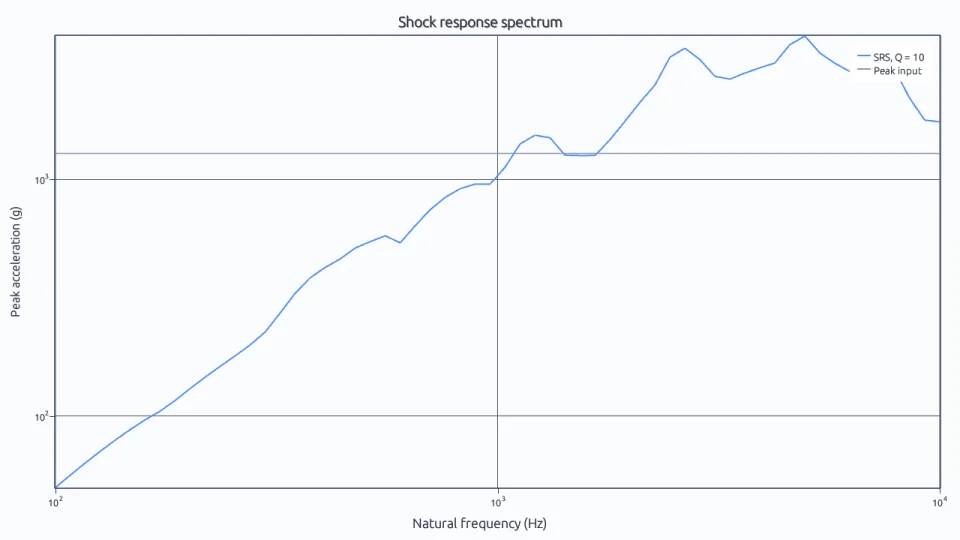

# Shock response spectrum of a pyroshock transient with Smallwood's method

[](https://runmat.com/sandbox?example=aerospace-shock-response-spectrum)

This example computes the maximax shock response spectrum (SRS) of a pyroshock-like transient at
Q = 10, over 60 natural frequencies from 100 Hz to 10 kHz. The input is 20 ms of five decaying
tones sampled at 102.4 kHz, with a peak of 1291 g. The SRS peaks at 4048 g at 4954 Hz.

<picture>
  <source media="(prefers-color-scheme: dark)" srcset=".artifacts/thumbnail.webp">
  
</picture>

## The problem

Separation nuts, pyrotechnic valves and stage separation produce short, high-frequency shocks.
The time history alone says little about what the shock does to equipment, because a component
responds according to its own natural frequency. The shock response spectrum answers that: for
each natural frequency f_n, it is the peak absolute acceleration of a single-degree-of-freedom
oscillator with that frequency and a chosen damping, mounted on the shaking base. Shock
specifications and test tolerances are written as SRS curves, conventionally at Q = 10
(5 % damping).

Smallwood's ramp-invariant digital filter gives each oscillator's response to the sampled base
acceleration in one call to `filter`, with coefficients from E = e^{-ζω_n Δt}, K = ω_d Δt,
C = E cos K, S = E sin K and S' = S/K:

$$b = [\,1 - S',\; 2(S' - C),\; E^2 - S'\,], \qquad a = [\,1,\; -2C,\; E^2\,]$$

## How the example works

1. **Build the transient.** Five tones at 450, 1200, 2600, 4800 and 7300 Hz, each decaying with a
   2.5 ms time constant and given a random phase:

   ```matlab
   base = base + amp(k) * exp(-t / 0.0025) .* sin(2*pi*f0(k)*t + 2*pi*rand());
   ```

2. **Pick the natural frequencies**: 60 log-spaced points, `fn = logspace(2, 4, 60)`.

3. **Filter the base acceleration through each oscillator** and keep the peak absolute response:

   ```matlab
   b = [1 - Sp, 2 * (Sp - C), E^2 - Sp];
   a = [1, -2 * C, E^2];
   srs(i) = max(abs(filter(b, a, base)));
   ```

4. **Plot** the SRS on log-log axes against the peak input level.

## Results

```
peak input 1291 g
SRS peak 4048 g at 4954 Hz
```

Below about 1 kHz the SRS rises with frequency and stays under the peak input, because those
oscillators are too slow to follow the shock. Above it the spectrum climbs past the input level,
with peaks near the strong tones at 2600 and 4800 Hz. The largest response, 4048 g at 4954 Hz,
is 3.1 times the peak input. A steady tone at resonance would be amplified by about Q = 10, but
these tones decay in a few milliseconds, before the oscillator can build up to that level.

## What to try

1. Change `Q = 10` to `Q = 25`. Look at how much the peaks grow for this short transient compared
   with the factor of 2.5 a steady tone would give.
2. Lengthen the decay from `0.0025` to `0.01` s and compare the SRS peak with the peak input again.
3. Replace `base` with a measured shock record and set `fs` to its sample rate.

## Files

- `shock-response-spectrum.m`: the script: the transient, Smallwood's filter for each natural frequency, and the plot.
- `runmat.toml`: the project file.

## Related

- [Aerospace engineering in RunMat](https://runmat.com/industries/aerospace)
- [Bracket shock spectrum](../../fea/bracket-shock-spectrum): a shock spectrum applied to a meshed bracket in an FEA study
- [Random vibration of one mode with Miles' equation](../random-vibration)
- Function reference: [`filter`](https://runmat.com/docs/reference/builtins/filter), [`logspace`](https://runmat.com/docs/reference/builtins/logspace), [`loglog`](https://runmat.com/docs/reference/builtins/loglog)
- [Download RunMat](https://runmat.com/download)
