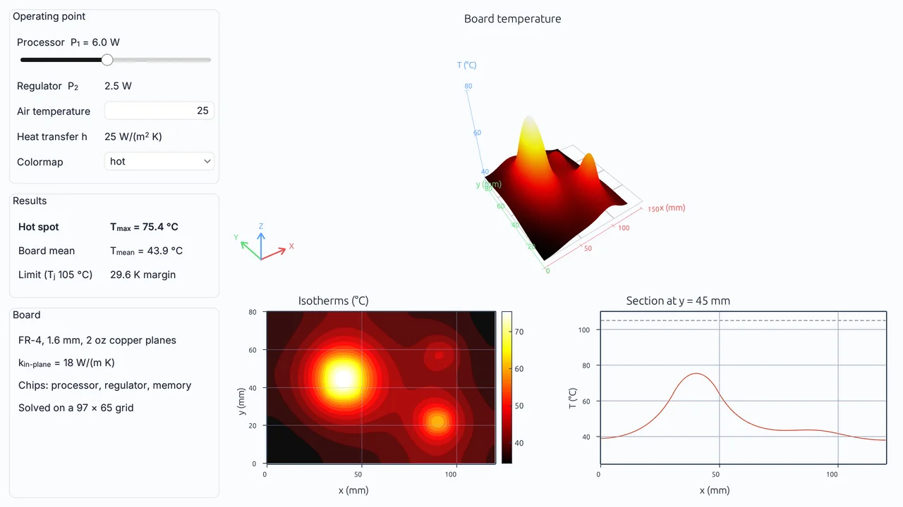

# Circuit board thermal explorer

[](https://runmat.com/sandbox?example=apps-board-thermal-explorer)

This app solves the steady temperature of a 120 × 80 mm FR-4 board with copper planes, carrying a
processor, a regulator and a memory chip and cooled by air on both faces. At 6 W processor power
and 25 °C air, the hot spot reaches 75.4 °C, 29.6 K below a 105 °C junction limit.

<picture>
  <source media="(prefers-color-scheme: dark)" srcset=".artifacts/thumbnail.webp">
  
</picture>

## The problem

Board designers need to know early whether a layout keeps every chip below its temperature
limit, and how much power headroom is left. A thin board conducts heat in its plane and loses it
to the air from both faces, so its temperature T obeys k·t·∇²T − 2h(T − T_air) + q = 0, with
in-plane conductivity k, thickness t, heat transfer coefficient h and the chips' heat flux q.

## How the example works

1. **Build the controls**: a slider for the processor power, a numeric edit field for the air
   temperature and a pop-up menu for the colormap, each wired to the same callback:

   ```matlab
   update = @(src, event) solveBoard(ui);
   powerSlider.Callback = update;
   ambient.ValueChangedFcn = update;
   ```

2. **Solve on a 97 × 65 grid**: `solveBoard` builds the five-point Laplacian with `spdiags` and
   `kron`, with insulated edges, and solves the sparse system with `\`.
3. **Draw three views** into `uiaxes`: a 3-D `surf`, filled isotherms with `contourf` and a
   colorbar, and a section through the processor at y = 45 mm against the 105 °C limit.
4. **Update the results panel**, whose labels use TeX for T_max and T_mean.

## Results

At the default operating point the board averages 43.9 °C and peaks at 75.4 °C over the
processor. The regulator, at 2.5 W on a smaller package, forms the second peak near x = 90 mm.

## What to try

1. Drag the processor power to 12 W and read the margin.
2. Raise `h` from 25 to 60 W/(m²·K), the value for forced air, and solve again.
3. Move the processor toward the board edge in the `chips` table.

## Files

- `board-thermal-explorer.m`: the app: the window, the sparse solver and the plots.
- `runmat.toml`: the project file.

## Related

- [Building apps with RunMat](https://github.com/runmat-org/runmat/blob/main/docs/plotting/apps.md)
- [Plotting in RunMat](https://runmat.com/math/plotting)
- [Download RunMat](https://runmat.com/download)
