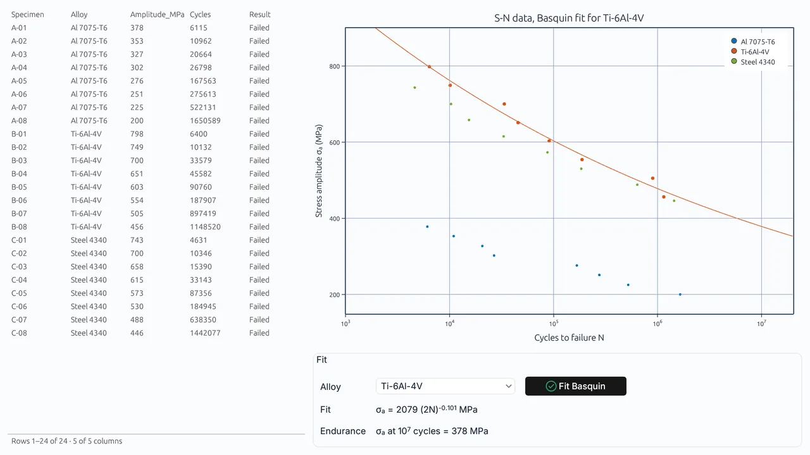

# Fatigue test log

[](https://runmat.com/sandbox?example=apps-fatigue-test-log)

This app keeps 24 constant-amplitude fatigue results for three alloys in a `uitable` and plots
them as S-N data with a Basquin fit for the alloy picked in a pop-up menu. For Ti-6Al-4V the fit
is σ_a = 2079·(2N)^−0.101 MPa, which gives 378 MPa at 10⁷ cycles.

<picture>
  <source media="(prefers-color-scheme: dark)" srcset=".artifacts/thumbnail.webp">
  
</picture>

## The problem

Fatigue test labs log each specimen's stress amplitude and cycles to failure, then fit
Basquin's law, σ_a = σ_f′·(2N)^b, to estimate life at a design stress. The table and the fit
belong side by side so a reviewer can trace each point.

## How the example works

1. **Make the records**: the script builds a `table` of specimens from each alloy's Basquin
   constants with scatter in life.
2. **Show them**: `uitable(root, 'Data', results)` places the table in the left column of the
   grid, spanning both rows.
3. **Fit the selected alloy**: `fitAlloy` fits a line to log σ_a against log 2N with `polyfit`,
   plots the data and the fit on a log cycles axis, and writes the result as TeX:

   ```matlab
   ui.fit.Text = sprintf('\\sigma_a = %.0f (2N)^{%.3f} MPa', 10^p(2), p(1));
   ```

## Results

The three alloys separate clearly: Al 7075-T6 runs from 378 MPa at about 6000 cycles to 200 MPa
at 1.65 million, while Ti-6Al-4V and steel 4340 carry 450 to 800 MPa over the same lives.

## What to try

1. Pick Steel 4340 and compare its exponent with the titanium fit.
2. Lower `loFrac` so the longest tests pass 10⁷ cycles and show as runouts.
3. Add a column for the specimen's surface finish to the table.

## Files

- `fatigue-test-log.m`: the app: the records, the window and the fit.
- `runmat.toml`: the project file.

## Related

- [Building apps with RunMat](https://github.com/runmat-org/runmat/blob/main/docs/plotting/apps.md)
- [Plotting in RunMat](https://runmat.com/math/plotting)
- [Download RunMat](https://runmat.com/download)
