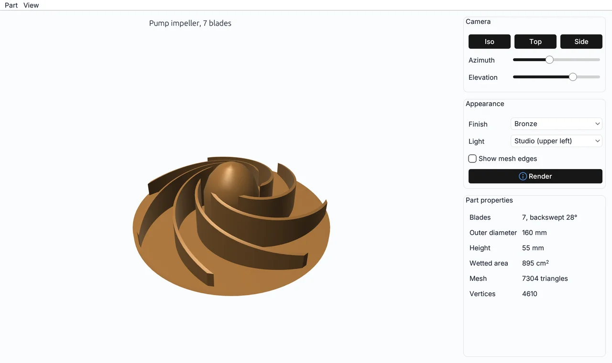

# Impeller geometry viewer

[](https://runmat.com/sandbox?example=apps-impeller-viewer)

This app builds a seven-blade centrifugal pump impeller as a triangle mesh (7304 triangles,
4610 vertices) and draws it with per-vertex shading. Camera buttons and sliders turn the part,
pop-up menus change the finish and the light, and a panel lists its 160 mm diameter, 55 mm
height and 895 cm² wetted area.

<picture>
  <source media="(prefers-color-scheme: dark)" srcset=".artifacts/thumbnail.webp">
  
</picture>

## The problem

Engineers often hold geometry as a mesh: a scan, an export from a CAD system or a mesh built in
code, as here. A small viewer that turns the part and reports its size and area is a common
first tool for checking it before analysis.

## How the example works

1. **Build the mesh**: `addRevolved` sweeps profiles into the back shroud and the hub, and
   `addGrid` turns each blade face, generated as a backswept log spiral, into triangles.
2. **Shade it**: `drawPart` sums face normals into vertex normals with `accumarray`, then
   computes diffuse, specular and rim terms for a light placed relative to the camera, and
   passes the colors to `patch`:

   ```matlab
   patch(ui.ax, 'Faces', F, 'Vertices', V, 'FaceVertexCData', C, ...
       'FaceColor', 'interp', 'EdgeColor', ec);
   ```

3. **Wire the controls**: the Iso, Top and Side buttons, the View menu items and the two sliders
   all call `drawPart`, so the shading follows the camera.

## Results

The impeller has a 6 mm back shroud, a hub that rises to 55 mm and seven 4.4 mm blades swept
back at 28°, falling from 36 mm high at the eye to 12 mm at the rim. Its wetted area is 895 cm².

## What to try

1. Choose the Anodized blue finish and the Headlight light.
2. Turn on mesh edges to see the triangulation.
3. Change `buildImpeller(7)` to `buildImpeller(9)`.

## Files

- `impeller-viewer.m`: the app: mesh construction, shading and the window.
- `runmat.toml`: the project file.

## Related

- [Building apps with RunMat](https://github.com/runmat-org/runmat/blob/main/docs/plotting/apps.md)
- [Plotting in RunMat](https://runmat.com/math/plotting)
- [Download RunMat](https://runmat.com/download)
