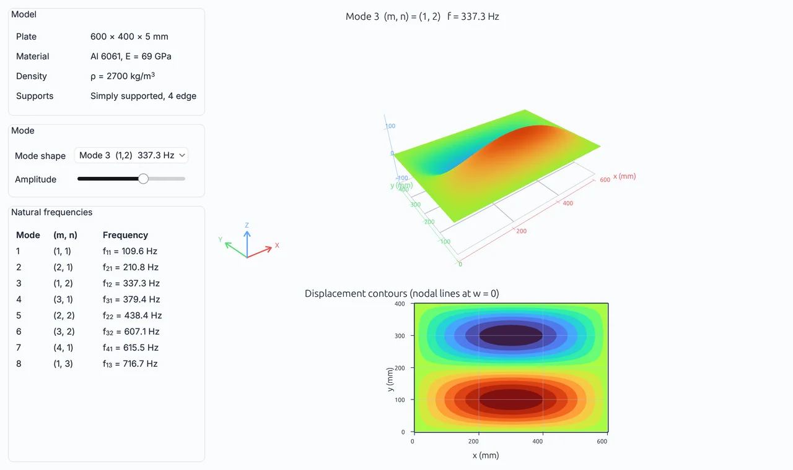

# Plate modal analysis app

[](https://runmat.com/sandbox?example=apps-plate-modal-analysis)

This app computes the first eight natural frequencies of a simply supported aluminum plate,
600 × 400 × 5 mm, and draws the mode shape you pick from a pop-up menu as a 3-D surface and a
contour plot. The fundamental mode is at 109.6 Hz; the eighth, mode (1, 3), is at 716.7 Hz.

<picture>
  <source media="(prefers-color-scheme: dark)" srcset=".artifacts/thumbnail.webp">
  
</picture>

## The problem

A plate's natural frequencies and mode shapes tell a designer where a panel will ring and
where to put stiffeners or mounts. For a simply supported rectangular plate the answer is in
closed form: f_mn = (π/2)((m/a)² + (n/b)²)·√(D/(ρh)), with flexural rigidity D = Eh³/(12(1 − ν²)),
and each mode shape is sin(mπx/a)·sin(nπy/b). The app puts that result in a window where an
engineer picks a mode and reads its shape and frequency.

## How the example works

1. **Compute and sort the frequencies** for m, n = 1 to 5 and keep the lowest eight.
2. **Lay out the window** with `uigridlayout`: a 320-pixel control column and a plot column.
   The left column holds three panels: the model summary, the mode picker and the frequency
   table, whose labels use TeX for subscripts:

   ```matlab
   uilabel(fg, 'Text', sprintf('f_{%d%d} = %.1f Hz', M(k), N(k), f(k)), 'Interpreter', 'tex');
   ```

3. **Place the classic controls** in the Mode panel at pixel positions:

   ```matlab
   modeMenu = uicontrol(pick, 'Style', 'popupmenu', 'String', names, 'Value', 3, ...
       'Position', [104 52 184 26]);
   ```

4. **Draw into app axes.** `drawMode` passes the `uiaxes` handle to each plotting call
   (`surf(ax3, ...)`, `contourf(ax2, ...)`, `view(ax3, ...)`), and the menu and slider callbacks
   call it again with the new selection.

## Results

The window opens on mode 3, (m, n) = (1, 2) at 337.3 Hz: two half-waves across the 400 mm
width, with the nodal line along y = 200 mm. The table lists 109.6, 210.8, 337.3, 379.4, 438.4,
607.1, 615.5 and 716.7 Hz.

## What to try

1. Pick mode 6, (3, 2), and count the nodal lines in the contour plot.
2. Change the thickness `h` to 8 mm; every frequency scales with h.
3. Change the material to steel (E = 200 GPa, ρ = 7850 kg/m³) and compare the fundamental.

## Files

- `plate-modal-analysis.m`: the app: the frequency calculation, the window and the drawing function.
- `runmat.toml`: the project file.

## Related

- [Building apps with RunMat](https://github.com/runmat-org/runmat/blob/main/docs/plotting/apps.md)
- [Plotting in RunMat](https://runmat.com/math/plotting)
- [Download RunMat](https://runmat.com/download)
