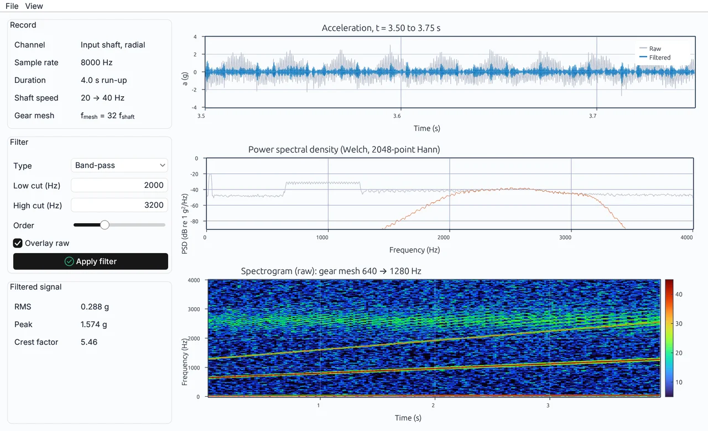

# Gearbox vibration workbench

[](https://runmat.com/sandbox?example=apps-vibration-workbench)

This app filters a 4-second accelerometer record from a gearbox run-up and shows the result as a
waveform, a Welch power spectral density and a spectrogram. The shaft speeds up from 20 to 40 Hz,
so the 32-tooth gear-mesh tone sweeps from 640 to 1280 Hz; the default 2.0 to 3.2 kHz band-pass
isolates a bearing resonance at 2.6 kHz.

<picture>
  <source media="(prefers-color-scheme: dark)" srcset=".artifacts/thumbnail.webp">
  
</picture>

## The problem

Vibration analysts look at the same record three ways: the waveform shows impacts, the spectrum
shows which frequencies carry the energy, and the spectrogram shows how they move with speed.
A band-pass filter around a structural resonance pulls out the impacts of a damaged bearing,
whose crest factor (peak over RMS) rises well above the 1.4 of a pure tone.

## How the example works

1. **Synthesize the record**: a 1× shaft tone, the gear-mesh tone with shaft-rate sidebands and
   its second harmonic, impacts at 3.1× shaft speed ringing a 2.6 kHz resonance, and noise.
2. **Build the window**: `uimenu` adds File and View menus; a `uigridlayout` splits a control
   column from three stacked `uiaxes`.
3. **Read the filter controls in one function.** The Apply button calls `analyze`, which reads
   the pop-up menu, the two numeric edit fields and the order slider:

   ```matlab
   apply = uibutton(flt, 'Text', 'Apply filter', 'Icon', 'success', 'Position', [8 4 280 30]);
   apply.ButtonPushedFcn = @(src, event) analyze(ui, t, x, fs);
   ```

4. **Filter and plot**: `butter` and `filtfilt` give a zero-phase filter, `pwelch` the spectrum,
   and a short-time FFT loop the spectrogram, drawn with `imagesc(ax, ...)`.

## Results

With the default fourth-order 2.0 to 3.2 kHz band-pass, the filtered signal has an RMS of
0.288 g, a peak of 1.574 g and a crest factor of 5.46. The spectrogram shows the mesh tone and
its harmonic as two rising lines and the bearing resonance as a band near 2.6 kHz.

## What to try

1. Switch the filter to Low-pass at 1500 Hz to keep the mesh tone and drop the bearing band.
2. Raise the order to 8 and compare the filter's roll-off in the spectrum.
3. Remove the bearing term from `x` and watch the crest factor fall.

## Files

- `vibration-workbench.m`: the app: the synthetic record, the window and the analysis function.
- `runmat.toml`: the project file.

## Related

- [Building apps with RunMat](https://github.com/runmat-org/runmat/blob/main/docs/plotting/apps.md)
- [Plotting in RunMat](https://runmat.com/math/plotting)
- [Download RunMat](https://runmat.com/download)
