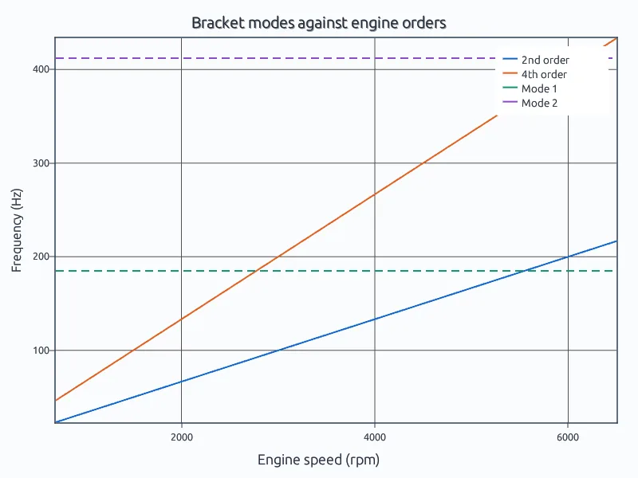

# Engine order crossings of a bracket's modes: a Campbell diagram

[](https://runmat.com/sandbox?example=automotive-transportation-bracket-orders)

This example plots an accessory bracket's first two natural frequencies, 185 Hz and 412 Hz, against
the second and fourth engine orders of a four-cylinder engine from idle at 700 rpm to redline at
6500 rpm. Every crossing is an engine speed where an order excites a mode. The second order crosses
the first mode at 5550 rpm; the fourth order crosses it at 2775 rpm and the second mode at 6180 rpm.

<picture>
  <source media="(prefers-color-scheme: dark)" srcset=".artifacts/thumbnail.webp">
  
</picture>

## The problem

Brackets that carry alternators, compressors and pumps are mounted to the engine, so they are
shaken at multiples of crankshaft speed. A four-stroke four-cylinder engine fires twice per
revolution, which makes the second order its strongest excitation, followed by the fourth. An
order k at engine speed n (rpm) has frequency

$$f = \frac{k \, n}{60}$$

When that line crosses a bracket mode inside the operating range, the bracket resonates at that
speed. Setting the order lines and the modes on one chart, a Campbell diagram, shows every
crossing at once, and the crossing speed for mode f_n is n = 60 f_n / k.

## How the example works

1. **Enter the modes and the speed range.** The modes would come from a modal test or an FEA
   study:

   ```matlab
   f1 = 185;  f2 = 412;
   rpm = linspace(700, 6500, 200);
   ```

2. **Compute the crossings** directly from n = 60 f_n / k:

   ```matlab
   fprintf('2nd order crosses the first mode at %.0f rpm\n', 60*f1/2);
   ```

3. **Draw the order lines and the modes**: `plot(rpm, 2*rpm/60)` and `plot(rpm, 4*rpm/60)`, with each
   mode as a dashed horizontal line.

## Results

```
2nd order crosses the first mode at 5550 rpm
4th order crosses it at 2775 rpm and the second mode at 6180 rpm
```

All three crossings fall inside the 700–6500 rpm range. The 2775 rpm crossing sits in the speed
band where an engine spends much of its time, and the 5550 rpm crossing comes from the strongest
order. The second order crosses the 412 Hz mode at 12360 rpm, above redline, so it never excites
that mode in service.

## What to try

1. Stiffen the bracket until the first mode clears the second order at redline: that needs
   `f1` above 2 × 6500 / 60 = 216.7 Hz.
2. Model a six-cylinder engine, whose firing order is the third. Plot `3*rpm/60`; it crosses the
   185 Hz mode at 3700 rpm and the 412 Hz mode at 8240 rpm, above redline.
3. Add a third mode from your own modal data and read off its crossings.

## Files

- `bracket-orders.m`: the script: modes, crossing speeds and the Campbell diagram.
- `runmat.toml`: the project file.

## Related

- [Automotive and transportation in RunMat](https://runmat.com/industries/automotive-transportation)
- [Order tracking of an engine run-up](../order-tracking) and [Campbell diagram of a wind turbine tower](../../energy/tower-campbell)
- [Tuning fork modal study](../../fea/tuning-fork-modal): natural frequencies from an FEA study
- Function reference: [`linspace`](https://runmat.com/docs/reference/builtins/linspace), [`plot`](https://runmat.com/docs/reference/builtins/plot)
- [Download RunMat](https://runmat.com/download)
