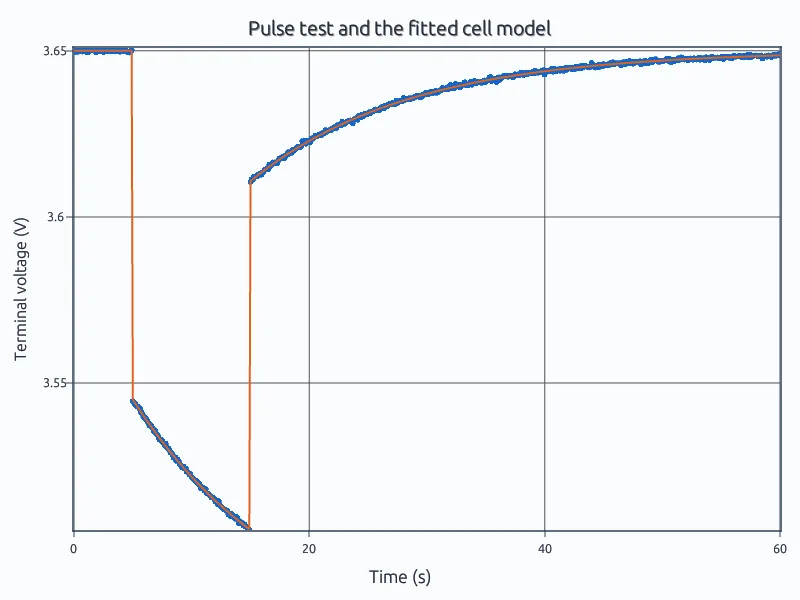

# Fitting a battery cell equivalent circuit to a pulse test with lsqcurvefit

[](https://runmat.com/sandbox?example=automotive-transportation-cell-model)

This example fits a one-RC equivalent circuit to the terminal voltage of a lithium-ion cell
through a 10-second, 50 A discharge pulse and the 45 seconds of relaxation after it. The fit
recovers the series resistance R0 = 2.10 mΩ, the polarization resistance R1 = 1.50 mΩ and a
13.5 s time constant from voltage data sampled at 10 Hz.

<picture>
  <source media="(prefers-color-scheme: dark)" srcset=".artifacts/thumbnail.webp">
  
</picture>

## The problem

Battery management systems and pack simulations model each cell as an open-circuit voltage source
in series with resistors and RC pairs. The parameters come from a pulse test: a current step
applied to a rested cell, with the voltage recorded through the pulse and its relaxation. The
instant voltage step at the pulse edges gives R0; the slow sag during the pulse and the slow
recovery after it give R1 and the time constant τ = R1·C1.

For a pulse of current I starting at t_on, the one-RC model is

$$V(t) = V_{oc} - I R_0 - I R_1 \left(1 - e^{-(t - t_{on})/\tau}\right)$$

during the pulse, with the RC voltage decaying as e^{-t/τ} once the current stops.

## How the example works

1. **Load the measurement.** `pulse_test`, a local function at the end of the file, produces 60
   seconds of voltage at 10 Hz with 0.3 mV of noise, for a 50 A pulse from 5 to 15 seconds. Swap
   it for your own data.

2. **Write the model** as a function of the parameter vector p = [R0 (mΩ), R1 (mΩ), τ (s)]:

   ```matlab
   model = @(p, t) ocv - p(1)/1000*50*on(t) - p(2)/1000*50*rise(t, p(3));
   ```

   `rise` is the RC voltage shape: an exponential charge during the pulse and an exponential decay
   from where it ended.

3. **Fit it** by nonlinear least squares from a starting guess of 1 mΩ, 1 mΩ and 5 s:

   ```matlab
   p = lsqcurvefit(model, [1 1 5], t, V);
   ```

4. **Plot** the measured points with the fitted model over them.

## Results

```
R0 2.10 mOhm, R1 1.50 mOhm
time constant 13.5 s
```

The fit returns the values the test cell was built with. During the pulse the voltage drops
105 mV at once through R0 (50 A × 2.10 mΩ), then sags another 39 mV through the RC branch by the end
of the pulse, since 10 seconds is less than one time constant. After the pulse the voltage jumps
back by the R0 drop and recovers toward 3.65 V over the next minute.

## What to try

1. Shorten the relaxation by cutting `t` to 30 seconds in `pulse_test` and compare the fitted time
   constant.
2. Start the fit from `[5 5 50]` and check that it reaches the same parameters.
3. Add a second RC pair to `model` with two more parameters and fit a cell with a fast and a slow
   time constant.

## Files

- `cell-model.m`: the script: the model, the fit, the plot, and the `pulse_test` data function.
- `runmat.toml`: the project file.

## Related

- [Automotive and transportation in RunMat](https://runmat.com/industries/automotive-transportation)
- [Battery module temperature](../module-temperature) and [EV energy on the EPA urban cycle](../drive-cycle)
- Function reference: [`lsqcurvefit`](https://runmat.com/docs/reference/builtins/lsqcurvefit), [`exp`](https://runmat.com/docs/reference/builtins/exp), [`plot`](https://runmat.com/docs/reference/builtins/plot)
- [Download RunMat](https://runmat.com/download)
