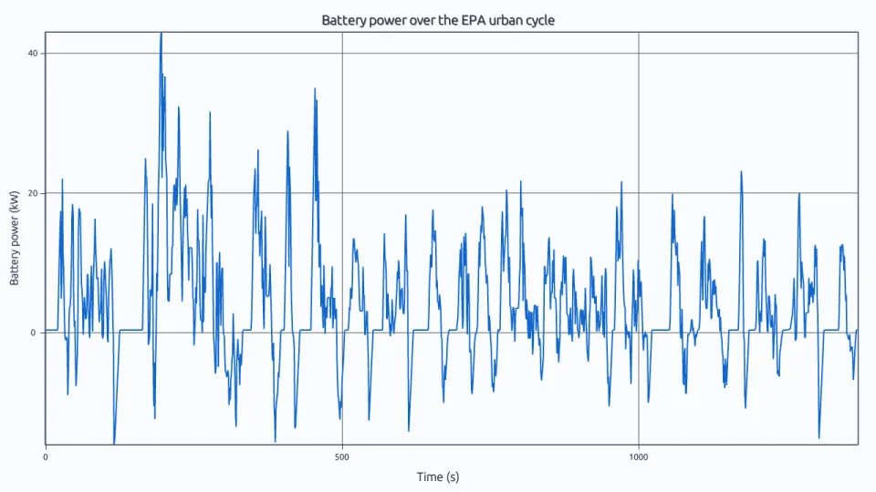

# EV energy consumption and range on the EPA urban drive cycle (UDDS)

[](https://runmat.com/sandbox?example=automotive-transportation-drive-cycle)

This example drives an 1800 kg electric vehicle through the EPA Urban Dynamometer Driving Schedule
(UDDS), second by second, and computes the battery power from road load, drivetrain losses,
regenerative braking and accessories. Over the 12.0 km, 1369-second cycle the battery supplies
125 Wh/km, which gives about 601 km of range from a 75 kWh pack.

<picture>
  <source media="(prefers-color-scheme: dark)" srcset=".artifacts/thumbnail.webp">
  
</picture>

## The problem

Range estimates start from a standard drive cycle: a speed trace that a test vehicle follows on a
dynamometer. The UDDS is the stop-and-go city cycle used in US certification. From the speed trace,
the power at the wheels is the sum of inertia, rolling resistance and aerodynamic drag, times speed:

$$P_{wheel} = \left(m a + m g C_{rr} + \tfrac{1}{2} \rho C_d A \, v^2\right) v$$

Positive wheel power is drawn from the battery through the drivetrain efficiency. Negative wheel
power is braking; part of it returns to the battery through regeneration.

## How the example works

1. **Read the cycle** from `cycles/udds.txt`, in seconds and mph, and convert to m/s:

   ```matlab
   d = readmatrix('cycles/udds.txt', 'NumHeaderLines', 2);
   t = d(:, 1);  v = d(:, 2) * 0.44704;
   ```

2. **Set the vehicle**: mass 1800 kg, rolling resistance 0.009, drag area 0.62 m², drivetrain
   efficiency 0.85, 60 % of braking energy recovered, 400 W of accessories.

3. **Compute wheel power and battery power** at each second:

   ```matlab
   P = (m*a + m*g*Crr*(v > 0) + 0.5*rho*CdA*v.^2) .* v;
   Pb = P/eta .* (P > 0) + P*eta*regen .* (P < 0) + aux;
   ```

4. **Integrate distance and energy** with `trapz`, then divide for Wh/km and range.

## Results

```
12.0 km in 1369 s at 125 Wh/km from the battery
about 601 km from a 75 kWh pack on this cycle
```

The plot shows battery power swinging with each acceleration, up to about 40 kW, and dipping below
zero during regenerative braking. The accessories alone draw 400 W × 1369 s = 152 Wh over the
cycle, about 13 Wh/km at urban speeds. Range here is the pack energy divided by cycle consumption;
certification range adds test procedures and adjustment factors on top of this.

## What to try

1. Set `aux = 0` to see the cycle without accessories; consumption drops by about 13 Wh/km.
2. Set `regen = 0` and compare: the difference is the energy the brakes would otherwise dissipate.
3. Add a highway cycle to `cycles/` in the same two-column format and point `readmatrix` at it.
   Aerodynamic drag grows with v², so look at how the balance between drag and inertia shifts.

## Files

- `drive-cycle.m`: the script: road load, battery power, energy per kilometer and range.
- `cycles/udds.txt`: the UDDS speed trace, one row per second (time in s, speed in mph).
- `runmat.toml`: the project file.

## Related

- [Automotive and transportation in RunMat](https://runmat.com/industries/automotive-transportation)
- [Cell model from a pulse test](../cell-model) and [quarter-car ride model](../quarter-car)
- Function reference: [`readmatrix`](https://runmat.com/docs/reference/builtins/readmatrix), [`trapz`](https://runmat.com/docs/reference/builtins/trapz), [`vertcat`](https://runmat.com/docs/reference/builtins/vertcat)
- [Download RunMat](https://runmat.com/download)
