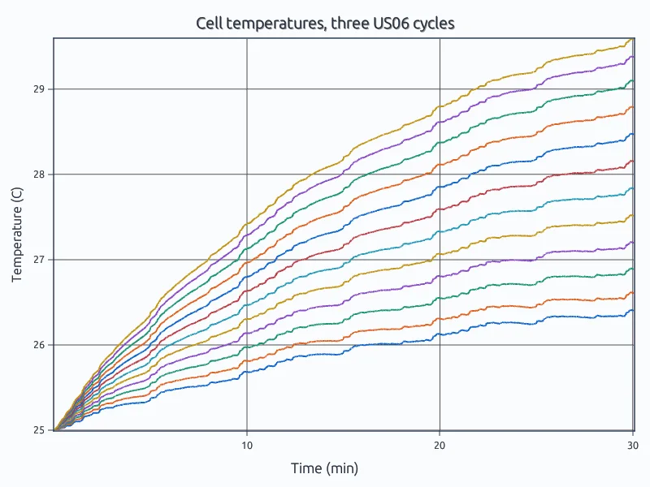

# Battery module cell temperatures on the US06 cycle: a lumped thermal model

[](https://runmat.com/sandbox?example=automotive-transportation-module-temperature)

This example steps the temperatures of the 12 cells in a battery module through three
back-to-back EPA US06 drive cycles, 30 minutes of aggressive driving. Each cell heats by I²R,
sheds heat to a cold plate whose coolant warms along its length, and exchanges heat with its
neighbors. After the three cycles the hottest cell is at 29.6 °C and the coolest at 26.4 °C, a
3.2 K spread across the module.

<picture>
  <source media="(prefers-color-scheme: dark)" srcset=".artifacts/thumbnail.webp">
  
</picture>

## The problem

Cells in a module age at different rates when they run at different temperatures, so pack
engineers size the cooling to hold the cell-to-cell spread within a few kelvin. The coolant picks
up heat as it flows along the cold plate, so cells at the outlet end sit on warmer coolant than
cells at the inlet. A lumped model with one temperature per cell shows how large that spread gets
on a hard drive cycle. For cell i, with one-second steps:

$$C_{th} \frac{dT_i}{dt} = I^2 R - h_c (T_i - T_{c,i}) + h_n (T_{i+1} - 2T_i + T_{i-1})$$

where C_th = 900 J/K is the cell heat capacity, R = 2.1 mΩ its resistance, h_c = 0.8 W/K the
conductance to the plate and h_n = 1.0 W/K the conductance to each neighbor.

## How the example works

1. **Load the cycle and repeat it three times.** `cycles/us06.txt` is the US06 speed trace at 1 Hz:

   ```matlab
   d = readmatrix('cycles/us06.txt', 'NumHeaderLines', 2);
   v = repmat(d(:, 2) * 0.44704, 3, 1);
   ```

2. **Turn speed into cell current.** Road-load power for an 1800 kg vehicle plus 400 W of
   accessories, drawn from a 350 V pack with three parallel strings:

   ```matlab
   P = 1800*vertcat(diff(v), 0).*v + 1800*9.81*0.009*v + 0.31*1.2*v.^3 + 400;
   I = P / 350 / 3;
   ```

3. **Set the coolant profile.** The coolant warms 0.4 K per cell, from 25 °C at the inlet to
   29.4 °C under the last cell: `Tc = 25 + 0.4*(0:cells - 1)'`.

4. **Step all 12 cells together** each second, with the neighbor term as a discrete Laplacian:

   ```matlab
   T = T + (I(k)^2*R - hc*(T - Tc) + hn*lap) / Cth;
   ```

5. **Plot** every cell's temperature history.

## Results

```
hottest cell 29.6 C after three US06 cycles, coolest 26.4 C
spread across the module 3.2 K
```

All 12 cells start at 25 °C and fan out as they heat, ordered by their position along the plate.
The coolant itself warms 4.4 K from inlet to outlet, but heat shared between neighbors pulls the
cells closer together, so the cell spread is 3.2 K. The curves are still rising at 30 minutes, so
a longer drive would end warmer.

## What to try

1. Halve the coolant temperature rise to `0.2` per cell, as a higher coolant flow would give, and
   compare the spread.
2. Set `hn = 0` to remove conduction between cells. The spread then follows the coolant profile
   more closely.
3. Raise `hc` to `1.6` to model a better thermal interface, and look at how far the hottest cell
   drops.

## Files

- `module-temperature.m`: the script: drive cycle, cell current, the thermal model and the plot.
- `cycles/us06.txt`: the US06 speed trace, one row per second (time in s, speed in mph).
- `runmat.toml`: the project file.

## Related

- [Automotive and transportation in RunMat](https://runmat.com/industries/automotive-transportation)
- [Battery module temperatures in 3D](../module): the same model drawn as the module on its plate
- [Battery cold plate](../../fea/battery-cold-plate): the cold plate as an FEA study
- Function reference: [`readmatrix`](https://runmat.com/docs/reference/builtins/readmatrix), [`repmat`](https://runmat.com/docs/reference/builtins/repmat), [`plot`](https://runmat.com/docs/reference/builtins/plot)
- [Download RunMat](https://runmat.com/download)
