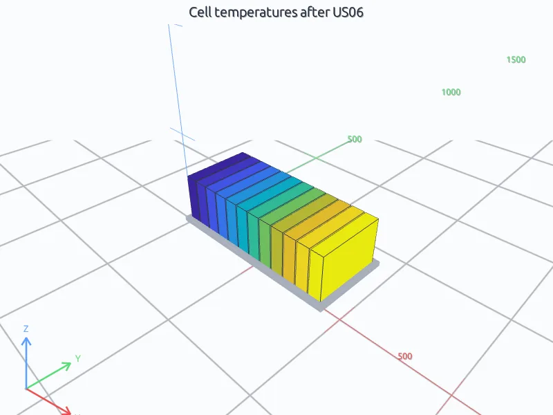

# Battery module cell temperatures drawn in 3D on the cold plate

[](https://runmat.com/sandbox?example=automotive-transportation-module)

This example draws a 12-cell prismatic battery module to scale on its aluminum cold plate and
colors each cell by its temperature after three back-to-back EPA US06 drive cycles. The cells run
from 26.4 °C at the coolant inlet to 29.6 °C at the outlet end, a 3.2 K spread. The temperatures
come from the same lumped thermal model as the [module temperatures](../module-temperature)
example.

<picture>
  <source media="(prefers-color-scheme: dark)" srcset=".artifacts/thumbnail.webp">
  
</picture>

## The problem

A temperature spread is easier to act on when it is shown on the hardware: which end of the module
runs hot, and how the gradient lines up with the coolant flow. This example puts the result of a
cell-level thermal model onto a scale drawing of the module, one colored box per cell.

The thermal model gives each cell one temperature. Each cell heats by I²R, sheds heat to the cold
plate through h_c = 0.8 W/K, and exchanges heat with its neighbors through h_n = 1.0 W/K. The
coolant warms 0.4 K per cell along the plate. The current comes from the road load of an 1800 kg
vehicle on three US06 cycles, drawn from a 350 V pack with three parallel strings.

## How the example works

1. **Run the thermal model** over three US06 cycles at one-second steps:

   ```matlab
   T = T + (I(k)^2*R - hc*(T - Tc) + hn*lap) / Cth;
   ```

2. **Size the geometry.** Prismatic cells 27 × 148 × 98 mm with 3 mm gaps, on a 10 mm plate that
   overhangs the cells by 10 mm on each side.

3. **Map each temperature to a color** in the `parula` colormap, scaled from the coolest to the
   hottest cell:

   ```matlab
   shade = cmap(1 + round(63*(T(c) - lo)/(hi - lo)), :);
   ```

4. **Draw each cell and the plate as a box** with `patch`, from eight vertices and six faces:

   ```matlab
   patch('Vertices', box((c-1)*(w + gap), 0, 10, w, depth, h), 'Faces', faces, 'FaceColor', shade);
   ```

## Results

```
cells run from 26.4 C at the coolant inlet to 29.6 C at the outlet end
spread across the module 3.2 K
```

The drawing shows the gradient running along the plate: the cells at the inlet end are coolest and
each cell toward the outlet is warmer than the last. The color scale spans only the 3.2 K spread,
so small differences between neighbors stay visible.

## What to try

1. Rotate the 3D view to look along the plate and compare the cell faces at each end.
2. Change the coolant rise from `0.4` to `0.2` per cell and see how the colors even out; the color
   scale rescales to the new spread.
3. Change the cell size to your own module's dimensions in `w`, `depth` and `h`.

## Files

- `module.m`: the script: the thermal model and the 3D drawing of the module.
- `cycles/us06.txt`: the US06 speed trace, one row per second (time in s, speed in mph).
- `runmat.toml`: the project file.

## Related

- [Automotive and transportation in RunMat](https://runmat.com/industries/automotive-transportation)
- [Module temperatures on US06](../module-temperature): the temperature history of every cell
- [Battery module cells](../../fea/battery-module-cells): a module as an FEA study
- Function reference: [`patch`](https://runmat.com/docs/reference/builtins/patch), [`parula`](https://runmat.com/docs/reference/builtins/parula), [`readmatrix`](https://runmat.com/docs/reference/builtins/readmatrix)
- [Download RunMat](https://runmat.com/download)
