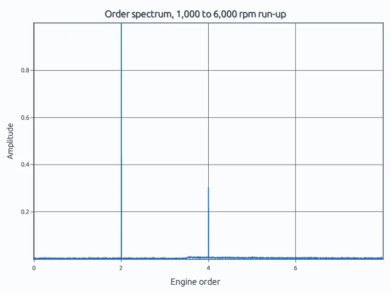

# Order tracking of an engine run-up by angle resampling

[](https://runmat.com/sandbox?example=automotive-transportation-order-tracking)

This example takes a 10-second vibration signal from a four-cylinder engine running up from 1000
to 6000 rpm and resamples it from time to shaft angle. In the angle domain the engine orders
become fixed lines in the spectrum. The 583 revolutions, at 64 samples each, give an order
spectrum whose largest peak is order 2.00, the firing order of a four-cylinder engine.

<picture>
  <source media="(prefers-color-scheme: dark)" srcset=".artifacts/thumbnail.webp">
  
</picture>

## The problem

During a run-up, every engine-driven component of the vibration changes frequency as the speed
changes. A plain FFT of the whole record spreads each one across a band of frequencies. Order
tracking fixes this by sampling the signal at equal increments of shaft angle instead of equal
time steps. Vibration that repeats k times per revolution then has a fixed frequency in cycles per
revolution: order k. Order spectra are the standard way to find which engine order drives a noise
or vibration problem.

The shaft angle is the time integral of speed:

$$\theta(t) = 2\pi \int_0^t \frac{n(\tau)}{60} \, d\tau$$

## How the example works

1. **Build the signal.** Speed ramps at 500 rpm/s, sampled at 10 kHz. The signal has a second
   order, a weaker fourth order, a 350 Hz tone at fixed frequency and noise:

   ```matlab
   rpm = 1000 + 500*t;  phase = 2*pi*cumtrapz(t, rpm/60);
   x = sin(2*phase) + 0.3*sin(4*phase) + 0.2*sin(2*pi*350*t) + 0.2*randn(size(t));
   ```

2. **Resample to angle.** 64 points per revolution over every full revolution:

   ```matlab
   theta = (0:revs*ppr - 1)' * 2*pi/ppr;
   xa = interp1(phase, x, theta);
   ```

3. **Take the FFT of the angle-domain signal.** Bin i is order i/revs:

   ```matlab
   X = 2*abs(fft(xa)) / numel(xa);  order = (0:numel(xa) - 1)' / revs;
   ```

4. **Find the largest peak** between orders 1.5 and 2.5, and plot orders 0 to 8.

## Results

```
583 revolutions resampled at 64 points each
largest order 2.00, the firing order of a 4-cylinder
```

The spectrum shows two sharp lines, at order 2 with amplitude near 1 and at order 4 with
amplitude near 0.3, matching the signal. The 350 Hz tone, which does not follow engine speed,
smears into a low band: at 1000 rpm it is order 21 and at 6000 rpm order 3.5, so in the plotted
range it appears only as a faint floor from order 3.5 upward. That is how a fixed-frequency
resonance looks in an order spectrum.

## What to try

1. Replace `xa` with `x` and take the FFT in time. The second order then spreads from 33 Hz to
   200 Hz instead of forming one line.
2. Add a half order, `0.2*sin(0.5*phase)`, as a misfire on one cylinder would produce, and find it
   in the spectrum.
3. Lower `ppr` to 16. The highest order the spectrum can show is half the samples per revolution,
   which is order 8.

## Files

- `order-tracking.m`: the script: run-up signal, angle resampling, order spectrum and the plot.
- `runmat.toml`: the project file.

## Related

- [Automotive and transportation in RunMat](https://runmat.com/industries/automotive-transportation)
- [Bracket modes against engine orders](../bracket-orders) and [bearing fault detection with the envelope spectrum](../../industrial-machinery/bearing-envelope)
- Function reference: [`interp1`](https://runmat.com/docs/reference/builtins/interp1), [`fft`](https://runmat.com/docs/reference/builtins/fft), [`cumtrapz`](https://runmat.com/docs/reference/builtins/cumtrapz)
- [Download RunMat](https://runmat.com/download)
