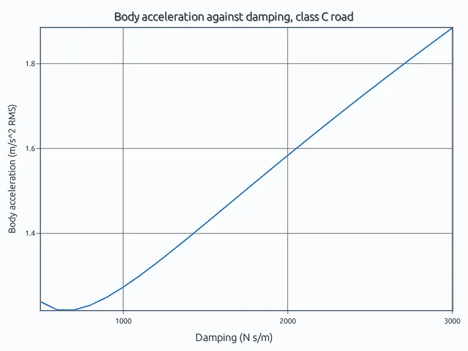

# Quarter-car ride comfort on an ISO 8608 road: body acceleration against damping

[](https://runmat.com/sandbox?example=automotive-transportation-quarter-car)

This example computes the RMS vertical acceleration of a car body driving at 72 km/h over an
ISO 8608 class C road, for suspension damping from 500 to 3000 N·s/m. It combines the road's
elevation spectrum with the frequency response of a two-mass quarter-car model. Body acceleration
is lowest, at 1.22 m/s² RMS, with 700 N·s/m of damping, and rises to 1.88 m/s² at 3000 N·s/m.

<picture>
  <source media="(prefers-color-scheme: dark)" srcset=".artifacts/thumbnail.webp">
  
</picture>

## The problem

Suspension tuning trades ride comfort against road holding. Body acceleration is the usual
comfort measure. The quarter-car model represents one corner of the vehicle: a sprung mass m_s
(the body) on a spring k_s and damper c, over an unsprung mass m_u (wheel and axle) on the tire
stiffness k_t. Here m_s = 290 kg, m_u = 15 kg, k_s = 16.2 kN/m and k_t = 191 kN/m, which put
the body mode at 1.19 Hz and the wheel-hop mode near 18.7 Hz.

ISO 8608 classifies road roughness by the displacement PSD at the reference spatial frequency
n₀ = 0.1 cycles/m; class C is 256 × 10⁻⁶ m³. With the PSD falling as n⁻², at speed V the
road input in time-frequency is

$$G_z(f) = \frac{G_d(n_0)}{V} \left(\frac{f}{V n_0}\right)^{-2}$$

and the body acceleration is

$$a_{RMS} = \sqrt{\int |H(f)|^2 \, G_z(f) \, df}$$

## How the example works

1. **Build the road spectrum** at 20 m/s over 0.1–50 Hz:

   ```matlab
   Gz = Gd0 * (f/V/n0).^(-2) / V;
   ```

2. **Form the transfer function** from road displacement to body acceleration for damping c:

   ```matlab
   den = (ms*s.^2 + c*s + ks).*(mu*s.^2 + c*s + ks + kt) - (c*s + ks).^2;
   H = s.^2 .* kt.*(c*s + ks) ./ den;
   ```

3. **Integrate the response PSD** for 26 damping values from 500 to 3000 N·s/m:

   ```matlab
   rms(j) = sqrt(trapz(f, abs(H).^2 .* Gz));
   ```

4. **Find the minimum** and plot RMS against damping.

## Results

```
lowest body acceleration 1.22 m/s^2 RMS at 700 N s/m
1.88 m/s^2 at 3,000 N s/m
```

The curve has a shallow minimum at 700 N·s/m, a body damping ratio of 0.16. Below it, the body
resonance at 1.19 Hz is too lightly damped. Above it, the damper transmits more road input to the
body: by 3000 N·s/m (damping ratio 0.69) acceleration is 54 % higher. Passenger cars often run
more damping than the comfort optimum, because wheel load variation and body control also count.

## What to try

1. Drive faster with `V = 30`. The road input at a given frequency scales with V, so
   acceleration rises at every damping; check whether the optimum moves.
2. Change to a class D road with `Gd0 = 1024e-6`. The input PSD is four times larger, so every RMS
   value doubles and the optimum stays at 700 N·s/m.
3. Soften the spring to `ks = 12000` and compare the lowest body acceleration.

## Files

- `quarter-car.m`: the script: road spectrum, quarter-car transfer function, RMS against damping and the plot.
- `runmat.toml`: the project file.

## Related

- [Automotive and transportation in RunMat](https://runmat.com/industries/automotive-transportation)
- [EV energy on the EPA urban cycle](../drive-cycle) and [random vibration of one mode](../../aerospace/random-vibration)
- Function reference: [`trapz`](https://runmat.com/docs/reference/builtins/trapz), [`linspace`](https://runmat.com/docs/reference/builtins/linspace), [`min`](https://runmat.com/docs/reference/builtins/min)
- [Download RunMat](https://runmat.com/download)
