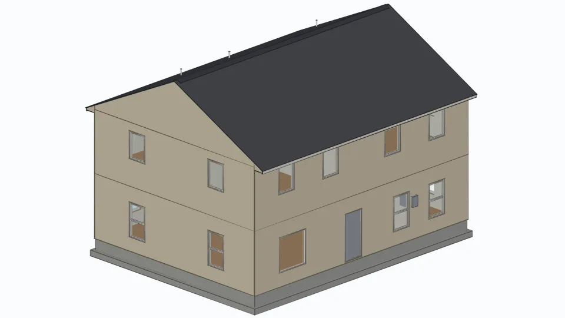

# Two-story wood-frame house model: foundation, framing, envelope, MEP and a wall heat-loss study

[](https://runmat.com/sandbox?example=construction-house)

A two-story, wood-framed, stucco-clad single-family house on a 40 × 30 ft footprint with a 6:12
gable roof, about 2,400 sq ft over two floors, modeled as parts and assemblies in feet and inches.
It holds the foundation, the structural framing, the envelope, the interior, the electrical,
plumbing and HVAC systems, four drawing sheets and a heat-conduction study of the exterior wall.
The study gives the wall a U-factor of 0.284 W/m²·K, with the stud as a thermal bridge.

<picture>
  <source media="(prefers-color-scheme: dark)" srcset=".artifacts/thumbnail.webp">
  
</picture>

## The problem

A house design has to carry its loads to the soil, keep weather and heat out, and fit its pipes,
ducts and cables through the framing without cutting it where it matters. This one follows US
residential practice: IRC-style light-frame construction, with loads from ASCE 7-16 and wood design
values from the NDS (2018) and SDPWS (2021).

The assumed site is a suburban lot, Exposure C, with 30 psf ground snow, seismic design category C
and clay-silt soil. Design loads include 40 psf floor live, 25 psf roof snow, 115 mph wind and an
equivalent lateral seismic force of 6.2 kips at strength level. Wind governs the lateral design: the
ASD wind base shear is 9.7 kips across the building and 7.7 kips along it, against 4.3 kips for
seismic. [DESIGN-NOTES.md](DESIGN-NOTES.md) sizes the footings, framing, headers and shear walls
from these loads, and gives the envelope layers, the floor plan and the MEP sizing.

## How the example works

1. **A skeleton sets the layout.** `house_skeleton.part` holds grid lines A–D and 1–5, the levels
   from the top of the footing to the ridge, the two roof planes, and a frame for every assembly and
   every window and door opening. `house.assembly` places the foundation, framing, envelope,
   interior and MEP on it.

2. **Structure.** `foundation/` holds the perimeter and pad footings with their reinforcement, the
   8 in stem wall and the slab on grade. `framing/` holds 2x6 exterior walls at 16 in o.c. with OSB
   shear-wall sheathing, the I-joist second floor on LVL beams, and roof trusses at 24 in o.c.
   `wall_framing.part` and `shear_wall.part` carry one configuration per wall line and level
   (`wall_a_l1` … `wall_5_l2`), each setting its openings' rough sizes and headers.

3. **Envelope and interior.** The wall layers run from three-coat stucco on metal lath through two
   layers of building paper, OSB, R-21 batts and a vapor retarder to gypsum. The roof has shingles,
   R-38 attic insulation and vented soffits. `interior/` holds the partitions, stair, cabinets and
   bath fixtures for five rooms downstairs and three bedrooms and two baths upstairs.

4. **MEP.** `mep/electrical/service.circuit` is the one-line from the meter to the 200 A panel,
   with the panel schedule as its breakers, and `branch_circuits.circuit` draws each branch
   circuit's wiring. The electrical, plumbing and HVAC assemblies route cables, pipes and ducts
   through bored holes in the joists, beams and plates. Each run is swept along its centerline.

5. **The wall study.** `simulation/wall_thermal.fea` solves steady conduction through half of one
   16 in stud bay, from the center of a stud to the center of the cavity, with 21 °C room air and
   -10 °C outdoor air on film coefficients:

   ```
   analysis heat { thermal steady {} }
   output heat_through_room_face = flux(analysis.heat.field.element.heat_flux, through = geometry.wall.region.inside_face)
   ```

## Results

The electrical load calculation (NEC 220.82, optional method) comes to 30,840 VA, 128.5 A at
240 V, on the 200 A service. The 3-ton heat pump's supply trunk carries 1,200 cfm at 1,540 ft/min.

The wall study, solved on 447,962 quadratic tetrahedra:

| Quantity | Hand estimate (parallel paths) | Solved |
| --- | --- | --- |
| U-factor | 0.281 W/m²·K | 0.284 W/m²·K |
| Heat flux at 31 K | 8.72 W/m² | 8.80 W/m² |
| Heat through the 203.2 × 5 mm slice | 0.00886 W | 0.008940 W |

The heat in at the room face and out at the weather face agree to 0.016 %. The room face runs from
19.22 °C over the stud to 20.09 °C mid-cavity. At the room surface the stud sits 1.78 K below the
air against 0.91 K mid-cavity, 1.95 ×. The 1-D paths predict 2.56 ×, and the difference is heat
spreading sideways from the cavity into the stud. That same sideways path puts the solved U-factor
0.9 % above the parallel-path estimate.

A hand estimate in the notes takes the walls, windows and doors together: 118.6 W/K, 3,679 W at
31 K. The opaque wall carries 60 % of that heat, and the windows a third from 11 % of the area.

## What to try

1. Open `house.assembly` and use Section to cut through a wall, the roof or the foundation.
2. Open `mep/electrical/branch_circuits.circuit` for the branch-circuit wiring diagrams.
3. In `simulation/wall_thermal.fea`, change a layer's conductivity, run `wall_heat_loss`, and read
   `heat_through_room_face` and the coldest room surface over the stud.
4. Change `simulation/wall_section.part`, for example to add continuous exterior insulation, then
   re-export `wall_thermal.assembly` to `simulation/geometry/wall_thermal.step` and run the study.

## Files

- `house.assembly`: the entry; places the foundation, framing, envelope, interior and MEP on the skeleton.
- `house_skeleton.part`: grid lines, levels, roof planes and the frames for assemblies and openings.
- `foundation/`: footings, stem wall and slab on grade with their reinforcement and insulation.
- `framing/`: wall framing, shear-wall sheathing, the floor system, posts and roof trusses.
- `+hardware/`: anchor bolts, hold-downs, joist hangers, truss ties and post bases.
- `envelope/`: exterior wall layers, gable walls, the roof, and windows W1–W5 and doors D1, D2.
- `interior/`: partitions, interior doors, the stair, floor finishes, kitchen and baths.
- `mep/`: the electrical service and branch circuits, plumbing supply and DWV, and HVAC assemblies.
- `drawings/`: floor plans, elevations, a building section and the exterior wall section detail.
- `simulation/`: the wall heat-loss study, its wall-section part and assembly, and the exported STEP.
- `DESIGN-NOTES.md`: loads, load path, member sizing, envelope, floor plan, MEP sizing and study results.
- `runmat.toml`: the project file.

## Related

- [RunMat MCAD](https://runmat.com/cad)
- [Build an assembly](https://runmat.com/docs/mcad/guides/build-an-assembly), [make a drawing](https://runmat.com/docs/mcad/guides/make-a-drawing) and the [steady heat transfer guide](https://runmat.com/docs/simulation/guides/steady-heat-transfer)
- [Thermal simulation in RunMat](https://runmat.com/simulation/thermal)
- [Narrow-body airliner](../../aerospace/airliner) and [thermal interface stack](../../fea/tim-stack)
- [Download RunMat](https://runmat.com/download)
