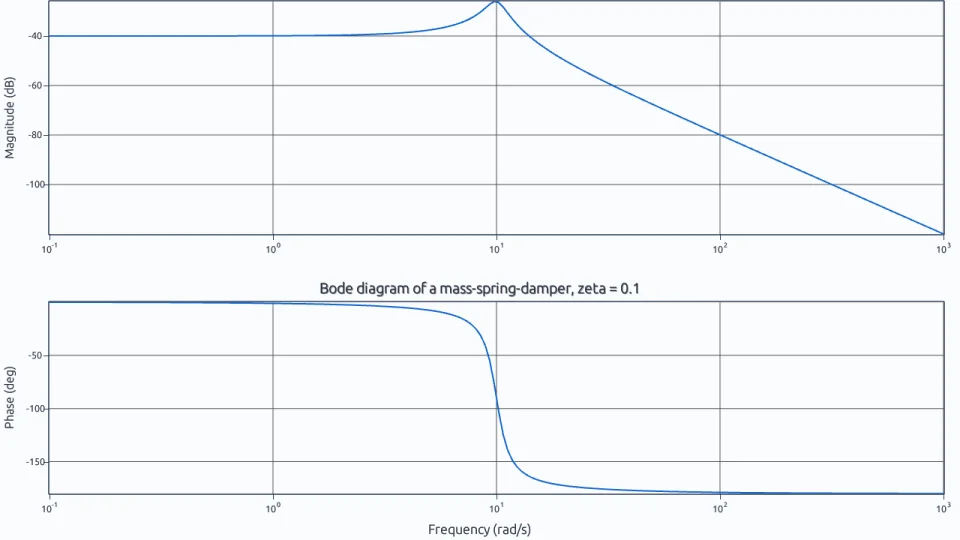

# Resonant peak of a mass-spring-damper from its Bode plot

[](https://runmat.com/sandbox?example=control-systems-bode-resonance)

This example builds the transfer function of a 1 kg mass on a 100 N/m spring with 2 N·s/m of
damping and reads its resonant peak from the Bode magnitude. The damping ratio is 0.10 and the
natural frequency 10.00 rad/s. The response peaks at 9.90 rad/s (1.58 Hz), where a harmonic force
deflects the mass 5.03 times as far as the same static force, 14.0 dB above the static gain.

<picture>
  <source media="(prefers-color-scheme: dark)" srcset=".artifacts/thumbnail.webp">
  
</picture>

## The problem

A lightly damped structure driven near its natural frequency moves far more than its static
stiffness suggests. Machine mounts, instrument brackets and servo loads are all checked for this
amplification before they are built. The mass-spring-damper is the one-degree-of-freedom model
behind those checks:

$$G(s) = \frac{X(s)}{F(s)} = \frac{1}{m s^2 + c s + k}, \qquad
\omega_n = \sqrt{k/m}, \qquad \zeta = \frac{c}{2\sqrt{km}}$$

For ζ below 1/√2 the magnitude has a peak at ω_r = ω_n√(1 − 2ζ²), and the peak height relative to
the static deflection 1/k is

$$M_r = \frac{1}{2\zeta\sqrt{1-\zeta^2}}$$

With ζ = 0.1 these formulas give ω_r = 9.90 rad/s and M_r = 5.03, the values the run finds
numerically.

## How the example works

1. **Build the transfer function** from mass, damping and stiffness:

   ```matlab
   m = 1; c = 2; k = 100;
   G = tf(1, [m c k]);
   ```

2. **Evaluate the magnitude on a fine grid** of 4000 log-spaced frequencies from 1 to 100 rad/s
   and take the maximum:

   ```matlab
   [mag, ~, w] = bode(G, logspace(0, 2, 4000));
   [peak, i] = max(squeeze(mag));
   ```

3. **Scale by the stiffness** to express the peak as a multiple of the static deflection:
   `peak*k`, and in decibels `20*log10(peak*k)`.

4. **Draw the Bode diagram** with `bode(G)`, magnitude above phase.

## Results

```
Natural frequency 10.00 rad/s, damping ratio 0.10
Peak at 9.90 rad/s (1.58 Hz): 5.03 times the static deflection (14.0 dB)
```

The magnitude plot sits flat at −40 dB (1/k = 0.01 m/N) at low frequency, rises to the peak just
below 10 rad/s and then falls at 40 dB per decade, where the mass dominates. The phase drops from
0° to −180°, passing −90° at the natural frequency. The narrower and taller the peak, the lower the
damping.

## What to try

1. Set `c = 1` for ζ = 0.05. The formula gives a peak of 10.01 times the static deflection
   (20.0 dB) at 9.97 rad/s.
2. Set `c = 15` for ζ = 0.75. Above ζ = 1/√2 the formula has no peak, so the magnitude falls
   from the static gain without rising first.
3. Double the mass to `m = 2` and watch the resonance move down to ω_n = 7.07 rad/s.

## Files

- `bode-resonance.m`: the script: transfer function, peak search and the Bode diagram.
- `runmat.toml`: the project file.

## Related

- [Control systems in RunMat](https://runmat.com/math/control-systems)
- [Damping ratio and overshoot](../damping-overshoot) and [low-pass Bode plot](../low-pass-bode)
- Function reference: [`tf`](https://runmat.com/docs/reference/builtins/tf), [`bode`](https://runmat.com/docs/reference/builtins/bode), [`logspace`](https://runmat.com/docs/reference/builtins/logspace)
- [Download RunMat](https://runmat.com/download)
