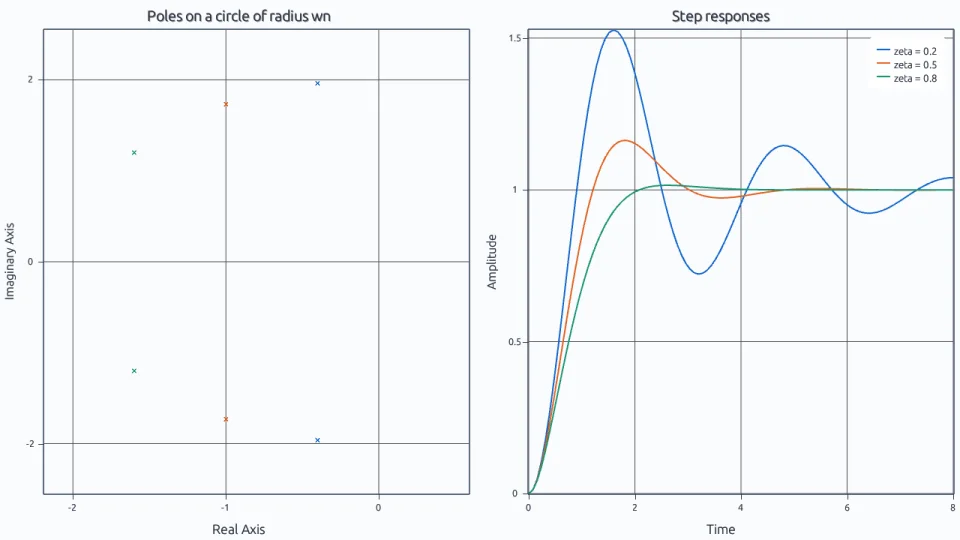

# Damping ratio and percent overshoot of a second-order system

[](https://runmat.com/sandbox?example=control-systems-damping-overshoot)

This example compares three second-order systems with the same natural frequency, 2 rad/s, and
damping ratios of 0.2, 0.5 and 0.8. It plots their poles and step responses and checks the measured
overshoot against the textbook formula. The overshoot falls from 53 % at ζ = 0.2 to 16 % at
ζ = 0.5 and 2 % at ζ = 0.8, matching the formula in each case.

<picture>
  <source media="(prefers-color-scheme: dark)" srcset=".artifacts/thumbnail.webp">
  
</picture>

## The problem

Many closed loops behave like a pair of dominant complex poles, so step-response specifications
are often written as a damping ratio: "less than 10 % overshoot" means ζ of at least about 0.6.
The standard second-order system is

$$G(s) = \frac{\omega_n^2}{s^2 + 2\zeta\omega_n s + \omega_n^2}$$

Its poles sit at s = −ζω_n ± jω_n√(1 − ζ²), on a circle of radius ω_n. The damping ratio sets the
angle of the poles from the negative real axis, cos θ = ζ, and the angle alone fixes the percent
overshoot:

$$M_p = 100\, e^{-\pi\zeta/\sqrt{1-\zeta^2}}\ \%$$

The real part −ζω_n sets how fast the oscillation decays.

## How the example works

1. **Build the three systems** from the Laplace variable:

   ```matlab
   s = tf('s');
   wn = 2;
   zeta = [0.2 0.5 0.8];
   G{i} = wn^2/(s^2 + 2*zeta(i)*wn*s + wn^2);
   ```

2. **Measure the step response** with `stepinfo` and print its overshoot beside the formula:

   ```matlab
   S = stepinfo(G{i});
   100*exp(-pi*zeta(i)/sqrt(1 - zeta(i)^2))
   ```

3. **Plot the poles** of all three systems with `pzmap(G{1}, G{2}, G{3})`.

4. **Plot the step responses** over 8 s with `step(G{1}, G{2}, G{3}, 8)`.

## Results

```
zeta = 0.2: poles -0.40 +/- 1.96i, overshoot 53% (formula 53%)
zeta = 0.5: poles -1.00 +/- 1.73i, overshoot 16% (formula 16%)
zeta = 0.8: poles -1.60 +/- 1.20i, overshoot 2% (formula 2%)
```

In the pole map all six poles lie on the circle of radius 2. As ζ rises they swing toward the
negative real axis: the imaginary part, which sets the oscillation frequency, shrinks, and the real
part, which sets the decay rate, grows. The step responses show the result. At ζ = 0.2 the output
rings for the full 8 s; at ζ = 0.8 it rises to 1 with a barely visible bump. The ζ = 0.5 response
overshoots once, dips slightly below 1 and settles.

## What to try

1. Add ζ = 0.6. The formula gives 9.5 % overshoot, a common target for "under 10 %".
2. Double `wn` to 4 rad/s. The overshoot values stay the same and the responses run twice as fast.
3. Add ζ = 1 to see the critically damped response, which reaches 1 without overshoot.

## Files

- `damping-overshoot.m`: the script: three systems, overshoot check, pole map and step responses.
- `runmat.toml`: the project file.

## Related

- [Control systems in RunMat](https://runmat.com/math/control-systems)
- [Bode plot of a resonance](../bode-resonance) and [PI controller design](../pi-controller)
- Function reference: [`stepinfo`](https://runmat.com/docs/reference/builtins/stepinfo), [`pzmap`](https://runmat.com/docs/reference/builtins/pzmap), [`step`](https://runmat.com/docs/reference/builtins/step)
- [Download RunMat](https://runmat.com/download)
