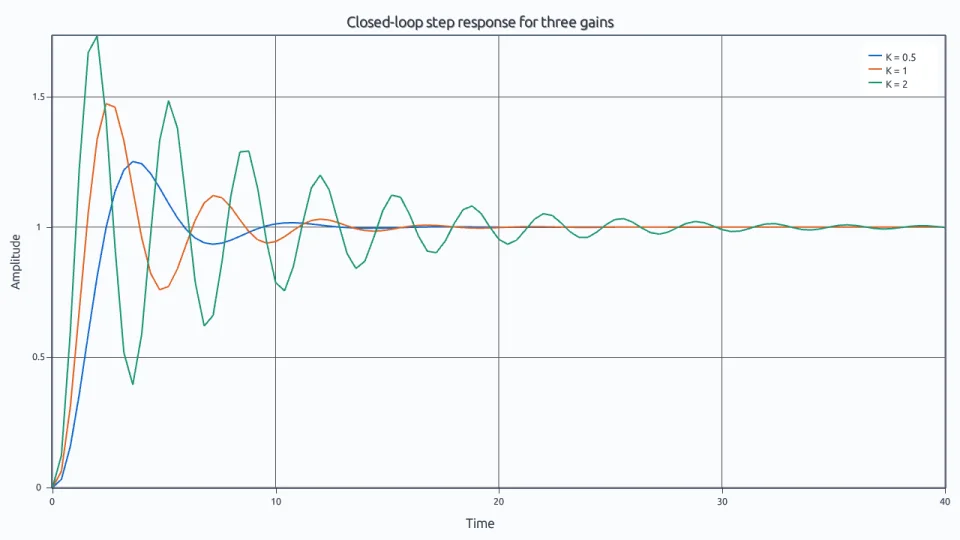

# Proportional gain sweep: closed-loop rise time and overshoot

[](https://runmat.com/sandbox?example=control-systems-gain-sweep)

This example closes a unity-feedback loop around the plant G(s) = 10/(s(s + 1)(s + 5)) with three
proportional gains, K = 0.5, 1 and 2, and measures each step response with `stepinfo`. Raising the
gain from 0.5 to 2 cuts the rise time from 1.53 s to 0.64 s, but the overshoot climbs from 25 % to
76 % and the settling time stretches from 8.9 s to 29.2 s.

<picture>
  <source media="(prefers-color-scheme: dark)" srcset=".artifacts/thumbnail.webp">
  
</picture>

## The problem

A proportional controller is the first design tried on most loops: the control effort is K times
the error. The plant here has an integrator (the pole at s = 0), so the closed loop tracks a step
with no steady-state error for any stable gain. The gain then trades speed against damping. With
unity feedback the closed-loop transfer function is

$$T(s) = \frac{K G(s)}{1 + K G(s)} = \frac{10K}{s^3 + 6s^2 + 5s + 10K}$$

By the Routh criterion this loop is stable for 0 < K < 3, the gain margin worked out in
[margins three ways](../margins-three-ways). The three gains in the sweep sit at one sixth, one
third and two thirds of that limit.

## How the example works

1. **Build the plant** from the Laplace variable:

   ```matlab
   s = tf('s');
   G = 10/(s*(s + 1)*(s + 5));
   ```

2. **Close the loop for each gain** and measure the step response:

   ```matlab
   for k = [0.5 1 2]
       S = stepinfo(feedback(k*G, 1));
   end
   ```

   `S.RiseTime` is the 10 % to 90 % rise time, `S.Overshoot` the peak above the final value in
   percent, and `S.SettlingTime` the time to stay within 2 % of the final value.

3. **Plot the three step responses** over 40 s on one axes with `step`.

## Results

```
K = 0.5: rise 1.53 s, overshoot 25%, settling 8.9 s
K = 1.0: rise 0.95 s, overshoot 49%, settling 12.7 s
K = 2.0: rise 0.64 s, overshoot 76%, settling 29.2 s
```

Each doubling of the gain cuts the rise time by about a third and raises the overshoot by roughly
25 percentage points. The settling time grows faster than the overshoot: at K = 2 the response is
still ringing visibly after 30 s, because the dominant closed-loop poles have moved close to the
imaginary axis. All three responses settle at 1, as the integrator in the plant guarantees. None of
these gains meets a typical specification of under 20 % overshoot; that needs a gain below 0.5 or
a compensator.

## What to try

1. Add `K = 0.3` to the sweep and look at the overshoot and settling time.
2. Set a gain of 3. The Routh limit says two closed-loop poles sit on the imaginary axis there, so
   the response oscillates without decaying.
3. Move the plant pole at −5 to −10 and rerun the sweep to see how a faster pole changes damping.

## Files

- `gain-sweep.m`: the script: plant, gain loop with stepinfo, and the step-response plot.
- `runmat.toml`: the project file.

## Related

- [Control systems in RunMat](https://runmat.com/math/control-systems)
- [Gain margin three ways](../margins-three-ways) and [damping ratio and overshoot](../damping-overshoot)
- Function reference: [`feedback`](https://runmat.com/docs/reference/builtins/feedback), [`stepinfo`](https://runmat.com/docs/reference/builtins/stepinfo), [`step`](https://runmat.com/docs/reference/builtins/step)
- [Download RunMat](https://runmat.com/download)
