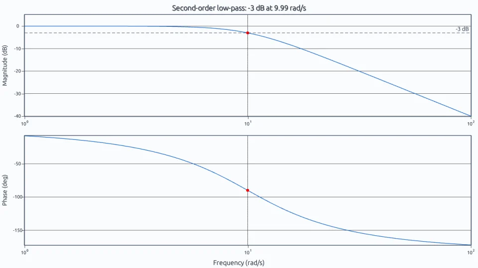

# Bode plot of a second-order low-pass filter with the −3 dB bandwidth marked

[](https://runmat.com/sandbox?example=control-systems-low-pass-bode)

This example draws the Bode magnitude and phase of a second-order low-pass filter with a natural
frequency of 10 rad/s and a damping ratio of 1/√2, then marks the −3 dB bandwidth on both plots.
`bandwidth` finds the −3 dB point at 9.99 rad/s, where the phase has fallen to about −90°.

<picture>
  <source media="(prefers-color-scheme: dark)" srcset=".artifacts/thumbnail.webp">
  
</picture>

## The problem

Sensor anti-aliasing filters, actuator command filters and the closed-loop response of many
servos are second-order low-pass systems:

$$G(s) = \frac{\omega_n^2}{s^2 + 2\zeta\omega_n s + \omega_n^2}$$

The bandwidth is the frequency where the gain has fallen 3 dB (to 1/√2) below its DC value. It sets
how fast a signal the filter passes and how much high-frequency noise it lets through. With
ζ = 1/√2, the Butterworth damping, the magnitude is maximally flat with no resonant peak, and the
−3 dB point falls exactly at ω_n. For other damping ratios the bandwidth moves away from ω_n:

$$\omega_b = \omega_n\sqrt{1 - 2\zeta^2 + \sqrt{4\zeta^4 - 4\zeta^2 + 2}}$$

## How the example works

1. **Build the filter**:

   ```matlab
   wn = 10;
   zeta = 1/sqrt(2);
   G = tf(wn^2, [1 2*zeta*wn wn^2]);
   ```

2. **Find the bandwidth** and evaluate magnitude and phase on 400 log-spaced frequencies:

   ```matlab
   wb = bandwidth(G);
   [mag, phase, w] = bode(G, logspace(0, 2, 400));
   mag = 20*log10(squeeze(mag));
   pb = interp1(w, phase, wb);
   ```

3. **Plot the magnitude** with `semilogx`, a dashed `yline` at −3 dB, a dotted `xline` at the
   bandwidth and a red marker where they cross.

4. **Plot the phase** below it, with the phase at the bandwidth marked the same way.

## Results

The magnitude panel's title reports the computed bandwidth:

```
Second-order low-pass: -3 dB at 9.99 rad/s
```

The formula gives exactly 10 rad/s for this damping; `bandwidth` returns 9.99 rad/s from its
numerical search. The magnitude is flat at 0 dB up to a few rad/s, crosses −3 dB at the marker and
then falls at 40 dB per decade, reaching −40 dB at 100 rad/s. The phase marker sits at about −90°,
halfway between the 0° low-frequency phase and the −180° high-frequency limit.

## What to try

1. Set `zeta = 0.3`. The formula gives a bandwidth of 14.5 rad/s, and the magnitude shows a
   resonant peak before the roll-off.
2. Set `zeta = 1`. The formula gives 6.44 rad/s, and the roll-off starts earlier.
3. Change `wn` to 50 and widen the frequency grid to `logspace(0, 3, 400)`.

## Files

- `low-pass-bode.m`: the script: filter, bandwidth, and the marked magnitude and phase plots.
- `runmat.toml`: the project file.

## Related

- [Control systems in RunMat](https://runmat.com/math/control-systems)
- [Bode plot of a resonance](../bode-resonance) and [margins three ways](../margins-three-ways)
- Function reference: [`bode`](https://runmat.com/docs/reference/builtins/bode), [`bandwidth`](https://runmat.com/docs/reference/builtins/bandwidth), [`semilogx`](https://runmat.com/docs/reference/builtins/semilogx)
- [Download RunMat](https://runmat.com/download)
