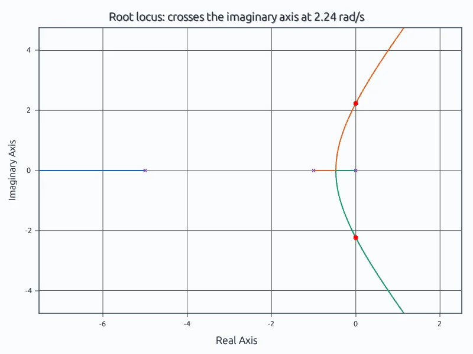

# Gain margin three ways: margin, the Routh array and the root locus

[](https://runmat.com/sandbox?example=control-systems-margins-three-ways)

This example finds how much the loop gain of G(s) = 10/(s(s + 1)(s + 5)) can rise before the
unity-feedback loop goes unstable, by three independent routes: `margin` on the open-loop
frequency response, the Routh stability condition, and the gain at which the root locus reaches
the imaginary axis. All three give a gain margin of 3 (9.54 dB), with the locus crossing the
imaginary axis at ±2.24 rad/s.

<picture>
  <source media="(prefers-color-scheme: dark)" srcset=".artifacts/thumbnail.webp">
  
</picture>

## The problem

The gain margin is the factor by which the loop gain can grow before the closed loop becomes
unstable. Plant gains drift with temperature, load and wear, so designs carry a gain margin of
typically 6 dB or more. Computing it three ways is a standard check, and each route shows a
different side of the same fact.

- **Frequency response.** The gain margin is 1/|G(jω)| at the phase-crossover frequency ω_cg,
  where the open-loop phase reaches −180°.
- **Routh array.** With gain K the closed-loop characteristic polynomial is
  s³ + 6s² + 5s + 10K. A cubic s³ + a₂s² + a₁s + a₀ is stable when all coefficients are positive
  and a₂a₁ > a₀, here 6·5 > 10K, so K < 3.
- **Root locus.** As K rises, two closed-loop poles move from the left half-plane toward the
  imaginary axis. At K = 3 the polynomial factors as (s + 6)(s² + 5), placing poles at ±j√5.

## How the example works

1. **Build the plant and call `margin`**, which returns gain margin, phase margin and their
   crossover frequencies:

   ```matlab
   s = tf('s');
   G = 10/(s*(s + 1)*(s + 5));
   [Gm, Pm, Wcg, Wcp] = margin(G);
   ```

2. **Print the Routh limit** from the coefficient condition: `6*5/10`.

3. **Check the poles at the margin gain**:

   ```matlab
   p = roots([1 6 5 10*Gm]);
   ```

4. **Draw the root locus** and mark the crossing points ±ω_cg with red circles:

   ```matlab
   rlocus(G);
   hold on;
   plot([0 0], [-1 1]*Wcg, 'ro', 'MarkerSize', 8);
   ```

## Results

The figure title reports the crossing frequency from `margin`:

```
Root locus: crosses the imaginary axis at 2.24 rad/s
```

The script also prints the margins, the Routh limit and the poles at the margin gain. The values
below come from the formulas above. The gain margin is 3, or 20·log₁₀3 = 9.54 dB, at ω_cg = √5 = 2.236 rad/s.
At K = 3 the closed-loop poles are −6 and ±2.236j. The phase margin at unity gain, from the
open-loop phase −90° − atan ω − atan(ω/5), is about 25.4° at a gain crossover near 1.227 rad/s.

In the root locus the three open-loop poles at 0, −1 and −5 are marked with crosses. The branches
from 0 and −1 meet on the real axis, break away and curve into the right half-plane, crossing the
imaginary axis at the red markers. The branch from −5 runs left along the real axis.

## What to try

1. Move the pole at −5 to −10: `G = 20/(s*(s + 1)*(s + 10))` keeps the same low-frequency gain.
   The Routh condition becomes 11·10 > 20K, a gain margin of 5.5.
2. Run `margin(2*G)`. By the Routh condition the margin halves to 1.5 (3.52 dB), and the
   crossing frequency stays at √5 rad/s.

## Files

- `margins-three-ways.m`: the script: margin, Routh limit, closed-loop poles and the root locus.
- `runmat.toml`: the project file.

## Related

- [Control systems in RunMat](https://runmat.com/math/control-systems)
- [Proportional gain sweep](../gain-sweep) and [Nyquist stability](../nyquist-stability)
- Function reference: [`rlocus`](https://runmat.com/docs/reference/builtins/rlocus), [`roots`](https://runmat.com/docs/reference/builtins/roots), [`bode`](https://runmat.com/docs/reference/builtins/bode)
- [Download RunMat](https://runmat.com/download)
