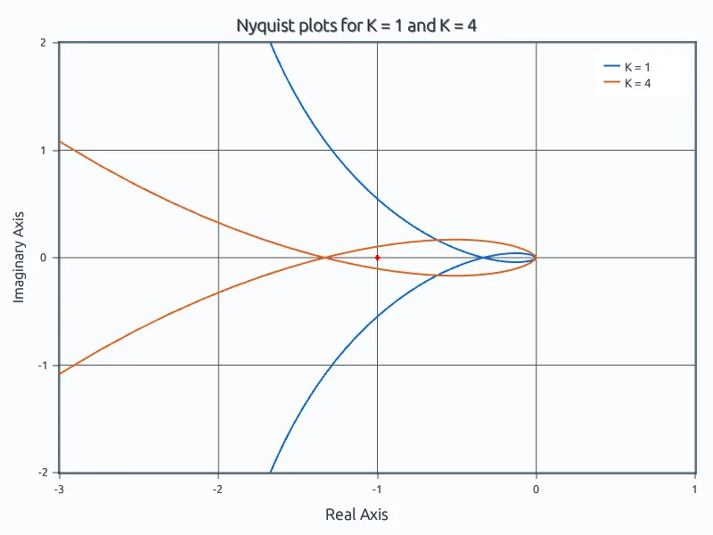

# Nyquist stability criterion: when the loop encircles −1

[](https://runmat.com/sandbox?example=control-systems-nyquist-stability)

This example draws the Nyquist plot of the loop K·G(s), with G(s) = 10/(s(s + 1)(s + 5)), for
K = 1 and K = 4, and counts the unstable closed-loop poles for each. At K = 1 the curve crosses the
negative real axis at −0.333, to the right of −1, and the closed loop is stable. At K = 4 it crosses
at −1.333, encircles −1, and the closed loop has 2 poles in the right half-plane.

<picture>
  <source media="(prefers-color-scheme: dark)" srcset=".artifacts/thumbnail.webp">
  
</picture>

## The problem

The Nyquist criterion predicts closed-loop stability from the open-loop frequency response alone,
which is useful when the plant is known only from measured frequency data. For a unity-feedback
loop L(s) = K·G(s),

$$Z = N + P$$

where Z is the number of closed-loop poles in the right half-plane, P the number of open-loop
poles there, and N the number of clockwise encirclements of the point −1 by the Nyquist plot of
L(jω). This plant has no open-loop poles in the right half-plane (P = 0), so the loop is stable
exactly when the curve does not encircle −1.

For this plant the phase reaches −180° at ω = √5 rad/s, where |G| = 1/3. The real-axis crossing of
K·G is therefore at −K/3, and the curve passes −1 when K exceeds 3, the gain margin.

## How the example works

1. **Build the plant**:

   ```matlab
   s = tf('s');
   G = 10/(s*(s + 1)*(s + 5));
   ```

2. **Evaluate each loop at the phase crossover**, √5 rad/s, to get the real-axis crossing, and
   count the closed-loop poles with positive real part:

   ```matlab
   [re, im] = nyquist(K*G, sqrt(5));
   unstable = sum(real(pole(feedback(K*G, 1))) > 0);
   ```

3. **Overlay the two Nyquist plots**, zoomed to the region around −1:

   ```matlab
   nyquist(G);
   hold on;
   nyquist(4*G);
   axis([-3 1 -2 2]);
   ```

## Results

```
K = 1: crosses the real axis at -0.333; 0 closed-loop poles in the right half-plane
K = 4: crosses the real axis at -1.333; 2 closed-loop poles in the right half-plane
```

In the figure, the K = 1 curve passes to the right of −1, crossing the real axis at
−1/3. The K = 4 curve is the same shape scaled by 4; its crossing at −4/3 puts −1 inside the loop,
so the curve circles it twice (N = 2) and Z = 2, matching the pole count. Both curves run off to
infinity along the imaginary direction as ω approaches 0, the effect of the integrator at s = 0.

## What to try

1. Try K = 3. The crossing lands on −1 itself, and two closed-loop poles sit on the imaginary
   axis at ±√5 rad/s.
2. Try K = 2.5 and read how close the crossing comes to −1: 2.5/3 = 0.833, a gain margin of 1.2.
3. Move the pole at −5 to −2: `G = 10/(s*(s + 1)*(s + 2))`. The phase crossover drops to
   √2 rad/s, where |G| = 10/6, so even K = 1 crosses at −1.667 and encircles −1.

## Files

- `nyquist-stability.m`: the script: crossings, closed-loop pole counts and the two Nyquist plots.
- `runmat.toml`: the project file.

## Related

- [Control systems in RunMat](https://runmat.com/math/control-systems)
- [Gain margin three ways](../margins-three-ways) and [proportional gain sweep](../gain-sweep)
- Function reference: [`nyquist`](https://runmat.com/docs/reference/builtins/nyquist), [`feedback`](https://runmat.com/docs/reference/builtins/feedback), [`pole`](https://runmat.com/docs/reference/builtins/pole)
- [Download RunMat](https://runmat.com/download)
