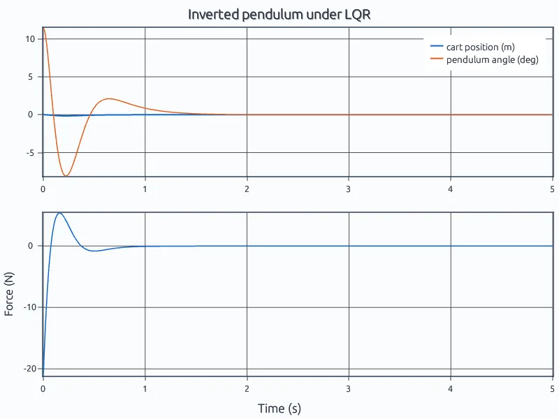

# Balance an inverted pendulum on a cart with LQR state feedback

[](https://runmat.com/sandbox?example=control-systems-pendulum-lqr)

This example linearizes a cart-and-pendulum system about the upright position, designs a
full-state feedback gain with `lqr`, and simulates the closed loop with `ode45` from a 0.2 rad
(11.5°) tilt. The open-loop model has an unstable pole at +5.568 rad/s. Under LQR the pendulum
overshoots past vertical, swings back and is upright before t = 2 s, while the cart barely moves.

<picture>
  <source media="(prefers-color-scheme: dark)" srcset=".artifacts/thumbnail.webp">
  
</picture>

## The problem

An inverted pendulum on a cart is the standard benchmark for unstable systems: rocket attitude
during launch, self-balancing vehicles and legged robots all face the same instability. A force on
the cart is the only input, and it has to keep the pendulum upright while also keeping the cart
near its starting point.

The model uses a 0.5 kg cart, a 0.2 kg pendulum with its center of mass 0.3 m from the pivot and a
moment of inertia of 0.006 kg·m², and 0.1 N·s/m of cart friction. Linearized about upright, with
state x = [cart position, cart velocity, angle, angular velocity], the system is ẋ = Ax + Bu.

The linear-quadratic regulator picks the gain K in u = −Kx that minimizes

$$J = \int_0^\infty \left(x^\top Q x + u^\top R u\right) dt$$

The weights set the trade: Q = diag(5000, 0, 100, 0) puts a weight of 5000 on cart position (m²)
and 100 on pendulum angle (rad²), and R = 1 weights the force (N²).

## How the example works

1. **Build the linearized model** from the physical parameters, with
   `p = I*(M + m) + M*m*l^2` as the common denominator:

   ```matlab
   A = [0, 1, 0, 0;
        0, -(I + m*l^2)*b/p, m^2*g*l^2/p, 0;
        0, 0, 0, 1;
        0, -m*l*b/p, m*g*l*(M + m)/p, 0];
   B = [0; (I + m*l^2)/p; 0; m*l/p];
   ```

2. **Check the open-loop poles** with `eig(A)`.

3. **Design the state-feedback gain**:

   ```matlab
   K = lqr(A, B, diag([5000 0 100 0]), 1);
   ```

4. **Simulate the closed loop** ẋ = (A − BK)x for 5 s and recover the force:

   ```matlab
   [t, x] = ode45(@(t, x) (A - B*K)*x, 0:0.01:5, [0; 0; 0.2; 0]);
   u = -(K*x.').';
   ```

5. **Plot** cart position and pendulum angle above, control force below.

## Results

The script prints the open-loop poles, the LQR gain, the peak force, the largest cart travel and
the time after which the angle stays within 1°. From the A matrix, the open-loop poles are 0,
−0.1428, −5.607 and +5.568 rad/s; the pole at +5.568 doubles an uncorrected tilt every 0.12 s.

In the figure, the pendulum angle starts at 11.5°, swings through vertical within the first
half second, comes back past zero once more and settles before t = 2 s. The cart position stays
close to zero throughout, as the heavy position weight demands. The force is largest at t = 0,
reverses sign as the pendulum passes vertical, and is near zero by t = 1 s.

## What to try

1. Lower the cart-position weight from 5000 to 50 and look at how far the cart travels.
2. Raise R from 1 to 10 to penalize force, and compare the peak force and recovery time.
3. Start from a larger tilt, `x0 = [0; 0; 0.4; 0]`. The model is linear, so every curve scales by 2.

## Files

- `pendulum-lqr.m`: the script: linearized model, LQR design, ode45 simulation and the plots.
- `runmat.toml`: the project file.

## Related

- [Control systems in RunMat](https://runmat.com/math/control-systems)
- [Damping ratio and overshoot](../damping-overshoot) and [sampled controller](../sample-controller)
- Function reference: [`lqr`](https://runmat.com/docs/reference/builtins/lqr), [`ode45`](https://runmat.com/docs/reference/builtins/ode45), [`eig`](https://runmat.com/docs/reference/builtins/eig)
- [Download RunMat](https://runmat.com/download)
