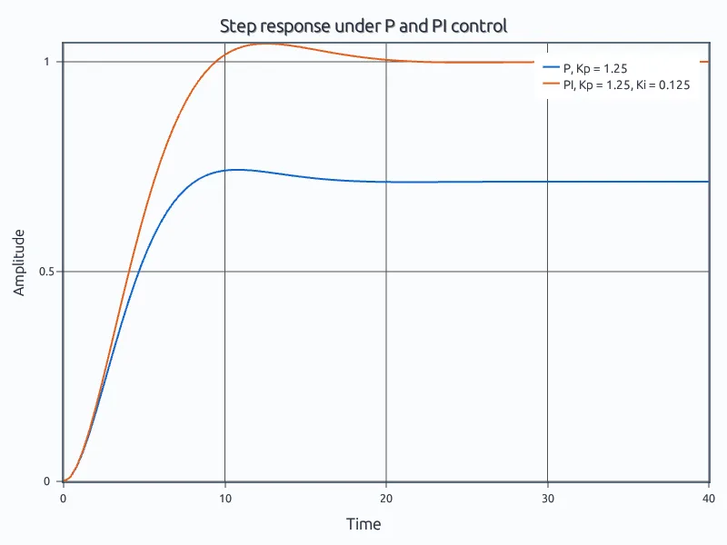

# PI controller for a thermal plant: removing steady-state error

[](https://runmat.com/sandbox?example=pi-controller)

This example controls a two-lag thermal plant, G(s) = 2/((10s + 1)(2s + 1)), first with a
proportional gain of 1.25 and then with a PI controller whose integral zero cancels the plant's
slow pole. Proportional control alone settles at 2.5/3.5 = 0.714 of the setpoint, a 29 % steady-state error.
The PI controller settles at the setpoint with a small overshoot.

<picture>
  <source media="(prefers-color-scheme: dark)" srcset=".artifacts/thumbnail.webp">
  
</picture>

## The problem

Ovens, heated baths, building zones and battery thermal loops respond like a chain of first-order
lags. This plant has a DC gain of 2 and time constants of 10 s and 2 s. Under proportional control
with unity feedback the closed-loop DC gain is

$$\frac{K_p G(0)}{1 + K_p G(0)} = \frac{2.5}{3.5} = 0.714$$

so the output stops 28.6 % short of the setpoint. Raising K_p shrinks the error but never removes
it, and adds overshoot.

A PI controller adds an integrator, which keeps pushing until the error is zero:

$$C(s) = K_p + \frac{K_i}{s} = K_p\,\frac{s + K_i/K_p}{s}$$

Choosing K_i = K_p/10 puts the controller zero at s = −0.1, on top of the slow plant pole. The loop
then reduces to L(s) = 0.25/(s(2s + 1)), and the closed loop is a second-order system with
ω_n = 0.354 rad/s and ζ = 0.707.

## How the example works

1. **Build the plant**:

   ```matlab
   s = tf('s');
   G = 2/((10*s + 1)*(2*s + 1));
   ```

2. **Build the PI controller** with its zero on the slow pole, and close both loops:

   ```matlab
   Kp = 1.25;
   C = pid(Kp, Kp/10);
   P = feedback(Kp*G, 1);
   T = feedback(C*G, 1);
   ```

3. **Measure the responses**: `dcgain` gives each loop's final value and `stepinfo(T)` gives the PI
   loop's overshoot and settling time.

4. **Plot both step responses** over 40 s with `step(P, T, 40)`.

## Results

The script prints the final value and error of the P loop and the final value, overshoot and
settling time of the PI loop. From the closed-loop formulas above, the P loop settles at 0.714
(28.6 % error) and the PI loop at 1. For the PI loop's second-order response with ζ = 0.707 the
standard formula gives 4.3 % overshoot, with the peak at 12.6 s and the response inside the 2 %
band from about 16.9 s.

In the figure both responses rise together for the first few seconds, since the proportional
action is the same. The P response peaks slightly near 10 s and levels off at 0.714. The PI response keeps
climbing, peaks just above 1 and settles at the setpoint.

## What to try

1. Raise `Kp` to 5 in the P loop. The final value becomes 10/11 = 0.909, still 9.1 % short.
2. Set the integral gain to `Kp/2` so the zero no longer cancels the slow pole, and compare the
   overshoot and settling time.
3. Double both gains, `pid(2.5, 0.25)`. The loop becomes 0.5/(s(2s + 1)), with ζ = 0.5 and a
   formula overshoot of 16.3 %.

## Files

- `pi-controller.m`: the script: plant, P and PI loops, dcgain and stepinfo, and the step plot.
- `runmat.toml`: the project file.

## Related

- [Control systems in RunMat](https://runmat.com/math/control-systems)
- [Proportional gain sweep](../gain-sweep) and [ramp tracking](../ramp-tracking)
- Function reference: [`feedback`](https://runmat.com/docs/reference/builtins/feedback), [`dcgain`](https://runmat.com/docs/reference/builtins/dcgain), [`stepinfo`](https://runmat.com/docs/reference/builtins/stepinfo)
- [Download RunMat](https://runmat.com/download)
