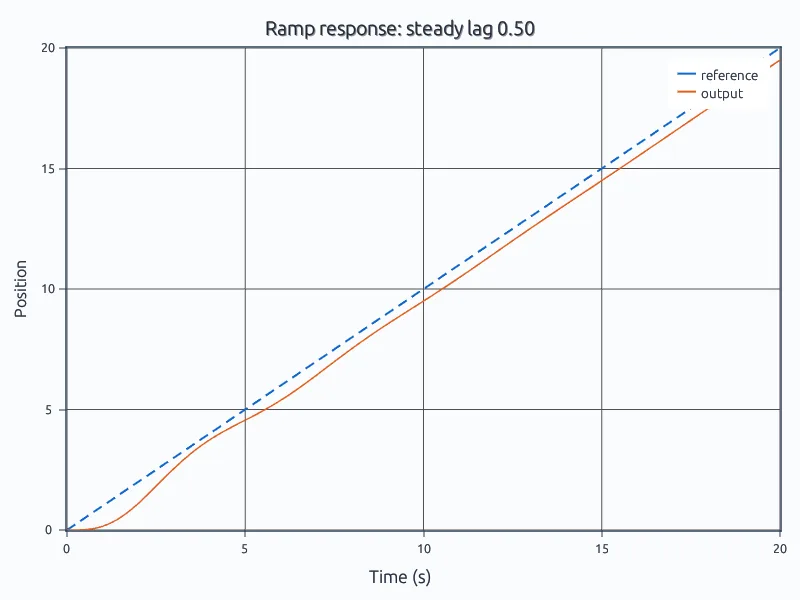

# Ramp tracking error of a type-1 loop and the velocity constant Kv

[](https://runmat.com/sandbox?example=control-systems-ramp-tracking)

This example drives the unity-feedback loop around G(s) = 10/(s(s + 1)(s + 5)) with a ramp
reference of 1 unit per second and simulates the output with `lsim`. The loop has one integrator,
so it follows the ramp with a constant lag instead of drifting away. The velocity constant is
K_v = 2, and the simulated lag at 20 s is 0.50, equal to 1/K_v.

<picture>
  <source media="(prefers-color-scheme: dark)" srcset=".artifacts/thumbnail.webp">
  
</picture>

## The problem

Many servos track moving targets rather than fixed setpoints: an antenna following a satellite, a
machine-tool axis on a constant-feed cut, a conveyor matching line speed. For these a ramp input
is the test signal, and the steady-state following error is the specification.

The system type, the number of integrators in the loop, decides how the error behaves. A type-0
loop cannot follow a ramp at all; a type-2 loop follows it with zero steady error. A type-1 loop,
like this one, follows with a constant error set by the velocity constant:

$$K_v = \lim_{s \to 0} s\,G(s) = \frac{10}{1 \cdot 5} = 2, \qquad
e_{ss} = \frac{1}{K_v} = 0.5$$

For a ramp of slope R the lag is R/K_v, so raising K_v is the direct way to cut the following
error.

## How the example works

1. **Close the loop**:

   ```matlab
   s = tf('s');
   G = 10/(s*(s + 1)*(s + 5));
   T = feedback(G, 1);
   ```

2. **Simulate the ramp response** over 20 s in 0.01 s steps:

   ```matlab
   t = (0:0.01:20)';
   r = t;
   y = lsim(T, r, t);
   ```

3. **Compare the simulated lag with the formula**: `Kv = 10/(1*5)` gives the predicted lag 1/K_v,
   and `r(end) - y(end)` gives the simulated one.

4. **Plot reference and output** together, with the final lag in the title.

## Results

The script prints K_v and the lag at 20 s. The figure title reports the simulated lag:

```
Ramp response: steady lag 0.50
```

This matches 1/K_v = 0.5 from the formula. In the figure the output starts slowly, since the
three-pole loop needs time to build up speed, wavers below the ramp for the first several
seconds and then runs parallel to it, a constant 0.5 below.

## What to try

1. Double the gain to `G = 20/(s*(s + 1)*(s + 5))`. K_v becomes 4 and the lag halves to 0.25.
   The closed-loop polynomial s³ + 6s² + 5s + 20 still meets the Routh condition 6·5 > 20, so the
   loop stays stable.
2. Change the reference to `r = 2*t`. The lag doubles to 1.0.
3. Feed a step instead, `r = ones(size(t))`, and confirm the type-1 loop settles with zero error.

## Files

- `ramp-tracking.m`: the script: closed loop, lsim ramp response, Kv check and the plot.
- `runmat.toml`: the project file.

## Related

- [Control systems in RunMat](https://runmat.com/math/control-systems)
- [Proportional gain sweep](../gain-sweep) and [PI controller](../pi-controller)
- Function reference: [`tf`](https://runmat.com/docs/reference/builtins/tf), [`feedback`](https://runmat.com/docs/reference/builtins/feedback), [`plot`](https://runmat.com/docs/reference/builtins/plot)
- [Download RunMat](https://runmat.com/download)
