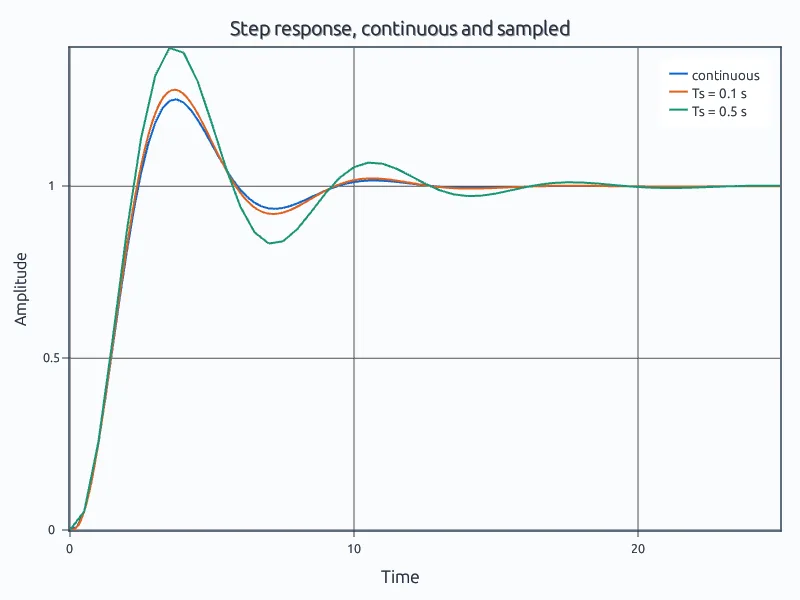

# Effect of sample time on a digital control loop: zero-order hold discretization

[](https://runmat.com/sandbox?example=control-systems-sample-controller)

This example takes the loop G(s) = 5/(s(s + 1)(s + 5)), discretizes it with a zero-order hold at
sample times of 0.1 s and 0.5 s, and compares the closed-loop step responses with the continuous
one. At 0.1 s the sampled response is close to the continuous one. At 0.5 s the response overshoots
further, undershoots further and rings longer.

<picture>
  <source media="(prefers-color-scheme: dark)" srcset=".artifacts/thumbnail.webp">
  
</picture>

## The problem

Most controllers now run on a microcontroller or PLC that reads the sensor and updates the actuator
once per sample period. Between updates a zero-order hold keeps the actuator command constant.
That hold behaves like a time delay of about half a sample period, Ts/2, which costs phase margin.
A design done in continuous time keeps its behavior only if the sample rate is fast compared with
the loop's dynamics.

A common rule of thumb is to sample 10 to 30 times faster than the closed-loop bandwidth. This
example shows what happens when the sample time is pushed toward the slow end. The plant is the
same G(s) = 10/(s(s + 1)(s + 5)) used in the other control examples, with a proportional gain of
0.5 folded in.

## How the example works

1. **Define the continuous loop** with the gain included:

   ```matlab
   s = tf('s');
   G = 5/(s*(s + 1)*(s + 5));
   ```

2. **Discretize with a zero-order hold** at each sample time and measure the closed-loop step:

   ```matlab
   for Ts = [0.1 0.5]
       Gd = c2d(G, Ts, 'zoh');
       S = stepinfo(feedback(Gd, 1));
   end
   ```

3. **Measure the continuous loop** with `stepinfo(feedback(G, 1))` for comparison.

4. **Plot all three step responses** over 25 s on one axes with `step`.

## Results

The script prints the overshoot and settling time for each sample time and for the continuous
loop. The continuous loop at this gain is the K = 0.5 case of the
[gain sweep](../gain-sweep), whose captured run gives 25 % overshoot and 8.9 s settling.

In the figure, the 0.1 s response lies almost on top of the continuous curve, peaking slightly
higher. The 0.5 s response peaks highest, dips furthest below 1 on the first undershoot, and takes a
second visible oscillation to settle. Its hold delay of about Ts/2 = 0.25 s costs phase margin,
which shows up as the larger overshoot.

## What to try

1. Add `Ts = 1` to the loop and look at the overshoot.
2. Try `Ts = 0.2` and see where its response falls between the two curves.
3. Raise the gain in `G` to 10 and repeat. The continuous loop is then the K = 1 case of the gain
   sweep, with 49 % overshoot, and the sampled loops start from less margin.

## Files

- `sample-controller.m`: the script: zero-order-hold discretization at two sample times, stepinfo
  and the step-response plot.
- `runmat.toml`: the project file.

## Related

- [Control systems in RunMat](https://runmat.com/math/control-systems)
- [Proportional gain sweep](../gain-sweep) and [gain margin three ways](../margins-three-ways)
- Function reference: [`stepinfo`](https://runmat.com/docs/reference/builtins/stepinfo), [`feedback`](https://runmat.com/docs/reference/builtins/feedback), [`step`](https://runmat.com/docs/reference/builtins/step)
- [Download RunMat](https://runmat.com/download)
