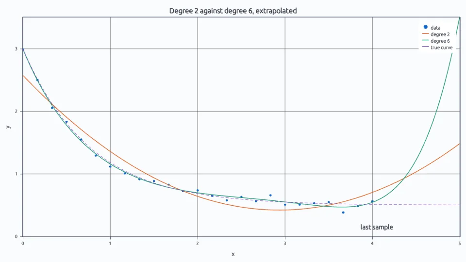

# Choose a polynomial degree: R-squared, adjusted R-squared and extrapolation

[](https://runmat.com/sandbox?example=curve-fitting-choose-degree)

This example fits polynomials of degree 1 to 6 to 25 noisy samples of an exponential decay and
compares them. R² climbs from 0.71149 at degree 1 to 0.99616 at degree 6, but adjusted R² peaks at
degree 4 and falls after it. Extrapolated past the last sample, the degree-6 fit turns sharply
upward while the true curve stays flat.

<picture>
  <source media="(prefers-color-scheme: dark)" srcset=".artifacts/thumbnail.webp">
  
</picture>

## The problem

A polynomial is the quickest model for a calibration curve or a trend, and the first question is
what degree to use. Every added term lets the curve pass closer to the samples, so R² can only rise
with degree. Past some point the extra terms fit the noise instead of the trend.

Adjusted R² charges each term for the degree of freedom it uses:

$$\bar R^2 = 1 - (1 - R^2)\,\frac{n - 1}{n - d - 1}$$

for n samples and degree d. It rises only if a new term reduces the residual more than chance
would. Extrapolation is the harsher test: a high-degree polynomial is dominated by its leading term
outside the data, and it diverges there.

## How the example works

1. **Sample the curve** y = 2.5 e^(−1.3x) + 0.5 at 25 points on 0 ≤ x ≤ 4, with 0.05 noise and a
   fixed seed.

2. **Fit each degree** with centering and scaling, and score it:

   ```matlab
   [p, ~, mu] = polyfit(x, y, d);
   r = y - polyval(p, x, [], mu);
   R2 = 1 - sum(r.^2)/sum((y - mean(y)).^2);
   adj = 1 - (1 - R2)*(n - 1)/(n - d - 1);
   ```

   The third output `mu` holds the mean and standard deviation of x, which keeps the high-degree
   fits well conditioned.

3. **Extrapolate degrees 2 and 6** to x = 5 and plot them with the true curve and a line at the
   last sample.

## Results

```
degree   R^2       adjusted R^2   residual norm
   1     0.71149   0.69895        1.7893
   2     0.94473   0.93970        0.7832
   3     0.98839   0.98673        0.3590
   4     0.99600   0.99520        0.2107
   5     0.99600   0.99495        0.2107
   6     0.99616   0.99488        0.2064
```

Degree 4 has the highest adjusted R², 0.99520. Degree 5 leaves the residual norm unchanged at
0.2107, and degree 6 lowers it only to 0.2064, so adjusted R² falls for both. Inside the data,
degrees 4 to 6 are indistinguishable. In the figure, degree 2 misses the curvature near x = 0 and
dips below the data around x = 3. Beyond the last sample at x = 4, degree 6 climbs off the chart
while the true curve levels out near 0.50.

## What to try

1. Add degree 4 to the plot with `polyfit(x, y, 4)` and see how it extrapolates.
2. Halve the noise to `0.025*randn(size(x))` and check which degree adjusted R² picks.
3. Fit the right model instead, an exponential, as in [the exponential decay fit](../exponential-decay).

## Files

- `choose-degree.m`: the script: data, fits of degree 1 to 6, the score table and the extrapolation plot.
- `runmat.toml`: the project file.

## Related

- [Curve fitting in RunMat](https://runmat.com/math/curve-fitting)
- [Fitting an exponential decay](../exponential-decay) and [two fits compared](../two-fits)
- Function reference: [`polyfit`](https://runmat.com/docs/reference/builtins/polyfit), [`polyval`](https://runmat.com/docs/reference/builtins/polyval)
- [Download RunMat](https://runmat.com/download)
