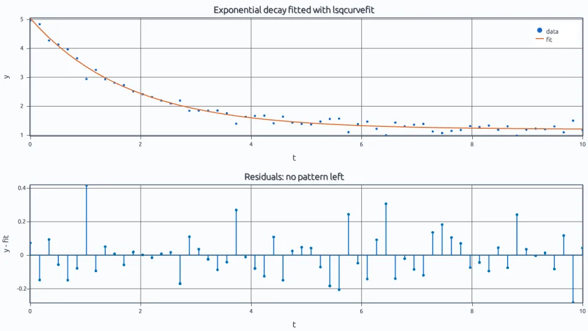

# Fit an exponential decay with bounds and 95 % parameter intervals

[](https://runmat.com/sandbox?example=curve-fitting-exponential-decay)

This example fits y = A e^(−kt) + c to 60 noisy samples with bounded nonlinear least squares and
reports each parameter with its 95 % confidence interval. The fit gives A = 3.828 ± 0.151,
k = 0.565 ± 0.046 and c = 1.203 ± 0.060; the true values 4.0, 0.6 and 1.2 each fall inside their
interval. The RMS residual is 0.1295, close to the 0.12 noise level.

<picture>
  <source media="(prefers-color-scheme: dark)" srcset=".artifacts/thumbnail.webp">
  
</picture>

## The problem

Exponential decays turn up across engineering: an RC discharge, a cooling part, a damped
vibration's envelope, a sensor settling, a drug clearing. The quantities of interest are the
parameters: the rate k, or time constant 1/k, the initial amplitude A and the final value c.

The model is nonlinear in k, so it needs an iterative solver and a starting guess. Bounds keep the
solver in the physical range, here A ≥ 0 and 0 ≤ k ≤ 5. A fitted parameter is only half an answer
without its uncertainty. Near the solution, the Jacobian J of the model with respect to the
parameters gives the covariance

$$\text{Cov}(\hat p) \approx (J^\top J)^{-1}\,\frac{\text{RSS}}{n - m}$$

for n samples and m parameters, and a Student-t quantile turns its diagonal into 95 % intervals.

## How the example works

1. **Make the data**: 60 samples over 0 ≤ t ≤ 10 from A = 4.0, k = 0.6, c = 1.2, plus noise with
   standard deviation 0.12 and a fixed seed.

2. **Fit with bounds** from the starting guess [1 0.1 0], and keep the Jacobian:

   ```matlab
   model = @(p, t) p(1)*exp(-p(2)*t) + p(3);
   [p, resnorm, res, ~, ~, ~, J] = lsqcurvefit(model, [1 0.1 0], t, y, lb, ub, opts);
   ```

3. **Compute the 95 % intervals** from the Jacobian:

   ```matlab
   covP = inv(J'*J) * resnorm/dof;
   half = tinv(0.975, dof) * sqrt(diag(covP))';
   ```

4. **Plot** the data with the fit, and the residuals as a stem plot.

## Results

```
A = 3.828 +/- 0.151   (true 4.0)
k = 0.565 +/- 0.046   (true 0.6)
c = 1.203 +/- 0.060   (true 1.2)
RMS residual 0.1295
```

The fitted time constant is 1/0.565 = 1.77 s, against a true 1.67 s. The rate has the widest
relative interval, ±8 %, because A and k trade off against each other: a slightly smaller amplitude
with a slower decay fits nearly as well. The RMS residual, 0.1295, matches the 0.12 noise, and the
residual stems scatter around zero with no trend, so the model has captured the shape.

## What to try

1. Shorten the record to `linspace(0, 3, 60)'`, before the decay has settled, and compare the
   interval on c.
2. Start from a poor guess such as `[10 3 -5]` and check whether the solver reaches the same answer.
3. Fit a sum of two exponentials, `p(1)*exp(-p(2)*t) + p(3)*exp(-p(4)*t) + p(5)`, and look at
   the intervals on the extra parameters.

## Files

- `exponential-decay.m`: the script: data, bounded fit, parameter intervals and the two plots.
- `runmat.toml`: the project file.

## Related

- [Curve fitting in RunMat](https://runmat.com/math/curve-fitting)
- [Fitting a Gaussian peak](../gaussian-peak) and [a prediction band for a fit](../prediction-band)
- Function reference: [`lsqcurvefit`](https://runmat.com/docs/reference/builtins/lsqcurvefit), [`tinv`](https://runmat.com/docs/reference/builtins/tinv), [`stem`](https://runmat.com/docs/reference/builtins/stem)
- [Download RunMat](https://runmat.com/download)
