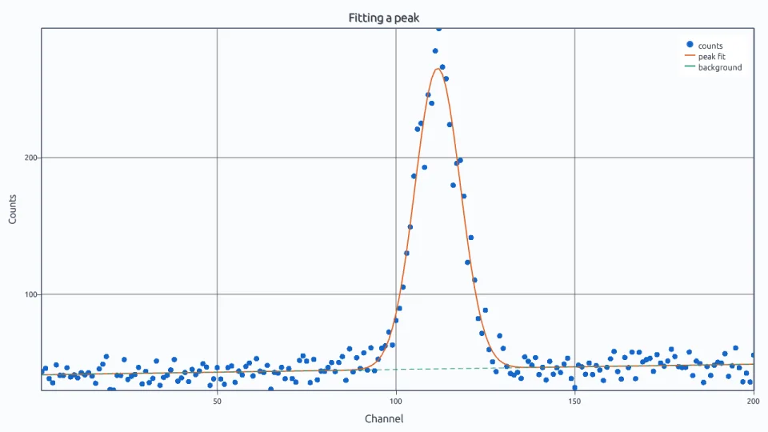

# Fit a Gaussian peak on a sloping background

[](https://runmat.com/sandbox?example=curve-fitting-gaussian-peak)

This example fits a Gaussian peak plus a linear background to 200 channels of noisy counts, the
shape of a spectrometer or chromatograph trace. The fit puts the peak at channel 111.66 with
σ = 6.36 channels and a height of 220.2 counts above background, a full width at half maximum of
14.98 channels.

<picture>
  <source media="(prefers-color-scheme: dark)" srcset=".artifacts/thumbnail.webp">
  
</picture>

## The problem

Gamma and X-ray spectra, chromatograms, diffraction patterns and optical spectra all show peaks on
a background. The peak's center identifies the line or compound, its width measures resolution,
and its area measures quantity. Reading these off the raw trace is unreliable: the background
shifts the apparent height, and counting noise moves the apparent maximum.

Fitting the peak and background together uses every channel. The model here is

$$y(x) = h\,e^{-(x - \mu)^2 / (2\sigma^2)} + b_0 + b_1 x$$

with five parameters: height h, center μ, width σ and a straight background. The full width at
half maximum follows from σ as FWHM = 2√(2 ln 2) σ ≈ 2.355σ.

## How the example works

1. **Simulate the counts**: a peak of height 220 at channel 112 with σ = 6.5 on a background of
   40 + 0.05·channel, with counting noise whose spread is √counts:

   ```matlab
   counts = 40 + 0.05*ch + 220*exp(-(ch - 112).^2/(2*6.5^2));
   counts = counts + sqrt(counts).*randn(size(ch));
   ```

2. **Start from the data**: the height guess is the maximum minus the median, and the background
   guess is the median:

   ```matlab
   p0 = [max(counts) - median(counts), 100, 10, median(counts), 0];
   ```

3. **Fit with bounds** that keep the center in range and the width between 0.5 and 50 channels:

   ```matlab
   p = lsqcurvefit(model, p0, ch, counts, [0 1 0.5 -Inf -Inf], [Inf 200 50 Inf Inf]);
   ```

4. **Plot** the counts, the full fit and the background line.

## Results

```
Peak at channel 111.66, sigma 6.36, height 220.2 counts
FWHM 14.98 channels
```

The fit recovers the simulated peak closely: center 111.66 against 112, σ 6.36 against 6.5, height
220.2 against 220. The true FWHM is 15.31 channels, and the fitted value is 14.98. In the figure,
the fitted curve passes through the peak's scatter and the dashed background follows the slow rise
across all 200 channels.

## What to try

1. Cut the peak to `50*exp(...)` and see how far the fitted center moves from 112.
2. Add a second peak at channel 130 and extend the model with three more parameters to fit both.
3. Compute the peak area as `p(1)*p(3)*sqrt(2*pi)`, the quantity used to measure concentration or
   activity.

## Files

- `gaussian-peak.m`: the script: simulated counts, the five-parameter fit and the plot.
- `runmat.toml`: the project file.

## Related

- [Curve fitting in RunMat](https://runmat.com/math/curve-fitting)
- [Fitting an exponential decay](../exponential-decay) and [kernel density estimate](../../statistics/kernel-density)
- Function reference: [`lsqcurvefit`](https://runmat.com/docs/reference/builtins/lsqcurvefit), [`median`](https://runmat.com/docs/reference/builtins/median)
- [Download RunMat](https://runmat.com/download)
