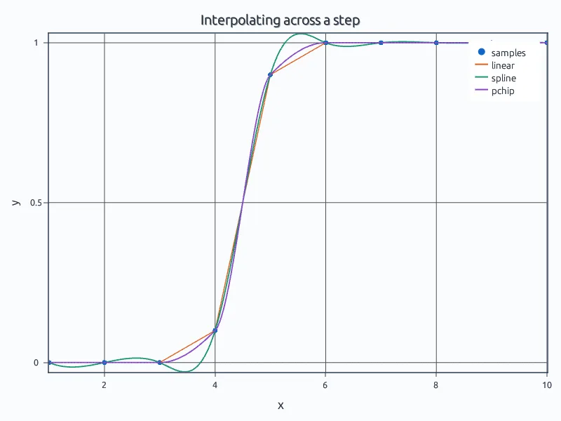

# Linear, spline or pchip interpolation: overshoot across a step

[](https://runmat.com/sandbox?example=curve-fitting-interp-methods)

This example interpolates ten samples of a step from 0 to 1 three ways: piecewise linear, cubic
spline and pchip, the shape-preserving cubic. The spline overshoots to 1.028 and undershoots to
−0.029. pchip stays between 0.000 and 1.000, the range of the data.

<picture>
  <source media="(prefers-color-scheme: dark)" srcset=".artifacts/thumbnail.webp">
  
</picture>

## The problem

Lookup tables, sensor calibrations and resampled records all need values between measured points.
The method decides what appears in the gaps.

- **Linear** joins neighbors with straight lines. It never leaves the range of its neighbors, but
  its slope jumps at every sample.
- **Spline** fits one cubic per interval with continuous first and second derivatives. It is the
  smoothest choice, and it overshoots near sharp changes, because its curvature has to carry on
  past them.
- **pchip** (piecewise cubic Hermite) picks each sample's slope so the curve stays monotonic
  wherever the data are. It has a continuous first derivative and never overshoots.

Overshoot matters when the quantity has hard limits: a valve fraction from 0 to 1, a concentration
that cannot go negative, an efficiency that cannot exceed 100 %.

## How the example works

1. **Define the step**: ten samples, 0 for the first three, 0.1 and 0.9 across the rise, and 1
   after it:

   ```matlab
   x = 1:10;
   y = [0 0 0 0.1 0.9 1 1 1 1 1];
   ```

2. **Interpolate on 400 points** with each method:

   ```matlab
   lin = interp1(x, y, xq, 'linear');
   spl = interp1(x, y, xq, 'spline');
   shp = interp1(x, y, xq, 'pchip');
   ```

3. **Measure the range** of each result, and plot all three with dotted lines at 0 and 1.

## Results

```
Spline overshoot: max 1.028, min -0.029
pchip stays in range: max 1.000, min 0.000
```

The spline rises 2.8 % above the top of the step just after it, between x = 5 and 6, and dips
2.9 % below zero just before it, between x = 3 and 4. It also ripples slightly on the flat parts on
either side. pchip follows the same S-shape across the step but stays flat where the data are
flat. Linear interpolation also stays in range, with corners at each sample.

## What to try

1. Make the step sharper with `y = [0 0 0 0 1 1 1 1 1 1]` and compare the spline's overshoot.
2. Interpolate a smooth function instead, such as `y = sin(x/2)`, where the spline's smoothness
   pays off, and compare the three curves.
3. Call `spline(x, y, xq)` and `pchip(x, y, xq)` directly and check that they match the `interp1`
   results.

## Files

- `interp-methods.m`: the script: step samples, three interpolants, the range check and the plot.
- `runmat.toml`: the project file.

## Related

- [Curve fitting in RunMat](https://runmat.com/math/curve-fitting)
- [Lookup table interpolation](../lookup-table) and [choosing a polynomial degree](../choose-degree)
- Function reference: [`interp1`](https://runmat.com/docs/reference/builtins/interp1), [`pchip`](https://runmat.com/docs/reference/builtins/pchip), [`spline`](https://runmat.com/docs/reference/builtins/spline)
- [Download RunMat](https://runmat.com/download)
