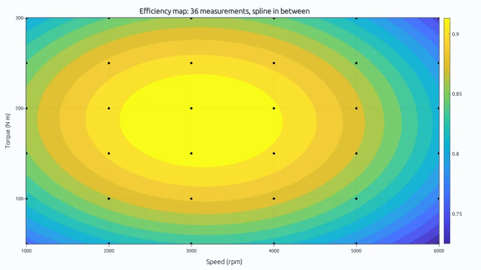

# Refine a motor efficiency map with 2-D spline interpolation

[](https://runmat.com/sandbox?example=curve-fitting-lookup-table)

This example takes a motor efficiency map measured on a 6 × 6 speed-torque grid and interpolates it
onto a 60 × 60 grid with a 2-D spline. The 36 measurements become 3600 map points. The refined map
peaks at 0.913 efficiency at 3119 rpm and 186 N·m, and reads 0.887 at an unmeasured operating point
of 2500 rpm and 120 N·m.

<picture>
  <source media="(prefers-color-scheme: dark)" srcset=".artifacts/thumbnail.webp">
  
</picture>

## The problem

Motors, engines, pumps and inverters are characterized on a dyno at a grid of operating points.
Each point is expensive, so the grid is coarse. Drive-cycle simulations, controller tables and
efficiency plots need values everywhere in between.

`interp2` interpolates a function of two variables sampled on a rectangular grid. With `'spline'`
it fits a cubic spline along each axis, so the surface has continuous slope and curvature and its
contours come out smooth. Linear interpolation is cheaper and never overshoots, but it draws
polygonal contours and flattens the peak between grid points.

## How the example works

1. **Build the measured grid**: speeds from 1000 to 6000 rpm and torques from 50 to 300 N·m in six
   steps each, with an efficiency surface that peaks near 3200 rpm and 190 N·m:

   ```matlab
   [S, T] = meshgrid(speed, torque);
   eff = 0.92 - 0.10*((S - 3200)/2800).^2 - 0.12*((T - 190)/160).^2 - 0.02*(S/6000).*(T/300);
   ```

2. **Interpolate onto a 60 × 60 grid**:

   ```matlab
   [Sq, Tq] = meshgrid(linspace(1000, 6000, 60), linspace(50, 300, 60));
   effq = interp2(S, T, eff, Sq, Tq, 'spline');
   ```

3. **Find the best point** on the refined map, and **query one operating point** directly:

   ```matlab
   interp2(S, T, eff, 2500, 120, 'spline')
   ```

4. **Draw the map** as 16 filled contour levels, with the measured points overlaid.

## Results

```
Measured points: 36; refined grid: 3600
Best efficiency 0.913 at 3119 rpm and 186 N m
At 2500 rpm and 120 N m: 0.887
```

The best point lies between measured grid points, which a 6 × 6 table alone would miss: the nearest
measurement, 3000 rpm and 200 N·m, sits just off the peak. The efficiency surface here is quadratic
in each variable, and a cubic spline reproduces such a surface exactly, so 0.887 at 2500 rpm and
120 N·m equals the formula's own value. Real dyno data carry noise, and the spline passes through
every measured value, noise included. In the figure, the elliptical contours center on the peak
and efficiency falls toward 0.72 at the low-speed and high-speed corners.

## What to try

1. Switch to `'linear'` and compare the contour shapes and the best efficiency found.
2. Add noise to the measurements, `eff = eff + 0.005*randn(size(eff))`, and watch how the spline
   contours respond.
3. Query a whole drive cycle at once by passing vectors of speed and torque to `interp2`.

## Files

- `lookup-table.m`: the script: measured grid, spline refinement, best point and the contour map.
- `runmat.toml`: the project file.

## Related

- [Curve fitting in RunMat](https://runmat.com/math/curve-fitting)
- [Linear, spline or pchip interpolation](../interp-methods) and [filled contour plots](../../plotting/contourf)
- Function reference: [`interp2`](https://runmat.com/docs/reference/builtins/interp2), [`meshgrid`](https://runmat.com/docs/reference/builtins/meshgrid), [`contourf`](https://runmat.com/docs/reference/builtins/contourf)
- [Download RunMat](https://runmat.com/download)
