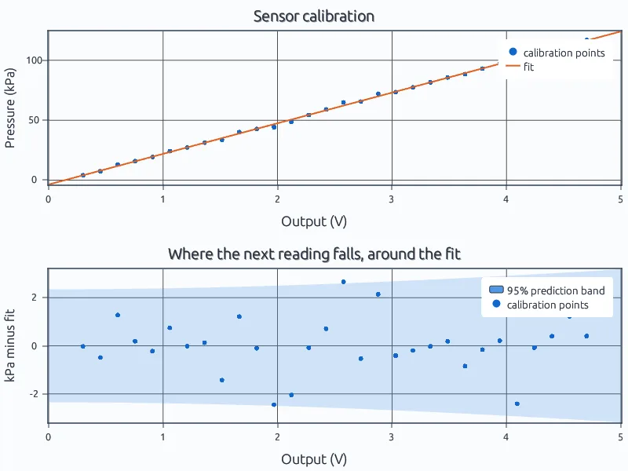

# Sensor calibration line with a 95 % prediction band

[](https://runmat.com/sandbox?example=curve-fitting-prediction-band)

This example calibrates a pressure sensor by fitting a straight line to 30 voltage-pressure pairs
from 0.3 to 4.7 V. It then draws the 95 % prediction band: the range in which a new reading will
fall around the calibration line. The script prints the calibration equation and the pressure for
a 2.5 V reading with its uncertainty.

<picture>
  <source media="(prefers-color-scheme: dark)" srcset=".artifacts/thumbnail.webp">
  
</picture>

## The problem

A calibration turns a sensor's output into an engineering quantity. Once fitted, it is used on
readings the calibration never saw, so it needs an uncertainty that applies to a single new
reading.

That uncertainty is the prediction interval. It combines two sources: the uncertainty in the
fitted line, which is smallest at the center of the calibration data, and the scatter of an
individual reading around the line. For a straight-line fit, the standard error of a prediction at
x₀ is

$$s_{pred}(x_0) = s\,\sqrt{1 + \frac{1}{n} + \frac{(x_0 - \bar x)^2}{\sum (x_i - \bar x)^2}}$$

where s is the residual standard deviation. The band is narrowest at the mean voltage and widens
toward and past the ends of the calibration range.

## How the example works

1. **Make the calibration data**: 30 points with a true sensitivity of 25.4 kPa/V, an offset of
   −3.1 kPa and 1.1 kPa of scatter, with a fixed seed.

2. **Fit the line** and keep the structure that carries its error information:

   ```matlab
   [p, S] = polyfit(volts, kPa, 1);
   ```

3. **Evaluate the fit and its prediction error** from 0 to 5 V:

   ```matlab
   [fitted, delta] = polyval(p, vq, S);
   ```

   `delta` is one standard error of a new observation; ±2·delta gives about 95 %.

4. **Plot** the calibration points with the fit, and below it the residuals inside the shaded band
   drawn with `fill`.

## Results

The script prints the fitted equation as `kPa = <slope> * V <offset>` and the pressure for a 2.5 V
reading with its ±2·delta range. The fitted slope and offset land close to the 25.4 kPa/V and
−3.1 kPa used to make the data.

In the figure, the calibration points sit on the fitted line across the full 0–5 V range. The
lower panel shows the residuals inside a band that is slightly narrower
at mid-range than at 0 V and 5 V. The band is nearly flat because 30 points pin the line down well;
most of its width is the 1.1 kPa reading scatter.

## What to try

1. Cut the calibration to 6 points with `linspace(0.3, 4.7, 6)'` and look at how the band widens
   at the ends.
2. Extend `vq` to 8 V and see how the band grows outside the calibrated range.
3. Fit a quadratic with `polyfit(volts, kPa, 2)` and compare the band width.

## Files

- `prediction-band.m`: the script: calibration data, linear fit, prediction band and the two plots.
- `runmat.toml`: the project file.

## Related

- [Curve fitting in RunMat](https://runmat.com/math/curve-fitting)
- [Regression with diagnostics](../../statistics/regression-diagnostics) and [choosing a polynomial degree](../choose-degree)
- Function reference: [`polyfit`](https://runmat.com/docs/reference/builtins/polyfit), [`polyval`](https://runmat.com/docs/reference/builtins/polyval), [`fill`](https://runmat.com/docs/reference/builtins/fill)
- [Download RunMat](https://runmat.com/download)
