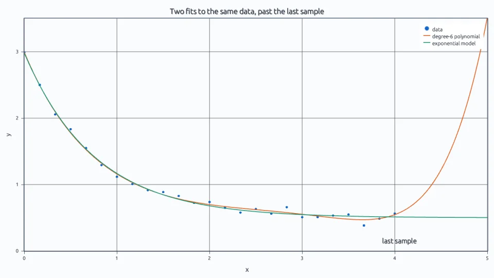

# Polynomial against physical model: extrapolating a curve fit

[](https://runmat.com/sandbox?example=curve-fitting-two-fits)

This example fits the same 25 noisy samples of an exponential decay two ways: a degree-6
polynomial and the exponential model y = A e^(−kx) + c. Over the sampled range 0 ≤ x ≤ 4 the two
curves lie on top of each other. Past the last sample the polynomial turns sharply upward, while
the exponential model levels off along the true asymptote.

<picture>
  <source media="(prefers-color-scheme: dark)" srcset=".artifacts/thumbnail.webp">
  
</picture>

## The problem

A flexible model such as a high-degree polynomial can match almost any data set inside the
sampled range. Its behavior outside that range is set by its highest-order term, not by the
physics, so it has no reason to follow the trend. A model with the right form, an exponential for
a decay or a power law for a scaling, carries its shape past the data.

This matters whenever a fit is used beyond its data: predicting a settling value from a short
test, extending a creep or wear curve to a service life, or reading a calibration at an
untested point.

## How the example works

1. **Sample the curve** y = 2.5 e^(−1.3x) + 0.5 at 25 points on 0 ≤ x ≤ 4, with 0.05 noise and a
   fixed seed. These are the same samples as in [choosing a polynomial degree](../choose-degree).

2. **Fit the polynomial** with centering and scaling:

   ```matlab
   [p6, ~, mu] = polyfit(x, y, 6);
   ```

3. **Fit the exponential model** with nonlinear least squares, keeping A and k non-negative:

   ```matlab
   model = @(p, x) p(1)*exp(-p(2)*x) + p(3);
   pe = lsqcurvefit(model, [1 1 0], x, y, [0 0 -Inf], [], opts);
   ```

4. **Evaluate both to x = 5** and plot them with the data and a marker at the last sample.

## Results

Inside the data, the two fits are indistinguishable at plot scale: both pass through the scatter
of the 25 samples. Past x = 4, the degree-6 polynomial rises steeply and leaves the top of the
chart before x = 5. The exponential model continues flat near 0.5, the true asymptote
2.5 e^(−6.5) + 0.5 = 0.504 at x = 5.

## What to try

1. Print `pe` and compare the fitted A, k and c with the true 2.5, 1.3 and 0.5.
2. Lower the polynomial to degree 3 and see how far past x = 4 it stays near the data.
3. Fit only the first 12 samples with both models and compare their predictions at x = 4.

## Files

- `two-fits.m`: the script: data, polynomial fit, exponential fit and the extrapolation plot.
- `runmat.toml`: the project file.

## Related

- [Curve fitting in RunMat](https://runmat.com/math/curve-fitting)
- [Choosing a polynomial degree](../choose-degree) and [fitting an exponential decay](../exponential-decay)
- Function reference: [`lsqcurvefit`](https://runmat.com/docs/reference/builtins/lsqcurvefit), [`polyfit`](https://runmat.com/docs/reference/builtins/polyfit), [`polyval`](https://runmat.com/docs/reference/builtins/polyval)
- [Download RunMat](https://runmat.com/download)
