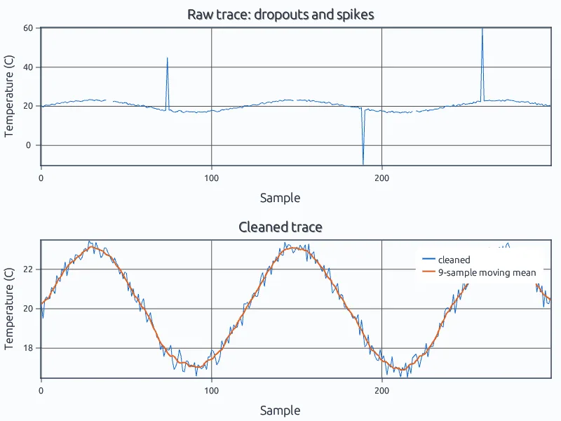

# Clean a sensor trace: fill dropouts and replace spikes

[](https://runmat.com/sandbox?example=data-tables-clean-sensor-trace)

This example cleans a 300-sample temperature trace that has five dropouts and three spikes. It
fills the dropouts by linear interpolation, detects outliers against a 15-sample moving median and
replaces them, then smooths the result with a 9-sample moving mean. The run fills 5 dropouts and
replaces 6 samples flagged as spikes.

<picture>
  <source media="(prefers-color-scheme: dark)" srcset=".artifacts/thumbnail.webp">
  
</picture>

## The problem

Logged sensor data carries two common defects. Dropouts are samples that never arrived, stored as
NaN or an empty field. Spikes are samples that arrived wrong, from electrical interference, a loose
connector or a bit error. Both break downstream analysis: a NaN propagates through every sum and
filter, and a single spike shifts a mean and dominates a maximum.

The order of operations matters. Fill the gaps first, so the outlier test has a complete series.
Then judge each sample against a moving median, which a spike barely moves, and replace the ones
that sit too far from it. Smooth last, so the smoothing does not spread a spike into its
neighbors.

## How the example works

1. **Make the trace**: a slow sine around 20 °C with 0.3 °C of noise, NaN at samples 40–42, 150
   and 220, and spikes of 45, −10 and 60 °C at samples 75, 190 and 260.

2. **Fill the dropouts** by linear interpolation:

   ```matlab
   filled = fillmissing(x, 'linear');
   ```

3. **Detect and replace spikes** against a 15-sample moving median:

   ```matlab
   isSpike = isoutlier(filled, 'movmedian', 15);
   clean = filloutliers(filled, 'linear', 'movmedian', 15);
   ```

   A sample counts as an outlier when it is more than three scaled median absolute deviations from
   the local median.

4. **Smooth** the cleaned trace with a 9-sample moving mean:

   ```matlab
   smooth = movmean(clean, 9);
   ```

## Results

```
5 dropouts filled, 6 spikes replaced
```

All five NaN samples are filled. The moving-median test flags 6 samples, three more than the
spikes put in. The extra three are ordinary samples that the test judged too far from their local
median; each is rebuilt from its neighbors, so the trace barely changes there. In the figure, the raw
trace's spikes stretch the axis from −10 to 60 °C and flatten the signal. The cleaned trace shows
the sine between about 17 and 23 °C, with the moving mean running through its noise.

## What to try

1. List the flagged samples with `find(isSpike)` and compare them with 75, 190 and 260.
2. Widen the window to `'movmedian', 31` and see how many samples are flagged.
3. Try `fillmissing(x, 'spline')` for the dropouts and compare the filled values at samples 40–42.

## Files

- `clean-sensor-trace.m`: the script: trace with defects, gap filling, spike replacement, smoothing and the two plots.
- `runmat.toml`: the project file.

## Related

- [Data tables in RunMat](https://runmat.com/math/data-tables)
- [Rolling mean](../rolling-mean) and [reading a messy CSV](../messy-csv)
- Function reference: [`fillmissing`](https://runmat.com/docs/reference/builtins/fillmissing), [`filloutliers`](https://runmat.com/docs/reference/builtins/filloutliers), [`isoutlier`](https://runmat.com/docs/reference/builtins/isoutlier), [`movmean`](https://runmat.com/docs/reference/builtins/movmean)
- [Download RunMat](https://runmat.com/download)
