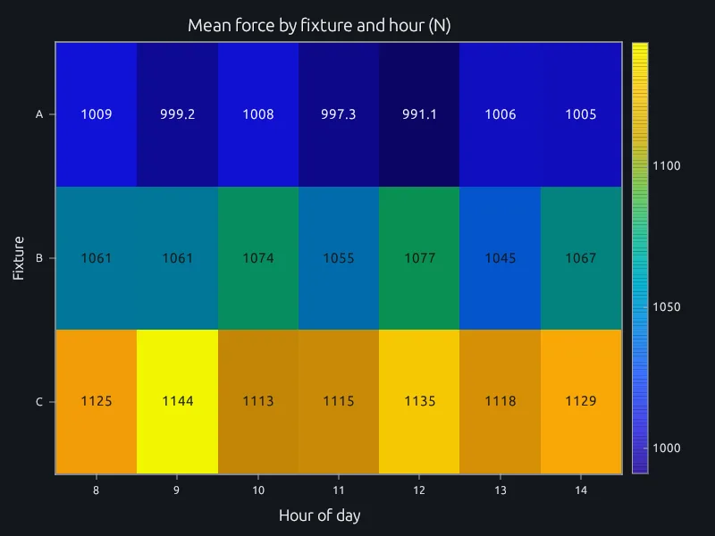

# Pivot a load log into mean force by fixture and hour

[](https://runmat.com/sandbox?example=data-tables-force-by-hour)

This example turns a test rig's load log into a table and a heatmap of mean force for each fixture
in each hour of the shift. It reads `rig_clean.csv`, drops incomplete rows and one outlier, pivots
the remaining 56 readings by fixture and hour, and draws the result with each cell's mean printed
on it. Fixture A runs from 991.1 to 1009.1 N across the shift, B from 1044.9 to 1077.3 N, and C
from 1113.1 to 1143.9 N.



## The problem

A rig log is a long table: one row per reading, with a timestamp, the fixture, the force and the
temperature. Questions about it are usually two-way: does any fixture drift during the shift, and
are the fixtures consistent with each other at the same hour? A pivot table answers both at once,
with fixtures as rows, hours as columns and the mean force in each cell. A heatmap of the same
table makes the pattern visible.

Cleaning comes first. A missing value would turn its cell's mean into NaN, and a single outlier
would pull one cell's mean far off.

## How the example works

1. **Read and clean the log.** Remove rows with a missing field, then readings that `isoutlier`
   flags, more than three scaled median absolute deviations from the median force:

   ```matlab
   T = rmmissing(readtable('rig_clean.csv'));
   T = T(~isoutlier(T.Force_N), :);
   ```

2. **Add an hour column** from the timestamps:

   ```matlab
   T.Hour = hour(T.Timestamp);
   ```

3. **Pivot** mean force by fixture and hour:

   ```matlab
   P = pivot(T, Rows = 'Fixture', Columns = 'Hour', DataVariable = 'Force_N', Method = 'mean')
   ```

4. **Draw the heatmap** straight from the table, with the same grouping:

   ```matlab
   h = heatmap(T, 'Hour', 'Fixture', 'ColorVariable', 'Force_N', 'ColorMethod', 'mean');
   ```

## Results

The log has 60 readings from 08:00 to 14:59. Three have a missing force or temperature, and one,
1650.0 N on fixture C at 12:47, is an outlier, which leaves 56. Each hour-fixture cell holds two or
three readings.

| Fixture | 08 | 09 | 10 | 11 | 12 | 13 | 14 |
| --- | --- | --- | --- | --- | --- | --- | --- |
| A | 1009.1 | 999.2 | 1007.9 | 997.3 | 991.1 | 1005.6 | 1004.7 |
| B | 1060.6 | 1060.7 | 1074.2 | 1055.1 | 1077.3 | 1044.9 | 1066.9 |
| C | 1125.0 | 1143.9 | 1113.1 | 1114.7 | 1135.3 | 1118.2 | 1128.6 |

The fixtures differ far more than the hours do: about 60 N separates each fixture from the next,
while no fixture moves more than about 32 N from hour to hour, with no steady trend in any row. In
the heatmap this shows as three horizontal color bands.

## What to try

1. Pivot temperature instead with `DataVariable = 'Temp_C'` to see whether the hall warmed through
   the shift.
2. Use `Method = 'max'` to find the hour with the highest single reading on each fixture.
3. Leave the outlier in by deleting the `isoutlier` line, and look at fixture C's 12:00 cell.

## Files

- `force-by-hour.m`: the script: read, clean, pivot and heatmap.
- `rig_clean.csv`: the rig log, 60 readings from three fixtures over one shift.
- `runmat.toml`: the project file.

## Related

- [Data tables in RunMat](https://runmat.com/math/data-tables)
- [Summary by group](../group-summary), [pivot heatmap](../pivot-heatmap) and [reading the raw log](../messy-csv)
- Function reference: [`pivot`](https://runmat.com/docs/reference/builtins/pivot), [`heatmap`](https://runmat.com/docs/reference/builtins/heatmap), [`isoutlier`](https://runmat.com/docs/reference/builtins/isoutlier), [`readtable`](https://runmat.com/docs/reference/builtins/readtable)
- [Download RunMat](https://runmat.com/download)
