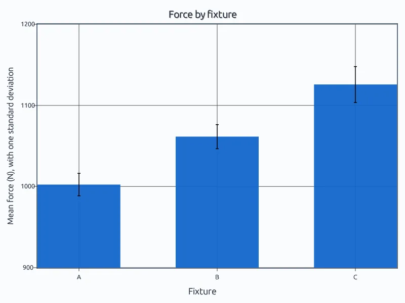

# Mean and standard deviation by group with groupsummary

[](https://runmat.com/sandbox?example=data-tables-group-summary)

This example summarizes a test rig's load log by fixture. It reads `rig_clean.csv`, removes rows
with missing values and one outlier, and computes the mean and standard deviation of force for each
of the three fixtures. Fixture A averages 1002.41 N, B 1061.44 N and C 1125.71 N. The bar chart
shows each mean with a one-standard-deviation error bar.

<picture>
  <source media="(prefers-color-scheme: dark)" srcset=".artifacts/thumbnail.webp">
  
</picture>

## The problem

Test data usually arrives as one long table, and the first question is how the groups in it
compare: fixtures, machines, batches, operators. A grouped summary reduces the table to one row per
group with the statistics that matter, here the mean force and its standard deviation.

Two cleaning steps come first. Rows with a missing field would turn a group's statistics into NaN.
An outlier, such as a mis-seated part or a logging glitch, would inflate one group's standard
deviation and shift its mean. `isoutlier` flags values more than three scaled median absolute
deviations from the median, a test that a single extreme value cannot hide from.

## How the example works

1. **Read the log and drop incomplete rows**:

   ```matlab
   T = readtable('rig_clean.csv');
   T = rmmissing(T);
   ```

2. **Remove outliers** in force and report how many readings remain:

   ```matlab
   spike = isoutlier(T.Force_N);
   T = T(~spike, :);
   ```

3. **Summarize by fixture**:

   ```matlab
   G = groupsummary(T, 'Fixture', {'mean', 'std'}, 'Force_N')
   ```

   `G` has one row per fixture, with columns `GroupCount`, `mean_Force_N` and `std_Force_N`.

4. **Plot** the means as bars and the standard deviations as error bars.

## Results

The log has 60 readings. Three have a missing value, and one, 1650.0 N on fixture C, is an outlier,
so 56 readings remain.

| Fixture | Readings | Mean force | Standard deviation |
| --- | --- | --- | --- |
| A | 18 | 1002.41 N | 13.84 N |
| B | 19 | 1061.44 N | 14.91 N |
| C | 19 | 1125.71 N | 22.23 N |

The fixtures are about 60 N apart, several standard deviations, so they apply clearly different
loads. Fixture C also scatters most, even with its outlier removed. Left in, the 1650.0 N reading
would raise C's mean to 1151.92 N and its standard deviation to 119.22 N.

## What to try

1. Add `'median'` and `'range'` to the list of methods in `groupsummary`.
2. Add `T.Hour = hour(T.Timestamp);` and group by `{'Fixture', 'Hour'}` to look for drift
   through the shift.
3. Summarize `Temp_C` alongside force by passing `{'Force_N', 'Temp_C'}`.

## Files

- `analysis.m`: the script: read, clean, group summary and the bar chart.
- `rig_clean.csv`: the rig log, 60 readings from three fixtures over one shift.
- `runmat.toml`: the project file.

## Related

- [Data tables in RunMat](https://runmat.com/math/data-tables)
- [Force by fixture and hour](../force-by-hour) and [comparing three suppliers with ANOVA](../../statistics/three-batches-anova)
- Function reference: [`groupsummary`](https://runmat.com/docs/reference/builtins/groupsummary), [`rmmissing`](https://runmat.com/docs/reference/builtins/rmmissing), [`isoutlier`](https://runmat.com/docs/reference/builtins/isoutlier), [`errorbar`](https://runmat.com/docs/reference/builtins/errorbar)
- [Download RunMat](https://runmat.com/download)
