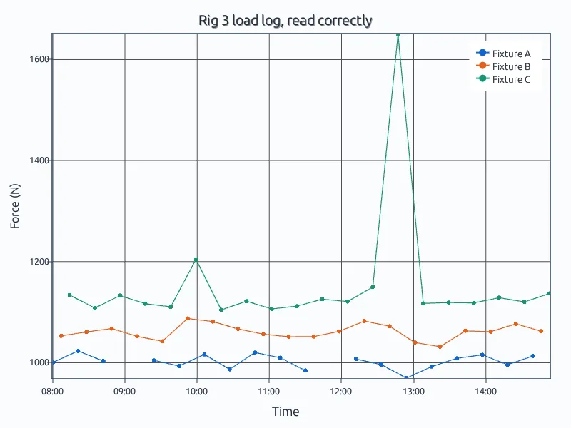

# Read a messy CSV export into a clean table with import options

[](https://runmat.com/sandbox?example=data-tables-messy-csv)

This example reads a test rig's CSV export as it comes off the logger: two comment lines before
the header, a units row, `N/A` for missing readings, a thousands separator in one force value, and
timestamps in two formats. Import options tell `readtable` where each part is, and the timestamps
are parsed in two passes. The result is a clean 60-row table, written to `rig_clean.csv` and
plotted as force against time for three fixtures.

<picture>
  <source media="(prefers-color-scheme: dark)" srcset=".artifacts/thumbnail.webp">
  
</picture>

## The problem

Instrument and logger exports rarely match what a default CSV reader expects. This file starts:

```
# Rig 3 load log, exported 2026-09-18
# operator: K. Ito
Timestamp,Fixture,Force_N,Temp_C
s,,N,degC
18/09/2026 08:00,A,1000.6,22.14
2026-09-18 08:07,B,1053.1,22.16
```

Read with defaults, the first comment line becomes the header, the units row lands in the data,
and the force column turns into text because of `N/A` and `"1,204.5"`. Every later step then
fails or, worse, runs on wrong values. Of the 60 data rows, 12 use the day-first `dd/MM/yyyy`
format and the rest `yyyy-MM-dd`.

## How the example works

1. **Show the default read**, which prints the variable names it took from the preamble.

2. **Describe the file** with import options: names on line 3, units on line 4, data from line 5:

   ```matlab
   opts = detectImportOptions('rig_log.csv', 'NumHeaderLines', 2);
   opts.VariableNamesLine = 3;
   opts.VariableUnitsLine = 4;
   opts.DataLines = [5 Inf];
   ```

3. **Set the column types and number formats**:

   ```matlab
   opts = setvartype(opts, {'Force_N', 'Temp_C'}, 'double');
   opts = setvaropts(opts, {'Force_N', 'Temp_C'}, 'TreatAsMissing', 'N/A');
   opts = setvaropts(opts, 'Force_N', 'ThousandsSeparator', ',');
   T = readtable('rig_log.csv', opts);
   ```

4. **Parse both timestamp formats**: try ISO first, then parse the rows it missed as day-first:

   ```matlab
   t = datetime(T.Timestamp, 'InputFormat', 'yyyy-MM-dd HH:mm');
   other = ismissing(t);
   t(other) = datetime(T.Timestamp(other), 'InputFormat', 'dd/MM/yyyy HH:mm');
   ```

5. **Write the clean table** with `writetable` and plot each fixture's force.

## Results

The table has 60 rows with the units N and degC attached to the force and temperature columns.
Two force readings and one temperature reading were `N/A` and are now missing values. The
`"1,204.5"` entry reads as 1204.5 N. In the figure, fixtures A, B and C run near 1000, 1060 and
1120 N through the shift from 08:00 to 15:00. Fixture C shows the 1204.5 N reading near 10:00 and a
1650.0 N spike at 12:47, and fixture A's line breaks at its two missing readings.

The cleaned file is the input to [summary by group](../group-summary) and
[force by fixture and hour](../force-by-hour), which remove the 12:47 spike.

## What to try

1. Print `T.Properties.VariableUnits` to see the units read from line 4.
2. Remove the `ThousandsSeparator` line and look at what happens to the 09:59 reading on fixture C.
3. Swap the order of the two `InputFormat` passes and check that the timestamps come out the same.

## Files

- `analysis.m`: the script: default read, import options, timestamp parsing, write and plot.
- `rig_log.csv`: the raw export, with preamble, units row, `N/A` markers and mixed timestamps.
- `runmat.toml`: the project file.

## Related

- [Data tables in RunMat](https://runmat.com/math/data-tables)
- [Summary by group](../group-summary) and [parsing a text log](../text-log)
- Function reference: [`readtable`](https://runmat.com/docs/reference/builtins/readtable), [`detectImportOptions`](https://runmat.com/docs/reference/builtins/detectimportoptions), [`setvaropts`](https://runmat.com/docs/reference/builtins/setvaropts), [`datetime`](https://runmat.com/docs/reference/builtins/datetime)
- [Download RunMat](https://runmat.com/download)
