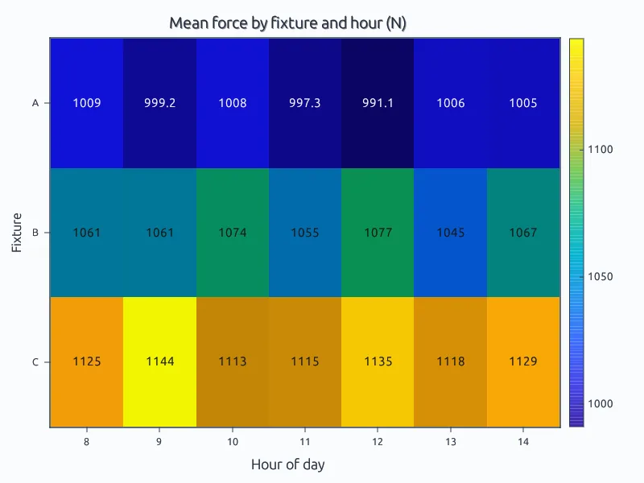

# Pivot a table on two keys and draw it as a heatmap

[](https://runmat.com/sandbox?example=data-tables-pivot-heatmap)

This example pivots a rig's load log on two keys, fixture and hour of the shift, into a 3 × 7 grid
of mean forces, then draws the grid as a heatmap with each cell's value printed in it. After
cleaning, 56 readings fill the grid. The three fixtures sit about 60 N apart, near 1000, 1060 and
1125 N, and no row shows a steady trend through the shift.

<picture>
  <source media="(prefers-color-scheme: dark)" srcset=".artifacts/thumbnail.webp">
  
</picture>

## The problem

A long table of readings answers one-key questions easily: the mean per fixture, or the mean per
hour. Many engineering questions need two keys at once. Does one fixture drift while the others
hold? Is one hour bad for every fixture, which points to the environment, or for only one, which
points to the fixture?

A pivot table puts one key on the rows and the other on the columns and fills each cell with an
aggregate of the matching rows. The heatmap shows the same grid in color, so a row or column that
departs from the rest stands out without reading every number.

## How the example works

1. **Read and clean** the log: drop incomplete rows and force outliers:

   ```matlab
   T = rmmissing(readtable('rig_clean.csv'));
   T = T(~isoutlier(T.Force_N), :);
   ```

2. **Derive the second key** from the timestamp:

   ```matlab
   T.Hour = hour(T.Timestamp);
   ```

3. **Pivot** with fixture as rows, hour as columns and the mean force in each cell:

   ```matlab
   P = pivot(T, Rows = 'Fixture', Columns = 'Hour', DataVariable = 'Force_N', Method = 'mean')
   ```

4. **Draw the heatmap** directly from the table. `heatmap` does its own grouping, so it takes the
   long table, not `P`:

   ```matlab
   h = heatmap(T, 'Hour', 'Fixture', 'ColorVariable', 'Force_N', 'ColorMethod', 'mean');
   ```

## Results

Of the log's 60 readings, three have a missing field and one, 1650.0 N on fixture C at 12:47, is an
outlier. The remaining 56 give two or three readings per cell. Fixture A's hourly means run from
991.1 to 1009.1 N, B's from 1044.9 to 1077.3 N and C's from 1113.1 to 1143.9 N. The heatmap shows
three horizontal bands, one per fixture, with no column that is high or low across all three.
[Force by fixture and hour](../force-by-hour) lists every cell.

## What to try

1. Swap the keys with `Rows = 'Hour', Columns = 'Fixture'` and compare the layout.
2. Change `Method` to `'count'` to see how many readings fall in each cell.
3. Pivot `Temp_C` on the same keys to check whether temperature tracks the hour.

## Files

- `analysis.m`: the script: read, clean, pivot and heatmap.
- `rig_clean.csv`: the rig log, 60 readings from three fixtures over one shift.
- `runmat.toml`: the project file.

## Related

- [Data tables in RunMat](https://runmat.com/math/data-tables)
- [Force by fixture and hour](../force-by-hour) and [summary by group](../group-summary)
- Function reference: [`pivot`](https://runmat.com/docs/reference/builtins/pivot), [`heatmap`](https://runmat.com/docs/reference/builtins/heatmap), [`hour`](https://runmat.com/docs/reference/builtins/hour)
- [Download RunMat](https://runmat.com/download)
