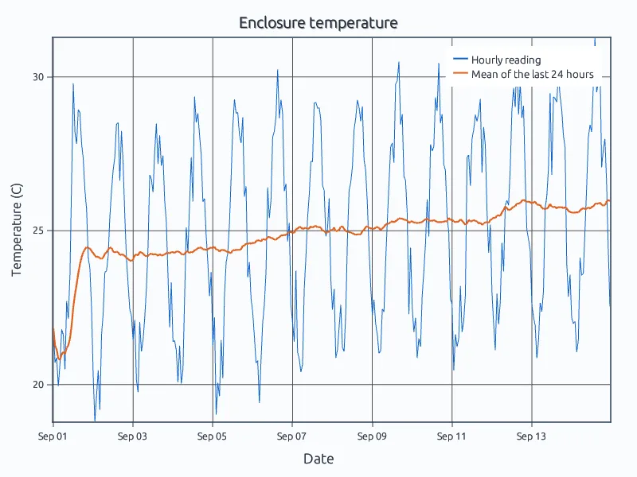

# Rolling 24-hour mean of hourly temperature in a timetable

[](https://runmat.com/sandbox?example=data-tables-rolling-mean)

This example stores two weeks of hourly enclosure temperature in a timetable and adds a trailing
24-hour mean. The hourly readings swing about ±4 °C each day around a level that rises by
0.15 °C per day. The rolling mean removes the daily swing and shows that slow rise, from about
24 °C to about 26 °C over the 14 days, and the script reports when the warmest 24 hours ended.

<picture>
  <source media="(prefers-color-scheme: dark)" srcset=".artifacts/thumbnail.webp">
  
</picture>

## The problem

Monitoring data from enclosures, buildings, batteries and outdoor equipment carries a strong daily
cycle. A slow trend underneath it, such as a clogging filter, a failing fan or seasonal drift, is
hard to see in the raw readings because the daily swing is larger than a week's change.

A trailing mean over exactly one cycle cancels the cycle: every hour of the day enters once. The
window `[23 0]` averages the current reading and the 23 before it, so each point uses only data
already recorded, as a live monitor would. A timetable keeps the readings tied to their timestamps,
so plots get a date axis and the warmest window can be reported by time.

## How the example works

1. **Build two weeks of hourly timestamps** and the temperature: 24 °C, a ±4 °C daily cycle
   peaking at 15:00, a 0.15 °C/day rise and 0.8 °C of noise:

   ```matlab
   time = datetime(2026, 9, 1) + hours(0:24*14 - 1)';
   daily = 4*sin(2*pi*(hour(time) - 9)/24);
   temp = 24 + daily + 0.15*days(time - time(1)) + 0.8*randn(size(time));
   ```

2. **Store it in a timetable**:

   ```matlab
   TT = timetable(time, temp, 'VariableNames', {'Temp_C'});
   ```

3. **Add the trailing 24-hour mean** as a new column:

   ```matlab
   TT.Daily_C = movmean(TT.Temp_C, [23 0]);
   ```

4. **Find the warmest 24 hours** with `max`, print when that window ended, and plot both columns
   against time.

## Results

The 336 hourly readings follow the daily cycle plus noise. The rolling mean is flat across each
day's cycle and climbs steadily, from about 24 °C after the first day to about 26 °C at the
end, matching the 0.15 °C/day rise. During the first 23 hours the window holds fewer than 24
readings, so the mean there still follows part of the daily cycle; the figure shows it dip and
recover on September 1. The warmest 24-hour window ends late in the record, where the trend is
highest; the exact hour depends on the noise.

## What to try

1. Use a centered window, `movmean(TT.Temp_C, 24)`, and compare where the curve sits against the
   trailing one.
2. Change the window to 12 hours with `[11 0]` and see how much daily cycle leaks through.
3. Fit the trend with `polyfit(days(TT.time - TT.time(1)), TT.Daily_C, 1)` and compare the slope
   with 0.15 °C/day.

## Files

- `rolling-mean.m`: the script: timestamps, temperature, timetable, rolling mean and the plot.
- `runmat.toml`: the project file.

## Related

- [Data tables in RunMat](https://runmat.com/math/data-tables)
- [Cleaning a sensor trace](../clean-sensor-trace) and [parsing a text log](../text-log)
- Function reference: [`timetable`](https://runmat.com/docs/reference/builtins/timetable), [`movmean`](https://runmat.com/docs/reference/builtins/movmean), [`datetime`](https://runmat.com/docs/reference/builtins/datetime)
- [Download RunMat](https://runmat.com/download)
