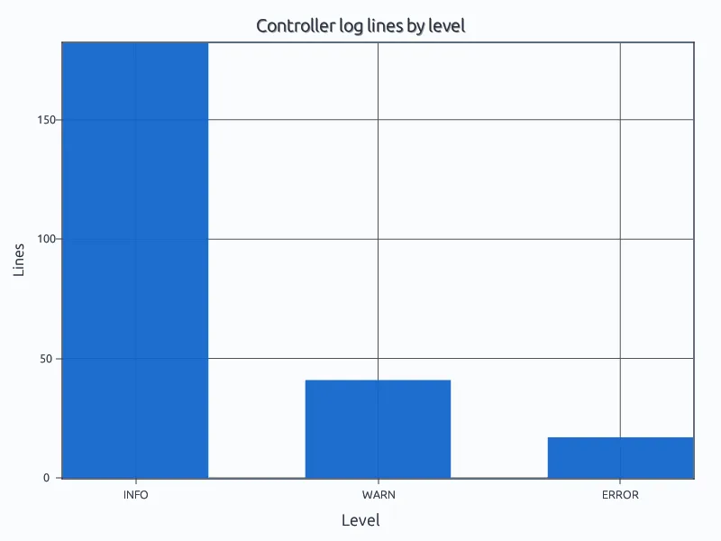

# Parse a controller text log with regular expressions and count by level

[](https://runmat.com/sandbox?example=data-tables-text-log)

This example reads a 240-line controller log, pulls the severity level and the load value out of
each line with one regular expression, and counts lines by level. The log has 182 INFO, 41 WARN
and 17 ERROR lines. The mean load is 1070.6 N and the maximum 1299.6 N, and WARN lines average
1233.1 N.

<picture>
  <source media="(prefers-color-scheme: dark)" srcset=".artifacts/thumbnail.webp">
  
</picture>

## The problem

Controllers, test benches and embedded devices often record their state as text lines, not as a
table:

```
2026-09-18 06:01:37 [WARN] rig3 load above limit load=1263.4
2026-09-18 06:03:14 [INFO] rig3 cycle complete load=985.4
```

The values needed for analysis sit inside free text. A regular expression with capture groups
turns each line into fields: here, the word inside the brackets and the number after `load=`. Once
the fields are columns, the log can be counted, filtered and summarized like any table.

## How the example works

1. **Read the lines** and drop empty ones:

   ```matlab
   lines = readlines('controller.log');
   lines = lines(strlength(lines) > 0);
   ```

2. **Extract the two fields** from every line at once. `'once'` returns one match per line, and
   the two capture groups become two columns:

   ```matlab
   tok = regexp(lines, '\[(\w+)\].*load=([\d.]+)', 'tokens', 'once');
   tok = vertcat(tok{:});
   ```

3. **Convert the fields**: the level to a categorical with a fixed order, the load to numbers:

   ```matlab
   level = categorical(tok(:, 1), {'INFO', 'WARN', 'ERROR'});
   loadN = str2double(tok(:, 2));
   ```

4. **Count by level** and average the load on WARN lines:

   ```matlab
   [counts, names] = groupcounts(level)
   warnLoad = mean(loadN(level == 'WARN'));
   ```

5. **Plot** the counts as a bar chart.

## Results

All 240 lines match the pattern. INFO lines make up 182, or 76 %; WARN 41 and ERROR 17. WARN lines
read "load above limit", and their loads run from 1167.4 to 1299.6 N, averaging 1233.1 N. INFO
loads stay between 934.5 and 1130.8 N, so the warning threshold sits between 1130.8 and 1167.4 N.
ERROR lines report sensor dropouts at ordinary loads, between 994.1 and 1105.2 N, so they do not
coincide with overloads.

## What to try

1. Pull the timestamp too, with `'^(\S+ \S+) \[(\w+)\].*load=([\d.]+)'`, and plot load against
   time colored by level.
2. Count lines per hour to see when warnings cluster.
3. Find the lowest WARN load with `min(loadN(level == 'WARN'))` to read the limit from the log.

## Files

- `analysis.m`: the script: read, parse, convert, count and the bar chart.
- `controller.log`: the controller log, 240 lines from one shift on rig 3.
- `runmat.toml`: the project file.

## Related

- [Data tables in RunMat](https://runmat.com/math/data-tables)
- [Reading a messy CSV](../messy-csv) and [summary by group](../group-summary)
- Function reference: [`regexp`](https://runmat.com/docs/reference/builtins/regexp), [`readlines`](https://runmat.com/docs/reference/builtins/readlines), [`groupcounts`](https://runmat.com/docs/reference/builtins/groupcounts), [`categorical`](https://runmat.com/docs/reference/builtins/categorical)
- [Download RunMat](https://runmat.com/download)
