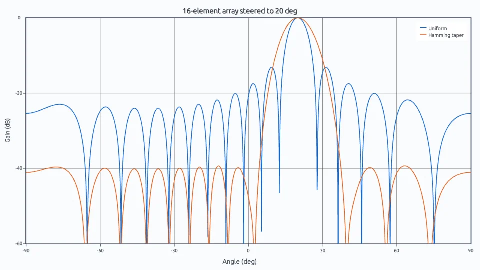

# Phased-array beam pattern: uniform weights against a Hamming taper

[](https://runmat.com/sandbox?example=defense-array-beam-pattern)

This example computes the far-field beam pattern of a 16-element linear array with half-wavelength
spacing, steered to 20°, with uniform weights and with a Hamming taper. The tapered beam points at
20.0° with a 10.2° 3 dB beamwidth. Its peak sidelobe is -38.9 dB, against -13.1 dB for uniform
weights.

<picture>
  <source media="(prefers-color-scheme: dark)" srcset=".artifacts/thumbnail.webp">
  
</picture>

## The problem

A phased array steers its beam electronically by applying a phase progression across its
elements. The amplitude weights set the shape of the beam: uniform weights give the narrowest main
lobe but sidelobes only 13 dB down, high enough for strong clutter or jamming to enter through
them. Tapering the weights toward the array ends lowers the sidelobes at the cost of a wider main
lobe and some lost gain. Radar and communications designers choose the taper from the sidelobe
level the system needs.

For N elements at spacing d (in wavelengths) and weights w_n, the pattern toward angle θ, with
the beam steered to θ₀, is

$$AF(\theta) = \left| \sum_{n=0}^{N-1} w_n \, e^{\,j 2\pi d n (\sin\theta - \sin\theta_0)} \right|$$

## How the example works

1. **Build the steering vectors** for every angle from -90° to 90° in 0.1° steps, one column per
   angle:

   ```matlab
   A = exp(1i*2*pi*d*n*sind(theta'));
   s = exp(1i*2*pi*d*n*sind(steer));
   ```

2. **Apply the weights** and evaluate both patterns with one matrix product each:

   ```matlab
   uniform = abs((s / N)' * A)';
   tapered = abs((hamming(N) .* s / sum(hamming(N)))' * A)';
   ```

3. **Normalize to dB** and plot both patterns.

4. **Measure** the tapered beam's pointing angle and 3 dB width, and the highest sidelobe of each
   pattern outside its main lobe.

## Results

```
tapered beam points at 20.0 deg, 3 dB width 10.2 deg
peak sidelobe -13.1 dB uniform, -38.9 dB with the Hamming taper
```

The uniform array shows the classic -13 dB first sidelobes beside a main lobe about 6.8° wide at
3 dB (0.886 λ/(N d) broadened by 1/cos 20°). The Hamming taper widens the main lobe to 10.2° and
pushes every sidelobe below -38.9 dB. Steering off broadside also widens both beams, because the
array's projected length shrinks by cos θ₀.

## What to try

1. Steer to `60` degrees. The beam widens by 1/cos 60° = 2 compared with broadside; look at how
   the pattern grows asymmetric.
2. Double the array with `N = 32`. The main lobe halves in width for both weightings.
3. Set `d = 0.8`. A grating lobe, a full-height copy of the main lobe, appears where
   sin θ = sin 20° - 1/0.8, near -65°.

## Files

- `array-beam-pattern.m`: the script: steering vectors, both weightings, the plot and the measurements.
- `runmat.toml`: the project file.

## Related

- [Defense engineering in RunMat](https://runmat.com/industries/defense)
- [Pulse compression](../pulse-compression) and [detection range from the radar range equation](../detection-range)
- Function reference: [`hamming`](https://runmat.com/docs/reference/builtins/hamming), [`sind`](https://runmat.com/docs/reference/builtins/sind), [`exp`](https://runmat.com/docs/reference/builtins/exp)
- [Download RunMat](https://runmat.com/download)
