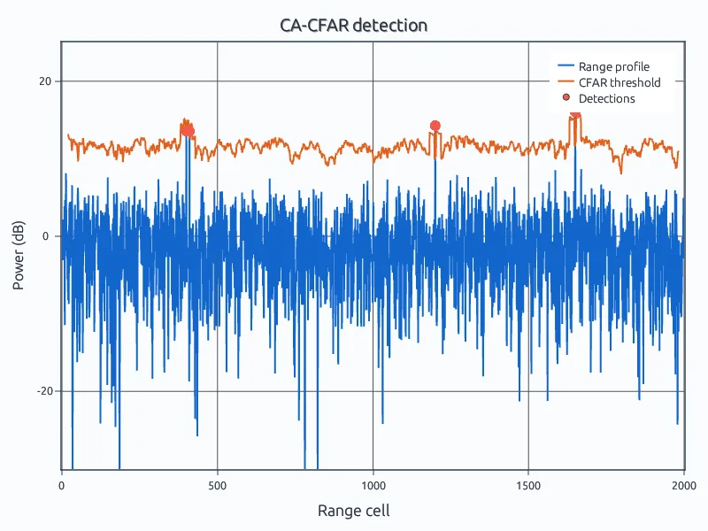

# Cell-averaging CFAR detection on a radar range profile

[](https://runmat.com/sandbox?example=defense-cfar-detection)

This example runs a cell-averaging constant false alarm rate (CA-CFAR) detector over a 2000-cell
radar range profile with four targets at 13–16 dB signal-to-noise. Each cell is compared with the
average noise power of 32 surrounding training cells, scaled by 11.4 dB for a false-alarm
probability of 10⁻⁵. Three targets are detected, at cells 410, 1200 and 1650. The target at cell
400 is lost because its neighbor ten cells away raises its noise estimate.

<picture>
  <source media="(prefers-color-scheme: dark)" srcset=".artifacts/thumbnail.webp">
  
</picture>

## The problem

A radar detector declares a target where the received power crosses a threshold. A fixed threshold
fails when the noise and clutter level changes across range: it either floods with false alarms or
misses targets. CA-CFAR estimates the local noise level from training cells on both sides of the
cell under test, skipping guard cells next to it, and scales that estimate so the false-alarm
probability stays constant. For exponentially distributed noise power and N training cells, the
scale factor is

$$\alpha = N \left( P_{fa}^{-1/N} - 1 \right)$$

With N = 32 and P_fa = 10⁻⁵, α = 13.86, or 11.4 dB.

## How the example works

1. **Make the range profile.** Complex Gaussian noise gives an exponentially distributed power with
   mean 1; four targets are added at cells 400, 410, 1200 and 1650:

   ```matlab
   x = abs(randn(n, 1) + 1i*randn(n, 1)).^2 / 2;
   x(cells(q)) = x(cells(q)) + 10^(snr_db(q)/10);
   ```

2. **Set the window**: 2 guard cells and 16 training cells on each side.

3. **Slide the window** along the profile and scale the training average:

   ```matlab
   lead = x(m-train-guard:m-guard-1);
   lag = x(m+guard+1:m+guard+train);
   threshold(m) = alpha * (sum(lead) + sum(lag)) / nt;
   ```

4. **Detect and plot** every cell above its threshold.

## Results

```
3 detections, at cells [410 1200 1650]
threshold 11.4 dB above the local noise estimate for Pfa = 1e-5
```

The threshold follows the noise at about 11 dB above its mean, with no false alarms over the 2000
cells. The targets at 1200 and 1650 stand alone and cross it cleanly. The two 13 dB targets at
400 and 410 sit inside each other's training windows, so each one inflates the other's noise
estimate and raises its threshold. Only the target at 410 crosses. This target-masking effect is
a known limit of cell averaging in dense target scenes.

## What to try

1. Cut the training cells to `train = 8`. The scale factor rises to 12.3 dB for the same false-alarm
   probability, because a 16-cell average is a noisier estimate.
2. Move the second target from `410` to `440`, outside the first target's window, and check
   whether both are detected.
3. Relax the false-alarm probability to `pfa = 1e-3` and count the false alarms in the noise.

## Files

- `cfar-detection.m`: the script: range profile, CA-CFAR threshold, detections and the plot.
- `runmat.toml`: the project file.

## Related

- [Defense engineering in RunMat](https://runmat.com/industries/defense)
- [Range-Doppler map](../range-doppler) and [pulse compression](../pulse-compression)
- Function reference: [`randn`](https://runmat.com/docs/reference/builtins/randn), [`find`](https://runmat.com/docs/reference/builtins/find), [`scatter`](https://runmat.com/docs/reference/builtins/scatter)
- [Download RunMat](https://runmat.com/download)
