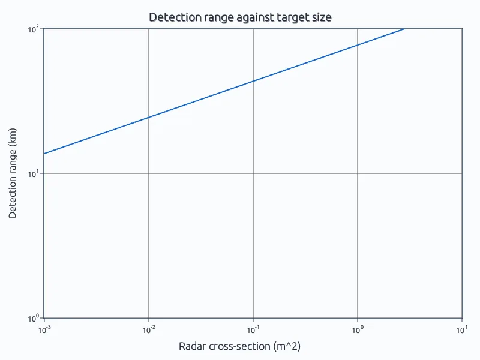

# Radar detection range against target RCS with Albersheim's equation

[](https://runmat.com/sandbox?example=defense-detection-range)

This example computes the detection range of an X-band pulse radar as a function of target radar
cross-section (RCS), from the radar range equation. Albersheim's equation gives the
signal-to-noise ratio needed for a 90 % probability of detection at a 10⁻⁶ false-alarm rate:
13.1 dB from one pulse, or -4.9 dB per pulse when 64 pulses are integrated coherently. The radar
detects a 1 m² target at 77.1 km and a 0.01 m² small drone at 24.4 km.

<picture>
  <source media="(prefers-color-scheme: dark)" srcset=".artifacts/thumbnail.webp">
  
</picture>

## The problem

Radar sizing starts from the range equation: how far away a target of a given RCS returns enough
energy to be detected reliably. Small drones have RCS values around 0.01 m², a hundred times less
than a small aircraft, so the question of how detection range scales with RCS comes up in every
counter-UAS study. The monostatic range equation, with pulse compression gain τB, gives

$$R^4 = \frac{P_t G^2 \lambda^2 \sigma \, (\tau B)}{(4\pi)^3 k T_0 F B L \cdot \text{SNR}}$$

Albersheim's empirical equation gives the single-pulse SNR (in dB) for a probability of detection
P_d and false-alarm probability P_fa, with A = ln(0.62/P_fa) and B = ln(P_d/(1 - P_d)):

$$\text{SNR}_1 = \left(6.2 + \frac{4.54}{\sqrt{n + 0.44}}\right) \log_{10}(A + 0.12AB + 1.7B)$$

Here it is evaluated for n = 1, and coherent integration of 64 pulses divides the required SNR
by 64.

## How the example works

1. **Set the radar**: 10 kW peak power, 35 dB antenna gain, 10 GHz, a 10 µs pulse with 5 MHz
   bandwidth, 4 dB noise figure and 6 dB of system losses.

2. **Find the required SNR** from Albersheim's equation and the integration gain:

   ```matlab
   snr_req = (6.2 + 4.54/sqrt(1 + 0.44)) * log10(A + 0.12*A*Bp + 1.7*Bp);
   snr_need = 10^(snr_req/10) / npulses;
   ```

3. **Solve the range equation** for RCS from 0.001 to 10 m²:

   ```matlab
   R = (Pt * G^2 * lambda^2 .* rcs * tau / ((4*pi)^3 * k * T0 * F * L * snr_need)).^(1/4);
   ```

4. **Plot** range against RCS on log axes and read off 1 m² and 0.01 m² with `interp1`.

## Results

```
Pd 0.9 at Pfa 1e-6 needs 13.1 dB from one pulse, -4.9 dB per pulse when 64 are integrated
detects a 1 m^2 target at 77.1 km and a 0.01 m^2 small drone at 24.4 km
```

Range grows with the fourth root of RCS, so the curve is a straight line on log axes with slope
1/4. Cutting RCS by a factor of 100 shortens the range by 100^(1/4) = 3.16, from 77.1 km to
24.4 km. Coherent integration gains 10 log₁₀ 64 = 18.1 dB, which is why the per-pulse requirement
falls below 0 dB.

## What to try

1. Double the transmit power with `Pt = 20e3`. Range grows by 2^(1/4) = 1.19, to 91.7 km for 1 m².
2. Integrate 16 pulses instead of 64. The required SNR rises by 6 dB and the 1 m² range falls to
   54.5 km.
3. Ask for `pd = 0.5` and compare the required single-pulse SNR.

## Files

- `detection-range.m`: the script: Albersheim's equation, the range equation over RCS and the plot.
- `runmat.toml`: the project file.

## Related

- [Defense engineering in RunMat](https://runmat.com/industries/defense)
- [CFAR detection](../cfar-detection) and [pulse compression](../pulse-compression)
- Function reference: [`logspace`](https://runmat.com/docs/reference/builtins/logspace), [`loglog`](https://runmat.com/docs/reference/builtins/loglog), [`interp1`](https://runmat.com/docs/reference/builtins/interp1)
- [Download RunMat](https://runmat.com/download)
